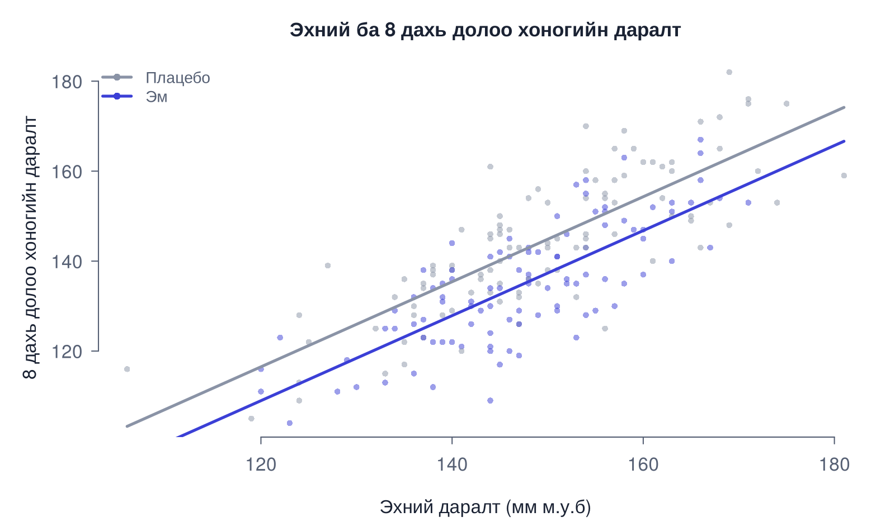

```{=html}
<header class="mt-hero" style="--mt-accent:#c026d3">
  <p class="mt-eyebrow"><a href="../methods.html">Data Analysis Methods</a> · Дундаж харьцуулах</p>
  <h1>Ковариацын шинжилгээ (ANCOVA)</h1>
  <p class="mt-en" lang="en">Analysis of covariance</p>
  <p class="mt-lead">Бүлгүүдийн дундажийг харьцуулахдаа үр дагаварт нөлөөлдөг тасралтгүй хувьсагч (ковариат)-ийн нөлөөг залруулна. RCT-д суурь утгаар залруулахад хамгийн түгээмэл хэрэглэгддэг.</p>
  <ul class="mt-badges"><li>Тасралтгүй</li><li>≥ 2 бүлэг + ковариат</li><li><code>lm(y ~ g + x)</code></li><li><span class="vc" data-vc-href=""></span></li></ul>
</header>
```

## Товч мэдээлэл

```{=html}
<div class="mt-facts"><div><span>Үр дагавар</span><strong>Тасралтгүй</strong></div><div><span>Бүлэг</span><strong>≥ 2 + ковариат</strong></div><div><span>Үр дүн</span><strong>Залруулсан дунджийн зөрүү</strong></div><div><span>Холбоотой</span><strong>Шугаман регресс</strong></div></div>
```

## Хэзээ хэрэглэх вэ?

Бүлгүүд суурь түвшиндээ ялгаатай байж болох, эсвэл суурь утгаар залруулж нарийвчлалаа сайжруулах бол.

::: {.callout-tip appearance="simple" icon="false"}
**Жишээ судалгааны асуулт:** Суурь жинг харгалзан үзвэл 12 дахь долоо хоногт эмийн бүлгийн жин плацебо бүлгийнхээс бага байна уу?
:::

## Таамаглалууд

Шинжилгээ хийхээс өмнө шалгана:

- [ ] ANOVA-ийн бүх таамаглал (хамааралгүй байдал, үлдэгдлийн хэвийн тархалт, дисперсийн тэнцүү байдал).
- [ ] Ковариат ба үр дагаврын хамаарал шугаман.
- [ ] Регрессийн налуу бүлгүүдэд ижил (бүлэг × ковариат хавсарсан нөлөөлөл ач холбогдолгүй).
- [ ] Ковариат нь бүлгийн хуваарилалтаас хамаарахгүй (эмчилгээ эхлэхээс өмнө хэмжигдсэн).

## R дээр хийх

```r
# Өгөгдөл: df$wt12 (12 дахь долоо хоног), df$wt0 (суурь), df$group
m <- lm(wt12 ~ group + wt0, data = df)
summary(m)          # group-ийн коэффициент = залруулсан зөрүү
confint(m)

# Налуу ижил эсэхийг шалгах
anova(lm(wt12 ~ group * wt0, data = df))

# Залруулсан дундаж (estimated marginal means)
emmeans::emmeans(m, ~ group)
```

## Жишээ: бодит гаралт ба тайлбар

::: {.mt-example-intro}
**Асуулт.** Эхний даралтыг залруулахад 8 дахь долоо хоногийн даралт эм ба плацебо бүлэгт ялгаатай юу?

Доорх гаралтыг сайтын [жишээ өгөгдөл](../resources/data/emnelgiin-jishee.csv) дээр R 4.3.3-аар жинхэнээр нь ажиллуулж гаргасан. Кодыг хуулж өөрийн компьютер дээр ажиллуулбал яг ижил үр дүн гарна.
:::

```{.text .mt-console}
> df <- read.csv("emnelgiin-jishee.csv", fileEncoding = "UTF-8-BOM")
> df$group <- factor(df$group, levels = c("Плацебо", "Эм"))
> m <- lm(sbp8 ~ sbp0 + group, data = df)
> car::Anova(m, type = 2)
Anova Table (Type II tests)

Response: sbp8
          Sum Sq  Df F value    Pr(>F)    
sbp0       26649   1 320.719 < 2.2e-16 ***
group       2815   1  33.879 2.347e-08 ***
Residuals  16369 197                      
---
Signif. codes:  0 ‘***’ 0.001 ‘**’ 0.01 ‘*’ 0.05 ‘.’ 0.1 ‘ ’ 1
> emmeans::emmeans(m, pairwise ~ group)
$emmeans
 group   emmean    SE  df lower.CL upper.CL
 Плацебо    143 0.913 197      141      145
 Эм         136 0.913 197      134      138

Confidence level used: 0.95 

$contrasts
 contrast     estimate   SE  df t.ratio p.value
 Плацебо - Эм     7.53 1.29 197   5.821  <.0001
```

{.mt-figure fig-alt="Эхний ба 8 дахь долоо хоногийн даралт. Хоёр зэрэгцээ шугамын хоорондын зай нь залруулсан бүлгийн ялгаа."}

### Гаралтыг хэрхэн унших вэ?

::: {.mt-readout}
1. `sbp0 F value 320.719` Ковариат (эхний даралт) эцсийн даралтыг маш хүчтэй тайлбарлаж байна. Үүнийг залруулснаар бүлгийн ялгааг илүү нарийн үнэлнэ.
2. `group F value 33.879, Pr(>F) 2.347e-08` Эхний даралтыг тогтмол үед бүлгүүд ялгаатай (p < 0.001).
3. `emmean 143 / 136` Залруулсан (estimated marginal) дундаж: хоёр бүлгийн эхний даралт ижил байсан бол 8 дахь долоо хоногт плацебо 143, эм 136 мм м.у.б байх байв.
4. `Плацебо - Эм estimate 7.53, SE 1.29, p.value <.0001` Залруулсан зөрүү 7.5 мм м.у.б. t-тестийн 9.4-өөс бага боловч стандарт алдаа нь бага (1.29) тул илүү нарийвчлалтай.
:::

::: {.mt-conclusion}
**Дүгнэлт (тайлагнах хэлбэрээр).** Эхний даралтаар залруулахад эмийн бүлгийн 8 дахь долоо хоногийн даралт плацебо бүлгийнхээс 7.5 мм м.у.б-аар бага байв (ANCOVA, F(1, 197) = 33.9, p < 0.001; залруулсан дундаж 136 ба 143).
:::

## Цэс дээр хийх (SPSS)

```{=html}
<div class="mt-menu"><div><b>SPSS</b> Analyze → General Linear Model → Univariate → Covariate(s); Options/EM Means… → залруулсан дундаж.</div></div>
```

## Үр дүнг тайлбарлах

- **group коэффициент** — суурь утгыг ижил байлгахад бүлгүүдийн дунджийн зөрүү.
- **wt0 коэффициент** — суурь жин 1 кг өндөр байхад 12 дахь долоо хоногийн жин хэр өндөр байх.
- **emmeans** — бүлэг тус бүрийн залруулсан дундаж ба CI.

## Тайлагнах жишээ

::: {.callout-note appearance="simple" icon="false"}
Суурь жингээр залруулахад 12 дахь долоо хоногт эмийн бүлгийн жин плацебо бүлгийнхээс 2.4 кг (95% CI 1.1; 3.7, p < 0.001) бага байв (ANCOVA).

<small>Тоонууд зохиомол бөгөөд тайлагнах хэлбэрийг харуулах зорилготой.</small>
:::

## Түгээмэл алдаа

::: {.callout-warning appearance="simple" icon="false"}
- Өөрчлөлтийн оноо (дараа − өмнө)-г t-тестээр харьцуулах нь ANCOVA-аас чадал багатай, суурь ялгаатай үед хазайлттай байж болно.
- Эмчилгээний дараа хэмжигдсэн, эмчилгээнд өртсөн хувьсагчаар залруулах.
:::

## Өөр аргууд

- [Дисперсийн шинжилгээ (ANOVA)](anova.html) — Гурав ба түүнээс дээш хамааралгүй бүлгийн дундажийг нэг дор харьцуулна.
- [Шугаман регресс](linear-regression.html) — Тасралтгүй үр дагаврыг нэг буюу олон тайлбарлагч хувьсагчаар загварчилна.

## Холбогдох нэр томьёо

```{=html}
<div class="glossary-embed"
     data-src="../glossary/terms.yml"
     data-glossary-url="../glossary.html"
     data-terms="ancova,covariate,linear-regression,regression-coefficient,interaction,confounding,anova,rct">
  <p class="gl-loading">Нэр томьёог ачаалж байна…</p>
</div>

<nav class="mt-pager" aria-label="Аргууд хооронд шилжих"><a href="anova.html">← Дисперсийн шинжилгээ (ANOVA)</a><a href="manova.html">Олон хэмжээст дисперсийн шинжилгээ (MANOVA) →</a></nav>
```
