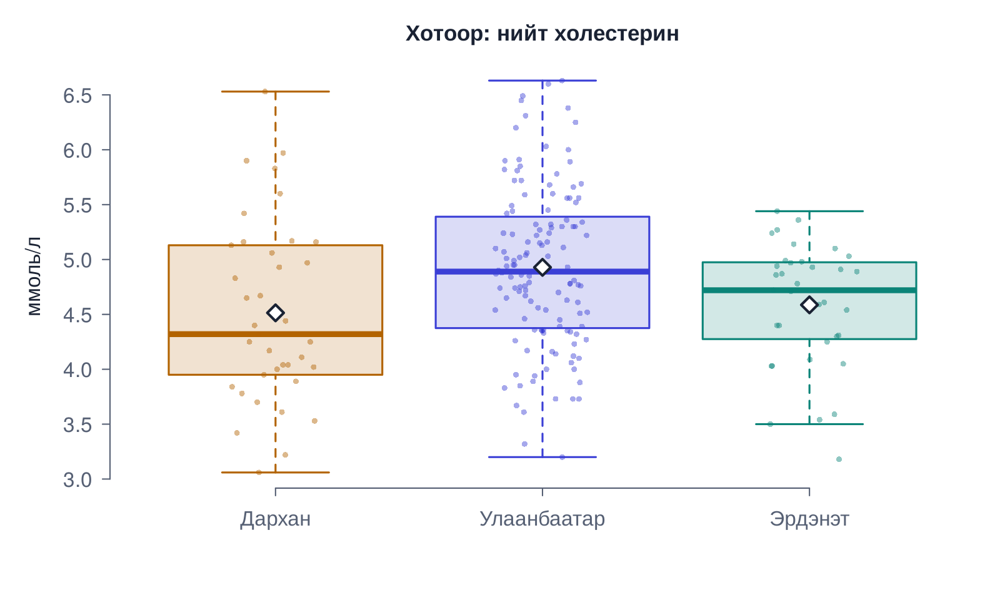

```{=html}
<header class="mt-hero" style="--mt-accent:#7c3aed">
  <p class="mt-eyebrow"><a href="../methods.html">Data Analysis Methods</a> · Дундаж харьцуулах</p>
  <h1>Дисперсийн шинжилгээ (ANOVA)</h1>
  <p class="mt-en" lang="en">One-way analysis of variance</p>
  <p class="mt-lead">Гурав ба түүнээс дээш хамааралгүй бүлгийн тасралтгүй хувьсагчийн дундаж бүгд ижил эсэхийг нэг тестээр шалгана. Ялгаа илэрвэл аль бүлгүүд ялгаатайг post hoc тестээр тогтооно.</p>
  <ul class="mt-badges"><li>Тасралтгүй</li><li>≥ 3 бүлэг</li><li><code>aov()</code></li><li><span class="vc" data-vc-href=""></span></li></ul>
</header>
```

## Товч мэдээлэл

```{=html}
<div class="mt-facts"><div><span>Үр дагавар</span><strong>Тасралтгүй</strong></div><div><span>Бүлэг</span><strong>≥ 3, хамааралгүй</strong></div><div><span>Тэг таамаглал</span><strong>μ₁ = μ₂ = … = μₖ</strong></div><div><span>Параметрийн бус хувилбар</span><strong>Крускал-Валлисын тест</strong></div></div>
```

## Хэзээ хэрэглэх вэ?

Нэг ангиллын хүчин зүйл (3+ түвшинтэй)-ийн бүлгүүдийн дундажийг харьцуулах бол.

::: {.callout-tip appearance="simple" icon="false"}
**Жишээ судалгааны асуулт:** Гурван өөр хоолны дэглэм (бага нүүрс ус, бага өөх тос, Газрын дундад тэнгисийн)-ийн 6 сарын дараах жингийн бууралт ялгаатай юу?
:::

## Таамаглалууд

Шинжилгээ хийхээс өмнө шалгана:

- [ ] Ажиглалтууд хоорондоо хамааралгүй.
- [ ] Бүлэг тус бүрийн үлдэгдэл ойролцоогоор хэвийн тархалттай.
- [ ] Бүлгүүдийн дисперс ойролцоогоор тэнцүү (Левенийн тест). Зөрчигдвөл Welch ANOVA.

## R дээр хийх

```r
# Өгөгдөл: df$loss (кг), df$diet (3 түвшинтэй factor)
m <- aov(loss ~ diet, data = df)
summary(m)                        # F, df, p
car::leveneTest(loss ~ diet, data = df)
shapiro.test(residuals(m))
TukeyHSD(m)                       # хосын харьцуулалт

# Дисперс тэнцүү биш бол:
oneway.test(loss ~ diet, data = df)   # Welch ANOVA
# Хэвийн тархалтгүй бол:
kruskal.test(loss ~ diet, data = df)
```

## Жишээ: бодит гаралт ба тайлбар

::: {.mt-example-intro}
**Асуулт.** Улаанбаатар, Эрдэнэт, Дарханы өвчтөнүүдийн нийт холестерины дундаж ялгаатай юу?

Доорх гаралтыг сайтын [жишээ өгөгдөл](../resources/data/emnelgiin-jishee.csv) дээр R 4.3.3-аар жинхэнээр нь ажиллуулж гаргасан. Кодыг хуулж өөрийн компьютер дээр ажиллуулбал яг ижил үр дүн гарна.
:::

```{.text .mt-console}
> df <- read.csv("emnelgiin-jishee.csv", fileEncoding = "UTF-8-BOM")
> aggregate(chol ~ city, data = df, FUN = function(x) round(c(n = length(x), mean = mean(x), sd = sd(x)), 2))
         city chol.n chol.mean chol.sd
1      Дархан  37.00      4.51    0.83
2 Улаанбаатар 128.00      4.93    0.73
3     Эрдэнэт  35.00      4.59    0.57
> m <- aov(chol ~ city, data = df)
> summary(m)
             Df Sum Sq Mean Sq F value  Pr(>F)   
city          2   6.72   3.361   6.459 0.00192 **
Residuals   197 102.52   0.520                   
---
Signif. codes:  0 ‘***’ 0.001 ‘**’ 0.01 ‘*’ 0.05 ‘.’ 0.1 ‘ ’ 1
> TukeyHSD(m)
  Tukey multiple comparisons of means
    95% family-wise confidence level

Fit: aov(formula = chol ~ city, data = df)

$city
                           diff         lwr         upr     p adj
Улаанбаатар-Дархан   0.41461782  0.09663871  0.73259694 0.0066746
Эрдэнэт-Дархан       0.07280309 -0.32888952  0.47449569 0.9040151
Эрдэнэт-Улаанбаатар -0.34181473 -0.66676527 -0.01686419 0.0366583
```

{.mt-figure fig-alt="Хотоор холестерины тархалт. Хайрцаг нь квартилууд, ромбо нь дундаж."}

### Гаралтыг хэрхэн унших вэ?

::: {.mt-readout}
1. `chol.mean 4.51 / 4.93 / 4.59` Хотуудын дундаж холестерин: Дархан 4.51, Улаанбаатар 4.93, Эрдэнэт 4.59 ммоль/л.
2. `city Df 2, F value 6.459` Бүлэг хоорондын дисперсийг бүлэг доторх дисперст харьцуулсан F статистик. df = бүлгийн тоо − 1 = 2.
3. `Residuals 197` Бүлэг доторх чөлөөний зэрэг = n − бүлгийн тоо = 200 − 3.
4. `Pr(>F) 0.00192 **` p = 0.002 < 0.05: ядаж нэг хотын дундаж бусдаасаа ялгаатай. Гэхдээ аль хот гэдгийг энэ тест хэлэхгүй.
5. `TukeyHSD: Улаанбаатар-Дархан 0.415, p adj 0.0067` Тьюкийн post-hoc тест: Улаанбаатар Дарханаас 0.41 ммоль/л өндөр (засвартай p = 0.007). Улаанбаатар Эрдэнэтээс 0.34-өөр өндөр (p = 0.037), харин Эрдэнэт ба Дархан ялгаагүй (p = 0.90).
:::

::: {.mt-conclusion}
**Дүгнэлт (тайлагнах хэлбэрээр).** Нийт холестерин хотуудын хооронд ялгаатай байв (ANOVA, F(2, 197) = 6.46, p = 0.002). Тьюкийн тестээр Улаанбаатарын өвчтөнүүдийн холестерин Дарханыхаас 0.41 ммоль/л (95% CI 0.10; 0.73), Эрдэнэтийнхээс 0.34 ммоль/л (0.02; 0.67) өндөр байв.
:::

## Цэс дээр хийх (SPSS)

```{=html}
<div class="mt-menu"><div><b>SPSS</b> Analyze → Compare Means → One-Way ANOVA → Post Hoc… → Tukey; Options… → Homogeneity of variance test.</div></div>
```

## Үр дүнг тайлбарлах

- **F value, Pr(>F)** — бүх бүлгийн дундаж ижил гэсэн тэг таамаглалын тест. Ач холбогдолтой гарвал дор хаяж нэг бүлэг ялгаатай.
- **Df** — бүлгийн хоорондох (k − 1) ба бүлгийн доторх (N − k) чөлөөний зэрэг.
- **TukeyHSD** — хос бүрийн дунджийн зөрүү, олон харьцуулалтаар залруулсан CI ба p.
- **η² (eta squared)** — нийт хэлбэлзлийн хэдэн хувийг бүлэг тайлбарлаж байгааг харуулах нөлөөний хэмжээ.

## Тайлагнах жишээ

::: {.callout-note appearance="simple" icon="false"}
Гурван дэглэмийн жингийн бууралт ялгаатай байв (F(2, 147) = 6.21, p = 0.003, η² = 0.08). Tukey тестээр бага нүүрс устай дэглэм бага өөх тостой дэглэмээс 2.1 кг (95% CI 0.6; 3.6) илүү бууралттай байв.

<small>Тоонууд зохиомол бөгөөд тайлагнах хэлбэрийг харуулах зорилготой.</small>
:::

## Түгээмэл алдаа

::: {.callout-warning appearance="simple" icon="false"}
- ANOVA ач холбогдолгүй гарсан ч post hoc тестээр ялгаа хайх.
- Бүлэг бүрийг хосоор нь залруулгагүй t-тестээр харьцуулах.
- Давтан хэмжилтэд (нэг хүн бүх бүлэгт) энгийн ANOVA хэрэглэх.
:::

## Өөр аргууд

- [Ковариацын шинжилгээ (ANCOVA)](ancova.html) — Бүлгүүдийн дундажийг суурь утга зэрэг тасралтгүй ковариатаар залруулж харьцуулна.
- [Олон хэмжээст дисперсийн шинжилгээ (MANOVA)](manova.html) — Хоёр ба түүнээс дээш хамааралтай үр дагаврыг бүлгүүдийн хооронд зэрэг харьцуулна.
- [Хамааралгүй түүврийн t-тест](independent-t-test.html) — Хоёр хамааралгүй бүлгийн тасралтгүй хувьсагчийн дундажийг харьцуулна.
- [Крускал-Валлисын тест](kruskal-wallis.html) — Хэвийн тархалт эсвэл дисперсийн тэгш байдал зөрчигдсөн үед.

## Холбогдох нэр томьёо

```{=html}
<div class="glossary-embed"
     data-src="../glossary/terms.yml"
     data-glossary-url="../glossary.html"
     data-terms="anova,post-hoc-test,multiple-comparisons,bonferroni,variance,levene-test,kruskal-wallis,residual,effect-size,repeated-measures-anova">
  <p class="gl-loading">Нэр томьёог ачаалж байна…</p>
</div>

<nav class="mt-pager" aria-label="Аргууд хооронд шилжих"><a href="paired-t-test.html">← Хамааралт түүврийн t тест</a><a href="ancova.html">Ковариацын шинжилгээ (ANCOVA) →</a></nav>
```
