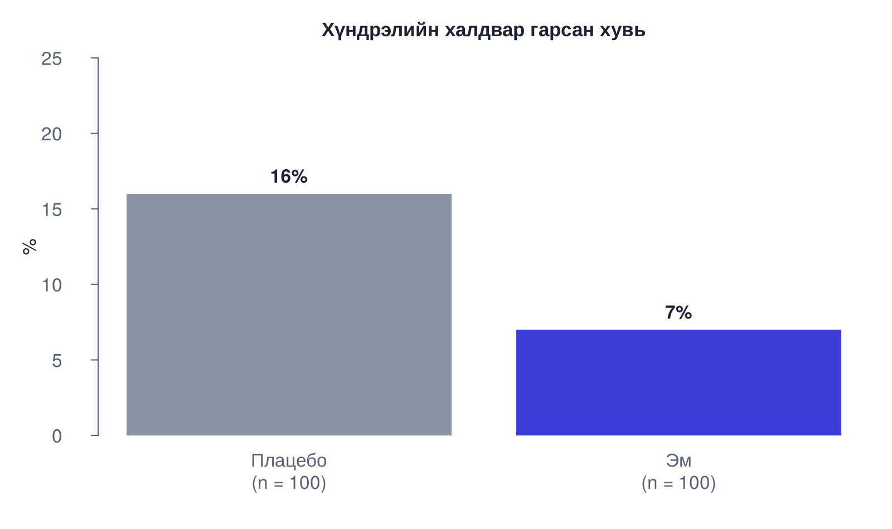

```{=html}
<header class="mt-hero" style="--mt-accent:#e11d48">
  <p class="mt-eyebrow"><a href="../methods.html">Data Analysis Methods</a> · Категорийн өгөгдөл</p>
  <h1>Хи-квадрат тест ба Фишерийн яг тест</h1>
  <p class="mt-en" lang="en">Chi-square test of independence &amp; Fisher's exact test</p>
  <p class="mt-lead">Хоёр категорийн хувьсагч хоорондоо хамааралтай эсэх, эсвэл хоёр ба түүнээс дээш бүлгийн хувь (жишээ нь хүндрэл гарсан хувь) ялгаатай эсэхийг хүснэгтийн давтамжаар шалгана.</p>
  <ul class="mt-badges"><li>Категорийн</li><li>≥ 2 бүлэг</li><li><code>chisq.test()</code></li><li><span class="vc" data-vc-href=""></span></li></ul>
</header>
```

## Товч мэдээлэл

```{=html}
<div class="mt-facts"><div><span>Үр дагавар</span><strong>Категорийн (0/1 эсвэл олон ангилал)</strong></div><div><span>Бүлэг</span><strong>≥ 2, хамааралгүй</strong></div><div><span>Тэг таамаглал</span><strong>Хоёр хувьсагч хамааралгүй</strong></div><div><span>Жижиг түүвэрт</span><strong>Фишерийн яг тест</strong></div></div>
```

## Хэзээ хэрэглэх вэ?

Үр дагавар болон бүлэглэх хувьсагч хоёулаа категорийн, хүн бүр зөвхөн нэг нүдэнд (хүснэгтийн нэг хослолд) орох бол. Ихэвчлэн 2×2 эсвэл r×c хүснэгтэд хэрэглэнэ.

::: {.callout-tip appearance="simple" icon="false"}
**Жишээ судалгааны асуулт:** Мэс заслын дараах шархны халдвар лапароскопоор хагалгаа хийлгэсэн бүлэгт нээлттэй хагалгааны бүлгийнхээс бага давтамжтай байна уу?
:::

## Таамаглалууд

Шинжилгээ хийхээс өмнө шалгана:

- [ ] Ажиглалтууд хоорондоо хамааралгүй. Нэг хүн зөвхөн нэг нүдэнд орно.
- [ ] Хүлээгдэх давтамж бүх нүдэнд ≥ 5 (r×c хүснэгтэд нүднүүдийн ≥ 80% нь ≥ 5, аль ч нүд < 1 биш).
- [ ] Энэ нөхцөл хангагдахгүй бол **Фишерийн яг тест** хэрэглэнэ.
- [ ] Өгөгдөл нь тоо (давтамж) байна, хувь эсвэл дундаж биш.

## R дээр хийх

```r
# Өгөгдөл: df$surgery ("Лапароскоп", "Нээлттэй"), df$infection ("Тийм", "Үгүй")
tab <- table(df$surgery, df$infection)
tab
prop.table(tab, margin = 1)          # мөр бүрийн хувь

res <- chisq.test(tab)               # 2x2 хүснэгтэд Йейтсийн засвар анхдагчаар
res
res$expected                         # хүлээгдэх давтамжийг шалгах

# Хүлээгдэх давтамж < 5 бол:
fisher.test(tab)                     # OR ба 95% CI-г бас гаргана

# Нөлөөний хэмжээ
effectsize::cramers_v(tab)           # r×c хүснэгтэд
epitools::riskratio(tab)             # 2x2-т эрсдэлийн харьцаа (RR)
```

## Жишээ: бодит гаралт ба тайлбар

::: {.mt-example-intro}
**Асуулт.** Хүндрэлийн халдвар эм уусан бүлэгт плацебо бүлгийнхээс бага давтамжтай байна уу?

Доорх гаралтыг сайтын [жишээ өгөгдөл](../resources/data/emnelgiin-jishee.csv) дээр R 4.3.3-аар жинхэнээр нь ажиллуулж гаргасан. Кодыг хуулж өөрийн компьютер дээр ажиллуулбал яг ижил үр дүн гарна.
:::

```{.text .mt-console}
> df <- read.csv("emnelgiin-jishee.csv", fileEncoding = "UTF-8-BOM")
> df$group <- factor(df$group, levels = c("Плацебо", "Эм"))
> tab <- table(df$group, df$infection)
> tab
         
          Тийм Үгүй
  Плацебо   16   84
  Эм         7   93
> round(prop.table(tab, margin = 1) * 100, 1)
         
          Тийм Үгүй
  Плацебо   16   84
  Эм         7   93
> chisq.test(tab)

	Pearson's Chi-squared test with Yates' continuity correction

data:  tab
X-squared = 3.1442, df = 1, p-value = 0.0762

> fisher.test(tab)

	Fisher's Exact Test for Count Data

data:  tab
p-value = 0.0744
alternative hypothesis: true odds ratio is not equal to 1
95 percent confidence interval:
 0.9254042 7.6101897
sample estimates:
odds ratio 
  2.519237
```

{.mt-figure fig-alt="Бүлэг тус бүрт халдвар гарсан хувь."}

### Гаралтыг хэрхэн унших вэ?

::: {.mt-readout}
1. `tab: 16 84 / 7 93` 2×2 хүснэгт: плацебо бүлэгт 16, эмийн бүлэгт 7 хүнд халдвар гарсан (бүлэг бүрт 100).
2. `prop.table: 16 / 7` Мөрийн хувь: плацебо 16%, эм 7%.
3. `X-squared = 3.1442, df = 1` Йейтсийн засвартай хи-квадрат. df = (2 − 1) × (2 − 1) = 1.
4. `p-value = 0.0762` p > 0.05: харагдаж буй ялгаа (16% ба 7%) санамсаргүй хэлбэлзлээс үүдэлтэй байж болох тул статистик ач холбогдолгүй.
5. `odds ratio 2.519237, 95% CI 0.9254 7.6102` Фишерийн тест: плацебо бүлэгт халдвар гарах odds эмийн бүлгийнхээс 2.5 дахин өндөр. Гэхдээ интервалд 1 орсон тул итгэлтэй хэлэх боломжгүй.
:::

::: {.mt-conclusion}
**Дүгнэлт (тайлагнах хэлбэрээр).** Хүндрэлийн халдвар плацебо бүлэгт 16%, эмийн бүлэгт 7% тохиолдсон ч ялгаа статистик ач холбогдолгүй байв (χ²(1) = 3.14, p = 0.076; Фишерийн p = 0.074). Энэ нь "нөлөөгүй" гэсэн үг биш: түүвэр бага тул ялгааг батлах статистик чадал хүрэлцээгүй байж болно.
:::

## Цэс дээр хийх (SPSS)

```{=html}
<div class="mt-menu"><div><b>SPSS</b> Analyze → Descriptive Statistics → Crosstabs → Statistics… → Chi-square; Cells… → Expected, Row percentages.</div></div>
```

## Үр дүнг тайлбарлах

- **X-squared, df, p-value**: хоёр хувьсагч хамааралгүй гэсэн тэг таамаглалын эсрэг нотолгоо. df = (мөрийн тоо − 1) × (баганын тоо − 1).
- **Хувь**: үр дүнг бүлэг тус бүрийн хувиар (жишээ нь 5.5% ба 14.9%) тайлбарлана. Зөвхөн p-утга хангалтгүй.
- **RR эсвэл OR, 95% CI**: 2×2 хүснэгтэд нөлөөний хэмжээ. Когорт ба RCT-д RR, кейс-контрол судалгаанд OR тохиромжтой.
- **Cramér's V**: r×c хүснэгтийн хамаарлын хүч (≈0.1 бага, ≈0.3 дунд, ≈0.5 их).

## Тайлагнах жишээ

::: {.callout-note appearance="simple" icon="false"}
Шархны халдвар лапароскопоор хагалгаа хийлгэсэн бүлэгт 8/145 (5.5%), нээлттэй хагалгааны бүлэгт 21/141 (14.9%) тохиолдсон бөгөөд ялгаа статистик ач холбогдолтой байв (Йейтсийн засвартай χ²(1) = 5.91, p = 0.015; RR = 0.37, 95% CI 0.17; 0.81).

<small>Тоонууд зохиомол бөгөөд тайлагнах хэлбэрийг харуулах зорилготой.</small>
:::

## Түгээмэл алдаа

::: {.callout-warning appearance="simple" icon="false"}
- Нэг хүнээс хоёр удаа авсан (өмнө/дараа) тийм/үгүй хэмжилтэд хи-квадрат хэрэглэх. Энэ тохиолдолд [МакНемарын тест](mcnemar-test.html) хэрэглэнэ.
- Хүлээгдэх давтамж бага байхад хи-квадрат хэрэглэх. Фишерийн тест хэрэглэнэ.
- Хувь эсвэл дунджийг хүснэгтэд оруулж тест хийх. Зөвхөн тоо (давтамж) оруулна.
- Ач холбогдолтой хи-квадратыг "шалтгаан" гэж тайлбарлах. Энэ нь зөвхөн хамаарлыг харуулна.
:::

## Өөр аргууд

- [МакНемарын тест](mcnemar-test.html) — нэг хүнээс авсан хоёр хоёр утгат хэмжилтийг харьцуулна.
- [Логистик регресс](logistic-regression.html) — хоёр утгат үр дагаврыг олон хүчин зүйлээр залруулж OR тооцно.
- [Пуассон регресс](poisson-regression.html) — үр дагавар нь тоо (давтамж) эсвэл түвшин бол.

## Холбогдох нэр томьёо

```{=html}
<div class="glossary-embed"
     data-src="../glossary/terms.yml"
     data-glossary-url="../glossary.html"
     data-terms="chi-square-test,fisher-exact-test,contingency-table,observed-frequencies,categorical-variable,proportion,relative-risk,odds-ratio,degrees-of-freedom,p-value">
  <p class="gl-loading">Нэр томьёог ачаалж байна…</p>
</div>

<nav class="mt-pager" aria-label="Аргууд хооронд шилжих"><a href="gee.html">← Ерөнхийлсөн үнэлгээний тэгшитгэл (GEE)</a><a href="mcnemar-test.html">МакНемарын тест →</a></nav>
```
