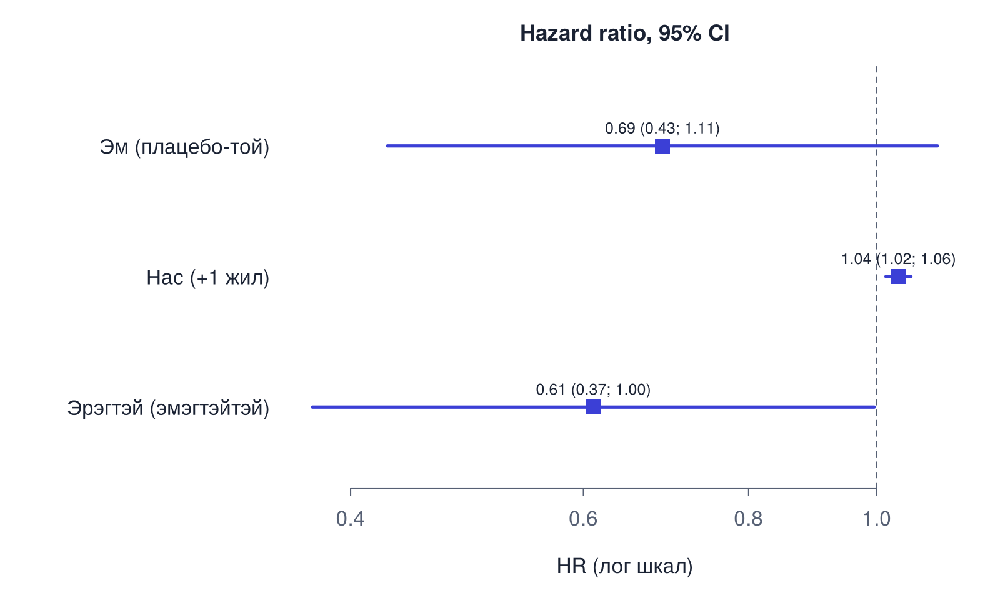

```{=html}
<header class="mt-hero" style="--mt-accent:#15803d">
  <p class="mt-eyebrow"><a href="../methods.html">Data Analysis Methods</a> · Амьдрах чадвар</p>
  <h1>Коксын регресс</h1>
  <p class="mt-en" lang="en">Cox proportional hazards regression</p>
  <p class="mt-lead">Амьдрах чадварын өгөгдөлд олон тайлбарлагч хувьсагчийн нөлөөг зэрэг тооцож, хор аюулын харьцаа (HR)-аар илэрхийлнэ. Каплан-Майерын олон хувьсагчийн өргөтгөл.</p>
  <ul class="mt-badges"><li>Хугацаа + үйл явдал</li><li>HR</li><li><code>coxph()</code></li><li><span class="vc" data-vc-href=""></span></li></ul>
</header>
```

## Товч мэдээлэл

```{=html}
<div class="mt-facts"><div><span>Үр дагавар</span><strong>Хугацаа + үйл явдал</strong></div><div><span>Тайлбарлагч</span><strong>Тоон ба ангиллын</strong></div><div><span>Үр дүн</span><strong>HR, aHR</strong></div><div><span>Гол таамаглал</span><strong>Пропорциональ хор аюул</strong></div></div>
```

## Хэзээ хэрэглэх вэ?

Үйл явдал хүртэлх хугацаанд нөлөөлөх хүчин зүйлсийг confounder-аар залруулж үнэлэх бол.

::: {.callout-tip appearance="simple" icon="false"}
**Жишээ судалгааны асуулт:** Нас, хавдрын үе шатаар залруулахад шинэ эмчилгээ нас баралтын эрсдэлийг бууруулдаг уу?
:::

## Таамаглалууд

Шинжилгээ хийхээс өмнө шалгана:

- [ ] Пропорциональ хор аюул: HR цаг хугацааны турш тогтмол (cox.zph-ээр шалгана).
- [ ] Цензур мэдээлэлгүй.
- [ ] Тасралтгүй хувьсагчийн log-hazard-тай хамаарал шугаман.
- [ ] Тайлбарлагч бүрт хангалттай үйл явдал (EPV ≥ 10 орчим).

## R дээр хийх

```r
library(survival)
m <- coxph(Surv(time, status) ~ treat + age + stage, data = df)
summary(m)                 # exp(coef) = HR, 95% CI

cox.zph(m)                 # пропорциональ хор аюулын шалгалт
plot(cox.zph(m))

gtsummary::tbl_regression(m, exponentiate = TRUE)
```

## Жишээ: бодит гаралт ба тайлбар

::: {.mt-example-intro}
**Асуулт.** Нас ба хүйсээр залруулахад эм үйл явдлын эрсдэлийг (hazard) бууруулсан уу?

Доорх гаралтыг сайтын [жишээ өгөгдөл](../resources/data/emnelgiin-jishee.csv) дээр R 4.3.3-аар жинхэнээр нь ажиллуулж гаргасан. Кодыг хуулж өөрийн компьютер дээр ажиллуулбал яг ижил үр дүн гарна.
:::

```{.text .mt-console}
> df <- read.csv("emnelgiin-jishee.csv", fileEncoding = "UTF-8-BOM")
> library(survival)
> df$group <- factor(df$group, levels = c("Плацебо", "Эм"))
> m <- coxph(Surv(time_months, event) ~ group + age + sex, data = df)
> summary(m)
Call:
coxph(formula = Surv(time_months, event) ~ group + age + sex, 
    data = df)

  n= 200, number of events= 72 

               coef exp(coef) se(coef)      z Pr(>|z|)    
groupЭм    -0.37317   0.68855  0.24434 -1.527 0.126694    
age         0.03778   1.03851  0.01113  3.396 0.000684 ***
sexЭрэгтэй -0.49358   0.61044  0.24957 -1.978 0.047962 *  
---
Signif. codes:  0 ‘***’ 0.001 ‘**’ 0.01 ‘*’ 0.05 ‘.’ 0.1 ‘ ’ 1

           exp(coef) exp(-coef) lower .95 upper .95
groupЭм       0.6886     1.4523    0.4265    1.1115
age           1.0385     0.9629    1.0161    1.0614
sexЭрэгтэй    0.6104     1.6382    0.3743    0.9956

Concordance= 0.636  (se = 0.035 )
Likelihood ratio test= 19.65  on 3 df,   p=2e-04
Wald test            = 19.13  on 3 df,   p=3e-04
Score (logrank) test = 19.52  on 3 df,   p=2e-04

> cox.zph(m)
        chisq df    p
group  1.1290  1 0.29
age    0.0514  1 0.82
sex    0.6362  1 0.43
GLOBAL 1.6091  3 0.66
```

{.mt-figure fig-alt="Залруулсан hazard ratio ба 95% CI (лог шкал). Тасархай шугам (HR = 1) нь нөлөөгүйг илтгэнэ."}

### Гаралтыг хэрхэн унших вэ?

::: {.mt-readout}
1. `n= 200, number of events= 72` Загварт 200 хүн, 72 үйл явдал орсон. Тайлбарлагч хувьсагч бүрт ≥ 10 үйл явдал байх нь зохимжтой.
2. `groupЭм exp(coef) 0.68855, lower .95 0.4265, upper .95 1.1115, p 0.126694` Нас, хүйсээр залруулахад эрсдэл 31%-иар бага гэсэн тооцоо гарсан ч CI 1-ийг агуулсан тул ач холбогдолгүй.
3. `age 1.03851 (1.0161; 1.0614)` Нас 1 жилээр ахих тутам эрсдэл 3.9%-иар нэмэгдэнэ (p < 0.001).
4. `sexЭрэгтэй 0.61044 (0.3743; 0.9956)` Эмэгтэйчүүдийг бодвол эрэгтэйчүүдийн эрсдэл 39%-иар бага (p = 0.048).
5. `Concordance= 0.636` C индекс: загвар хоёр хүний алинд нь эрт үйл явдал тохиолдохыг 64% тохиолдолд зөв эрэмбэлнэ.
6. `cox.zph GLOBAL p 0.66` Пропорциональ эрсдэлийн таамаглалын тест: бүх p > 0.05 тул таамаглал хангагдсан.
:::

::: {.mt-note}
Каплан-Майерийн хуудасны лог-ранк тест (залруулгагүй) p = 0.04 гарсан бол энд залруулсны дараа p = 0.13 болсон. Энэ нь бүлгүүдийн нас, хүйсний бүтэц зарим талаар ялгааг тайлбарлаж байсныг харуулна. Аль үр дүнг гол болгохыг судалгааны протоколд урьдчилан тодорхойлох ёстой.
:::

::: {.mt-conclusion}
**Дүгнэлт (тайлагнах хэлбэрээр).** Нас ба хүйсээр залруулахад эмийн бүлэгт үйл явдлын эрсдэл бага байх хандлагатай байсан ч статистик ач холбогдолгүй байв (HR = 0.69, 95% CI 0.43; 1.11, p = 0.13). Нас (жил тутам HR = 1.04, 95% CI 1.02; 1.06) нь эрсдэлтэй хамааралтай байв. Пропорциональ эрсдэлийн таамаглал хангагдсан (глобал p = 0.66).
:::

## Цэс дээр хийх (SPSS)

```{=html}
<div class="mt-menu"><div><b>SPSS</b> Analyze → Survival → Cox Regression → Options… → CI for exp(B); пропорциональ эрсдэлийг шалгахад Cox w/ Time-Dep Cov.</div></div>
```

## Үр дүнг тайлбарлах

- **exp(coef) = HR** — HR < 1 бол үйл явдал удаан тохиолддог (хамгаалах), HR > 1 бол эрсдэл өндөр.
- **lower/upper .95** — HR-ийн 95% CI. 1-ийг агуулахгүй бол p < 0.05.
- **Concordance** — загварын ялгах чадвар (AUC-тай төстэй).
- **cox.zph p < 0.05** — тухайн хувьсагчид пропорциональ хор аюулын таамаглал зөрчигдсөн байж болзошгүй.

## Тайлагнах жишээ

::: {.callout-note appearance="simple" icon="false"}
Нас, хавдрын үе шатаар залруулахад шинэ эмчилгээ нас баралтын эрсдэлийг 32%-иар бууруулсан (aHR = 0.68, 95% CI 0.52; 0.89, p = 0.005). Пропорциональ хор аюулын таамаглал хангагдсан (глобал тест p = 0.41).

<small>Тоонууд зохиомол бөгөөд тайлагнах хэлбэрийг харуулах зорилготой.</small>
:::

## Түгээмэл алдаа

::: {.callout-warning appearance="simple" icon="false"}
- HR-ийг «нас барах магадлал 32%-иар бага» гэж тайлбарлах. HR нь агшин зуурын түвшний харьцаа.
- Пропорциональ хор аюулын таамаглалыг шалгахгүй орхих. Муруйнууд огтлолцвол ялангуяа анхаарна.
- Хугацаанаас хамаарч өөрчлөгддөг хувьсагчийг суурь утгаар нь л оруулах.
:::

## Өөр аргууд

- [Амьдрах чадварын шинжилгээ](survival-analysis.html) — Үйл явдал хүртэлх хугацааг цензурыг тооцож шинжилж, бүлгүүдийн муруйг харьцуулна.
- [Логистик регресс](logistic-regression.html) — Хоёр утгат (тийм/үгүй) үр дагаврын odds-ийг олон хувьсагчаар загварчилж OR тооцно.

## Холбогдох нэр томьёо

```{=html}
<div class="glossary-embed"
     data-src="../glossary/terms.yml"
     data-glossary-url="../glossary.html"
     data-terms="cox-regression,hazard,hazard-ratio,proportional-hazards,censoring,kaplan-meier,confounding,covariate,overfitting">
  <p class="gl-loading">Нэр томьёог ачаалж байна…</p>
</div>

<nav class="mt-pager" aria-label="Аргууд хооронд шилжих"><a href="survival-analysis.html">← Амьдрах чадварын шинжилгээ</a><a href="gee.html">Ерөнхийлсөн үнэлгээний тэгшитгэл (GEE) →</a></nav>
```
