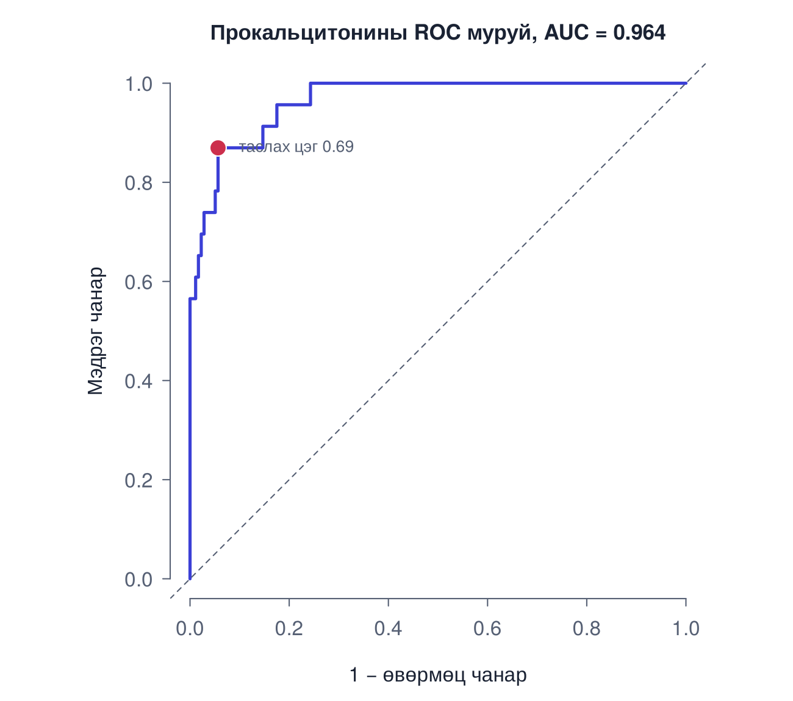

```{=html}
<header class="mt-hero" style="--mt-accent:#be185d">
  <p class="mt-eyebrow"><a href="../methods.html">Data Analysis Methods</a> · Оношилгоо ба тохирол</p>
  <h1>Оношилгооны тестийн нарийвчлал ба ROC муруй</h1>
  <p class="mt-en" lang="en">Diagnostic accuracy: sensitivity, specificity &amp; ROC analysis</p>
  <p class="mt-lead">Шинэ тест, түргэвчилсэн оношлуур эсвэл биомаркер өвчтэй ба өвчгүй хүнийг хэр зөв ялгаж байгааг алтан стандарттай харьцуулж үнэлнэ. Тасралтгүй маркерт хамгийн тохиромжтой таслах цэгийг ROC муруйгаар сонгоно.</p>
  <ul class="mt-badges"><li>Тест ба алтан стандарт</li><li>Se, Sp, AUC</li><li><code>pROC::roc()</code></li><li><span class="vc" data-vc-href=""></span></li></ul>
</header>
```

## Товч мэдээлэл

```{=html}
<div class="mt-facts"><div><span>Өгөгдөл</span><strong>Тестийн үр дүн + алтан стандарт</strong></div><div><span>Гол үзүүлэлт</span><strong>Мэдрэг чанар, өвөрмөц чанар</strong></div><div><span>Тасралтгүй маркерт</span><strong>ROC муруй, AUC</strong></div><div><span>Тайлагнах заавар</span><strong>STARD</strong></div></div>
```

## Хэзээ хэрэглэх вэ?

Шинэ оношилгооны аргыг одоо мөрдөж буй хамгийн найдвартай аргатай (алтан стандарт) нэг хүмүүс дээр харьцуулж байгаа бол.

::: {.callout-tip appearance="simple" icon="false"}
**Жишээ судалгааны асуулт:** Сийвэнгийн прокальцитонин нь яаралтай тусламжид хандсан хүүхдүүдийн нянгийн халдварыг (цусны өсгөвөрөөр баталгаажсан) хэр сайн ялгаж байна вэ?
:::

## Таамаглалууд

Шинжилгээ хийхээс өмнө шалгана:

- [ ] Бүх оролцогчид тест болон алтан стандарт хоёуланг нь хийлгэсэн (зөвхөн тест эерэгт алтан стандарт хийвэл баталгаажуулалтын хазайлт үүснэ).
- [ ] Алтан стандартыг үнэлэгч тестийн үр дүнг мэдээгүй (сохор).
- [ ] Судалгааны хүн ам нь тестийг бодитоор хэрэглэх хүн амтай төстэй (өвчний хүнд хөнгөний хүрээ).
- [ ] Таслах цэгийг ижил өгөгдөл дээр сонгосон бол үр дүн хэт өөдрөг байж болохыг анхаарна.

## R дээр хийх

```r
# Өгөгдөл: df$pct (нг/мл), df$sbi (алтан стандарт: 1 = нянгийн халдвар, 0 = үгүй)
library(pROC)
r <- roc(sbi ~ pct, data = df, ci = TRUE)
r                                    # AUC ба 95% CI
plot(r, print.auc = TRUE)

# Юдений индексээр хамгийн тохиромжтой таслах цэг
coords(r, "best", best.method = "youden",
       ret = c("threshold", "sensitivity", "specificity", "ppv", "npv"))

# Тогтсон таслах цэг (жишээ нь 0.5 нг/мл) дээрх 2x2 хүснэгт ба 95% CI
df$test_pos <- factor(df$pct >= 0.5, levels = c(TRUE, FALSE))
tab <- table(Test = df$test_pos, Disease = factor(df$sbi, levels = c(1, 0)))
epiR::epi.tests(tab, conf.level = 0.95)   # Se, Sp, PPV, NPV, LR+, LR−

# Хоёр маркерийн AUC-г харьцуулах
roc.test(r, roc(sbi ~ crp, data = df))     # DeLong тест
```

## Жишээ: бодит гаралт ба тайлбар

::: {.mt-example-intro}
**Асуулт.** Сийвэнгийн прокальцитонин (PCT) хүндрэлийн халдварыг хэр сайн ялгаж байна вэ? (алтан стандарт: эмнэлзүйн баталгаажсан халдвар)

Доорх гаралтыг сайтын [жишээ өгөгдөл](../resources/data/emnelgiin-jishee.csv) дээр R 4.3.3-аар жинхэнээр нь ажиллуулж гаргасан. Кодыг хуулж өөрийн компьютер дээр ажиллуулбал яг ижил үр дүн гарна.
:::

```{.text .mt-console}
> df <- read.csv("emnelgiin-jishee.csv", fileEncoding = "UTF-8-BOM")
> library(pROC)
> r <- roc(infection ~ pct, data = df, levels = c("Үгүй", "Тийм"), direction = "<", ci = TRUE)
> r

Call:
roc.formula(formula = infection ~ pct, data = df, levels = c("Үгүй",     "Тийм"), direction = "<", ci = TRUE)

Data: pct in 177 controls (infection Үгүй) < 23 cases (infection Тийм).
Area under the curve: 0.9635
95% CI: 0.933-0.994 (DeLong)
> coords(r, "best", best.method = "youden",
+        ret = c("threshold", "sensitivity", "specificity", "ppv", "npv"))
          threshold sensitivity specificity       ppv       npv
threshold     0.685   0.8695652   0.9435028 0.6666667 0.9823529
> tab <- table(Test = factor(df$pct >= 0.5, levels = c(TRUE, FALSE)),
+              Infection = factor(df$infection, levels = c("Тийм", "Үгүй")))
> tab
       Infection
Test    Тийм Үгүй
  TRUE    20   17
  FALSE    3  160
> epiR::epi.tests(tab, conf.level = 0.95)
          Outcome +    Outcome -      Total
Test +           20           17         37
Test -            3          160        163
Total            23          177        200

Point estimates and 95% CIs:
--------------------------------------------------------------
Apparent prevalence *                  0.18 (0.13, 0.25)
True prevalence *                      0.12 (0.07, 0.17)
Sensitivity *                          0.87 (0.66, 0.97)
Specificity *                          0.90 (0.85, 0.94)
Positive predictive value *            0.54 (0.37, 0.71)
Negative predictive value *            0.98 (0.95, 1.00)
Positive likelihood ratio              9.05 (5.61, 14.61)
Negative likelihood ratio              0.14 (0.05, 0.41)
False T+ proportion for true D- *      0.10 (0.06, 0.15)
False T- proportion for true D+ *      0.13 (0.03, 0.34)
False T+ proportion for T+ *           0.46 (0.29, 0.63)
False T- proportion for T- *           0.02 (0.00, 0.05)
Correctly classified proportion *      0.90 (0.85, 0.94)
--------------------------------------------------------------
* Exact CIs
```

{.mt-figure fig-alt="Прокальцитонины ROC муруй. Улаан цэг нь Юдений индексээр сонгосон хамгийн тохиромжтой таслах цэг."}

### Гаралтыг хэрхэн унших вэ?

::: {.mt-readout}
1. `177 controls (Үгүй) < 23 cases (Тийм)` 23 халдвартай, 177 халдваргүй хүн.
2. `Area under the curve: 0.9635, 95% CI: 0.933-0.994` AUC = 0.96: маш сайн ялгах чадвартай. Санамсаргүй сонгосон халдвартай хүний PCT халдваргүй хүнийхээс өндөр байх магадлал 96%.
3. `threshold 0.685, sensitivity 0.870, specificity 0.944` Юдений индексээр хамгийн тохиромжтой таслах цэг 0.685 нг/мл: мэдрэг чанар 87%, өвөрмөц чанар 94%.
4. `tab: 20 17 / 3 160` Урьдчилан тогтоосон 0.5 нг/мл таслах цэг дээрх 2×2 хүснэгт: 20 үнэн эерэг, 17 хуурамч эерэг, 3 хуурамч сөрөг, 160 үнэн сөрөг.
5. `Sensitivity 0.87 (0.66, 0.97); Specificity 0.90 (0.85, 0.94)` 0.5 нг/мл-д мэдрэг чанар 87%, өвөрмөц чанар 90%. Халдвартай хүн цөөн (23) тул мэдрэг чанарын CI өргөн.
6. `Positive predictive value 0.54; Negative predictive value 0.98` Тест эерэг бол халдвартай байх магадлал 54%, сөрөг бол халдваргүй байх магадлал 98%. Энэ хоёр нь халдварын тархалтаас (12%) хамаарна.
7. `Positive likelihood ratio 9.05; Negative likelihood ratio 0.14` LR+ = 9: эерэг хариу халдварын odds-ийг 9 дахин нэмэгдүүлнэ. LR− = 0.14: сөрөг хариу odds-ийг 7 дахин бууруулна.
:::

::: {.mt-conclusion}
**Дүгнэлт (тайлагнах хэлбэрээр).** Прокальцитонины AUC 0.96 (95% CI 0.93; 0.99) байв. 0.5 нг/мл таслах цэгт мэдрэг чанар 87% (95% CI 66; 97), өвөрмөц чанар 90% (85; 94), PPV 54%, NPV 98%, LR+ 9.1, LR− 0.14 байв (n = 200, тархалт 11.5%).
:::

## Цэс дээр хийх (SPSS)

```{=html}
<div class="mt-menu"><div><b>SPSS</b> Analyze → Classify → ROC Curve (хуучин хувилбарт Analyze → ROC Curve) → Standard error and confidence interval, Coordinate points of the ROC Curve-г сонгоно.</div></div>
```

## Үр дүнг тайлбарлах

- **Мэдрэг чанар (Se)**: өвчтэй хүмүүсийн хэдэн хувийг тест эерэг гэж илрүүлсэн. Өндөр бол сөрөг хариу өвчнийг үгүйсгэхэд тустай.
- **Өвөрмөц чанар (Sp)**: өвчгүй хүмүүсийн хэдэн хувийг тест сөрөг гэж зөв тодорхойлсон. Өндөр бол эерэг хариу өвчнийг батлахад тустай.
- **PPV, NPV**: тестийн хариуны дараах өвчтэй/өвчгүй байх магадлал. **Тархалтаас хамаардаг** тул өөр хүн амд шууд шилжүүлэхгүй.
- **LR+, LR−**: тархалтаас хамаарахгүй, эмнэлзүйн шийдвэрт хэрэгтэй (LR+ > 10, LR− < 0.1 бол хүчтэй).
- **AUC**: 0.5 = санамсаргүй таавар, 0.7–0.8 хүлээн зөвшөөрөгдөхүйц, 0.8–0.9 сайн, > 0.9 маш сайн.

## Тайлагнах жишээ

::: {.callout-note appearance="simple" icon="false"}
Нянгийн халдварыг ялгахад прокальцитонины AUC 0.84 (95% CI 0.79; 0.89) байв. 0.5 нг/мл таслах цэгт мэдрэг чанар 78.3% (95% CI 68.4; 86.2), өвөрмөц чанар 81.6% (77.2; 85.4), LR+ 4.3, LR− 0.27 байв (n = 412, тархалт 22.3%).

<small>Тоонууд зохиомол бөгөөд тайлагнах хэлбэрийг харуулах зорилготой.</small>
:::

## Түгээмэл алдаа

::: {.callout-warning appearance="simple" icon="false"}
- PPV, NPV-г өөр тархалттай хүн амд шууд хэрэглэх.
- Се, Sp-г итгэх интервалгүй тайлагнах.
- Таслах цэгийг тухайн өгөгдөл дээрээ сонгоод, ижил өгөгдөл дээр нарийвчлалыг тооцож, баталгаажуулалтгүйгээр тайлагнах.
- Хамгийн хүнд өвчтөн ба эрүүл хүмүүсийг харьцуулж (кейс-контрол загвар) нарийвчлалыг хэт өндөр гаргах.
:::

## Өөр аргууд

- [Найдвартай байдал ба тохирол](reliability.html) — хоёр тест эсвэл шинжээч хоорондын тохирлыг үнэлэх бол (алтан стандартгүй).
- [Логистик регресс](logistic-regression.html) — хэд хэдэн маркерийг хослуулж таамаглах загвар байгуулах бол.
- [Хи-квадрат тест](chi-square-test.html) — тестийн эерэг хувь бүлгүүдэд ялгаатай эсэх.

## Холбогдох нэр томьёо

```{=html}
<div class="glossary-embed"
     data-src="../glossary/terms.yml"
     data-glossary-url="../glossary.html"
     data-terms="sensitivity,specificity,ppv,npv,likelihood-ratio,roc-curve,auc,cut-off,youden-index,gold-standard,prevalence">
  <p class="gl-loading">Нэр томьёог ачаалж байна…</p>
</div>

<nav class="mt-pager" aria-label="Аргууд хооронд шилжих"><a href="mixed-models.html">← Холимог нөлөөний загвар</a><a href="reliability.html">Найдвартай байдал ба тохирол →</a></nav>
```
