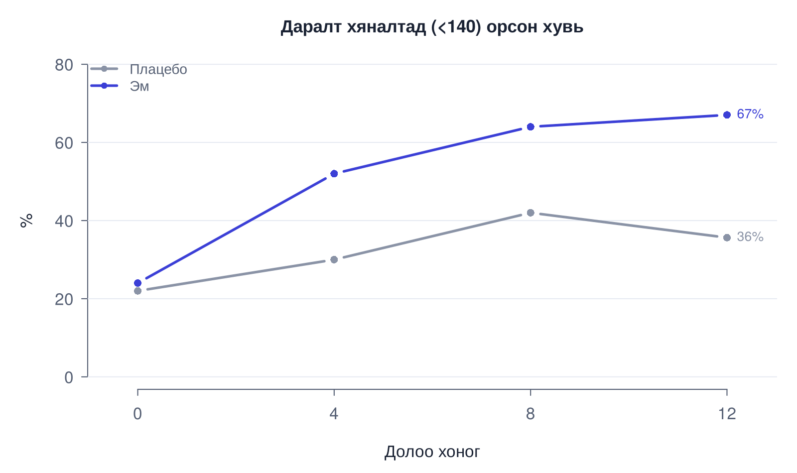

```{=html}
<header class="mt-hero" style="--mt-accent:#4338ca">
  <p class="mt-eyebrow"><a href="../methods.html">Data Analysis Methods</a> · Давтан хэмжилт ба кластер</p>
  <h1>Ерөнхийлсөн үнэлгээний тэгшитгэл (GEE)</h1>
  <p class="mt-en" lang="en">Generalized estimating equations</p>
  <p class="mt-lead">Нэг хүнээс олон удаа, эсвэл нэг эмнэлэг, сургууль, өрхөөс олон хүн хэмжсэн үед ажиглалтуудын хамаарлыг тооцож, хүн амын дундаж нөлөөг найдвартай стандарт алдаатай үнэлнэ.</p>
  <ul class="mt-badges"><li>Давтан хэмжилт</li><li>Тасралтгүй / 0-1 / тоо</li><li><code>geeglm()</code></li><li><span class="vc" data-vc-href=""></span></li></ul>
</header>
```

## Товч мэдээлэл

```{=html}
<div class="mt-facts"><div><span>Үр дагавар</span><strong>Тасралтгүй, хоёр утгат, тоолсон</strong></div><div><span>Өгөгдлийн бүтэц</span><strong>Давтан хэмжилт / кластер</strong></div><div><span>Үр дүн</span><strong>β, OR, IRR (хүн амын түвшин)</strong></div><div><span>Гол сонголт</span><strong>Корреляцийн бүтэц</strong></div></div>
```

## Хэзээ хэрэглэх вэ?

Ажиглалтууд хамааралтай (нэг хүний олон хэмжилт, нэг кластерын олон хүн) бөгөөд хүн амын дундаж нөлөө сонирхолтой бол.

::: {.callout-tip appearance="simple" icon="false"}
**Жишээ судалгааны асуулт:** Хүүхдүүдийг 4 улиралд давтан үзлэг хийхэд PM2.5-ын түвшин амьсгалын замын халдвартай байх odds-той хамааралтай юу?
:::

## Таамаглалууд

Шинжилгээ хийхээс өмнө шалгана:

- [ ] Кластерууд хоорондоо хамааралгүй (кластер доторх хамаарлыг загвар тооцно).
- [ ] Үр дагаврын тархалтын төрөл (family) ба холбоос функц зөв сонгогдсон.
- [ ] Кластерын тоо хангалттай (ойролцоогоор 30–40-өөс дээш), эс бөгөөс жижиг түүврийн залруулга хэрэгтэй.
- [ ] Дутуу өгөгдөл бүрэн санамсаргүй (MCAR), эсвэл жинлэсэн GEE хэрэглэнэ.

## R дээр хийх

```r
library(geepack)
# Урт хэлбэрийн өгөгдөл: нэг мөр = нэг хүүхдийн нэг үзлэг
df <- df[order(df$id, df$visit), ]     # id-аар эрэмбэлсэн байх ёстой

m <- geeglm(infection ~ pm25 + age + sex + visit,
            id = id, family = binomial,
            corstr = "exchangeable", data = df)
summary(m)                     # robust SE ашигласан Wald тест

# OR ба 95% CI
broom::tidy(m, conf.int = TRUE, exponentiate = TRUE)
```

## Жишээ: бодит гаралт ба тайлбар

::: {.mt-example-intro}
**Асуулт.** Даралт хяналтад (< 140) орох магадлал хугацааны явцад хэрхэн өөрчлөгдөж, энэ нь эм ба плацебо бүлэгт ялгаатай юу? (хоёр утгат давтан хэмжилт)

Доорх гаралтыг сайтын [жишээ өгөгдөл](../resources/data/emnelgiin-jishee.csv) дээр R 4.3.3-аар жинхэнээр нь ажиллуулж гаргасан. Кодыг хуулж өөрийн компьютер дээр ажиллуулбал яг ижил үр дүн гарна.
:::

```{.text .mt-console}
> df <- read.csv("emnelgiin-jishee.csv", fileEncoding = "UTF-8-BOM")
> library(geepack)
> long <- reshape(df[, c("id", "group", "sbp0", "sbp4", "sbp8", "sbp12")],
+                 direction = "long", varying = c("sbp0", "sbp4", "sbp8", "sbp12"),
+                 v.names = "sbp", timevar = "week", times = c(0, 4, 8, 12), idvar = "id")
> long <- long[!is.na(long$sbp), ]
> long <- long[order(long$id, long$week), ]
> long$group <- factor(long$group, levels = c("Плацебо", "Эм"))
> long$ctrl <- as.integer(long$sbp < 140)                    # даралт хяналтад орсон эсэх
> m <- geeglm(ctrl ~ group * week, id = id, family = binomial,
+             corstr = "exchangeable", data = long)
> summary(m)

Call:
geeglm(formula = ctrl ~ group * week, family = binomial, data = long, 
    id = id, corstr = "exchangeable")

 Coefficients:
             Estimate  Std.err   Wald Pr(>|W|)    
(Intercept)  -1.13856  0.21573 27.854 1.31e-07 ***
groupЭм       0.35340  0.28826  1.503  0.22021    
week          0.07126  0.01693 17.717 2.56e-05 ***
groupЭм:week  0.08144  0.02641  9.507  0.00205 ** 
---
Signif. codes:  0 ‘***’ 0.001 ‘**’ 0.01 ‘*’ 0.05 ‘.’ 0.1 ‘ ’ 1

Correlation structure = exchangeable 
Estimated Scale Parameters:

            Estimate Std.err
(Intercept)   0.9997 0.04299
  Link = identity 

Estimated Correlation Parameters:
      Estimate Std.err
alpha   0.4847 0.04986
Number of clusters:   200  Maximum cluster size: 4 
> round(exp(cbind(OR = coef(m), lower = coef(m) - 1.96 * sqrt(diag(vcov(m))),
+                 upper = coef(m) + 1.96 * sqrt(diag(vcov(m))))), 3)
                OR lower upper
(Intercept)  0.320 0.210 0.489
groupЭм      1.424 0.809 2.505
week         1.074 1.039 1.110
groupЭм:week 1.085 1.030 1.142
```

{.mt-figure fig-alt="Хэмжилт бүрт даралт хяналтад орсон хувь, бүлгээр."}

### Гаралтыг хэрхэн унших вэ?

::: {.mt-readout}
1. `Number of clusters: 200, Maximum cluster size: 4` 200 хүн (кластер), хүн бүрт хамгийн ихдээ 4 хэмжилт.
2. `alpha 0.4847` Нэг хүний хэмжилтүүд хоорондоо 0.48 корреляцитай (exchangeable бүтэц). Тиймээс хамааралгүй гэж үзэж болохгүй.
3. `week OR 1.074 (1.039; 1.110)` Плацебо бүлэгт хяналтад орох odds долоо хоног бүр 7.4%-иар нэмэгдэнэ.
4. `groupЭм:week OR 1.085 (1.030; 1.142), p 0.00205` Эмийн бүлэгт долоо хоног бүр нэмэлт 8.5%-иар нэмэгдэнэ. Өөрөөр хэлбэл эмийн бүлэгт хяналтад орох хурд илүү.
5. `groupЭм OR 1.424 (0.809; 2.505)` Эхэн үед (0 дахь долоо хоногт) бүлгүүд ялгаагүй.
6. `Std.err (robust)` GEE-ийн стандарт алдаа нь "сэндвич" (robust) тооцоо тул корреляцийн бүтцийг буруу сонгосон ч зөв хэвээр байна.
:::

::: {.mt-conclusion}
**Дүгнэлт (тайлагнах хэлбэрээр).** GEE-ээр (exchangeable корреляци, robust SE) даралт хяналтад орох odds эмийн бүлэгт плацебо бүлгийнхээс илүү хурдан нэмэгдэж байв (бүлэг × долоо хоног OR = 1.085, 95% CI 1.030; 1.142, p = 0.002). 12 дахь долоо хоногт хяналтад орсон хувь эмийн бүлэгт 67%, плацебо бүлэгт 36% байв.
:::

## Цэс дээр хийх (SPSS)

```{=html}
<div class="mt-menu"><div><b>SPSS</b> Analyze → Generalized Linear Models → Generalized Estimating Equations → Repeated: Subject variable, Working correlation matrix.</div></div>
```

## Үр дүнг тайлбарлах

- **Estimate** — хүн амын түвшний дундаж нөлөө (logit холбоостой бол exp() хувиргаж OR).
- **Std.err** — бат бөх (sandwich) стандарт алдаа: корреляцийн бүтэц буруу сонгогдсон ч хүчинтэй.
- **Wald, Pr(>|W|)** — коэффициент тус бүрийн тест.
- **Correlation (alpha)** — кластер доторх тооцоолсон хамаарал.

## Тайлагнах жишээ

::: {.callout-note appearance="simple" icon="false"}
Нас, хүйс, улирлаар залруулахад PM2.5 10 мкг/м³-аар өсөхөд амьсгалын замын халдвартай байх odds 1.12 дахин нэмэгдэж байв (OR = 1.12, 95% CI 1.05; 1.19; GEE, exchangeable бүтэц, 312 хүүхдийн 1186 үзлэг).

<small>Тоонууд зохиомол бөгөөд тайлагнах хэлбэрийг харуулах зорилготой.</small>
:::

## Түгээмэл алдаа

::: {.callout-warning appearance="simple" icon="false"}
- Давтан хэмжилтийг хамааралгүй мэт энгийн регрессээр шинжлэх. Стандарт алдаа хэт бага гарна.
- GEE-ийн OR-ийг холимог загварын (хувь хүний түвшний) OR-той шууд харьцуулах.
- Кластер цөөн үед robust SE-д залруулга хийхгүй орхих.
:::

## Өөр аргууд

- [Хамааралт түүврийн t тест](paired-t-test.html) — Нэг хүнээс авсан хоёр хэмжилтийн (өмнө/дараа) дундаж зөрүүг шалгана.
- [Шугаман регресс](linear-regression.html) — Тасралтгүй үр дагаврыг нэг буюу олон тайлбарлагч хувьсагчаар загварчилна.
- [Логистик регресс](logistic-regression.html) — Хоёр утгат (тийм/үгүй) үр дагаврын odds-ийг олон хувьсагчаар загварчилж OR тооцно.
- [Холимог нөлөөний загвар](mixed-models.html) — Хувь хүний түвшний нөлөө сонирхолтой, дутуу өгөгдөлтэй давтан хэмжилтэд.

## Холбогдох нэр томьёо

```{=html}
<div class="glossary-embed"
     data-src="../glossary/terms.yml"
     data-glossary-url="../glossary.html"
     data-terms="gee,working-correlation,robust-standard-error,clustered-data,independence,mixed-model,repeated-measures-anova,odds-ratio,missing-data">
  <p class="gl-loading">Нэр томьёог ачаалж байна…</p>
</div>

<nav class="mt-pager" aria-label="Аргууд хооронд шилжих"><a href="cox-regression.html">← Коксын регресс</a><a href="chi-square-test.html">Хи-квадрат тест →</a></nav>
```
