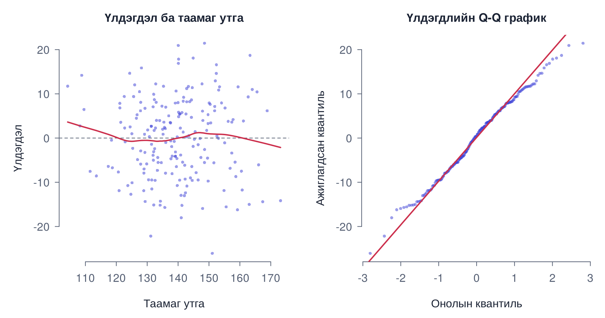

```{=html}
<header class="mt-hero" style="--mt-accent:#dc2626">
  <p class="mt-eyebrow"><a href="../methods.html">Data Analysis Methods</a> · Хамаарал ба регресс</p>
  <h1>Шугаман регресс</h1>
  <p class="mt-en" lang="en">Linear regression</p>
  <p class="mt-lead">Тасралтгүй үр дагавар ба тайлбарлагч хувьсагчдын хамаарлыг шулуун шугамын тэгшитгэлээр илэрхийлж, хувьсагч бүрийн нөлөөг бусдаар нь залруулж тооцно.</p>
  <ul class="mt-badges"><li>Тасралтгүй үр дагавар</li><li>Олон хувьсагч</li><li><code>lm()</code></li><li><span class="vc" data-vc-href=""></span></li></ul>
</header>
```

## Товч мэдээлэл

```{=html}
<div class="mt-facts"><div><span>Үр дагавар</span><strong>Тасралтгүй</strong></div><div><span>Тайлбарлагч</span><strong>Тоон ба ангиллын</strong></div><div><span>Үр дүн</span><strong>β коэффициент, R²</strong></div><div><span>Таамаглал шалгах</span><strong>Үлдэгдлийн график</strong></div></div>
```

## Хэзээ хэрэглэх вэ?

Тасралтгүй үр дагаврыг таамаглах, эсвэл confounder-аар залруулсан хамаарлыг тооцох бол.

::: {.callout-tip appearance="simple" icon="false"}
**Жишээ судалгааны асуулт:** Нас, хүйс, BMI-гээр залруулахад тамхи татах нь систолын даралттай хамааралтай юу?
:::

## Таамаглалууд

Шинжилгээ хийхээс өмнө шалгана:

- [ ] Тайлбарлагч ба үр дагаврын хамаарал шугаман.
- [ ] Ажиглалтууд хоорондоо хамааралгүй.
- [ ] Үлдэгдэл ойролцоогоор хэвийн тархалттай.
- [ ] Үлдэгдлийн дисперс тогтмол (homoscedasticity).
- [ ] Тайлбарлагч хувьсагчид хэт хүчтэй хамааралгүй (VIF < 5–10).

## R дээр хийх

```r
m <- lm(sbp ~ smoke + age + sex + bmi, data = df)
summary(m)          # β, SE, t, p, R²
confint(m)          # β-ийн 95% CI

par(mfrow = c(2, 2)); plot(m)   # үлдэгдлийн оношлогоо
car::vif(m)                     # олон шугамт хамаарал

# Хүснэгт гаргах
gtsummary::tbl_regression(m)
```

## Жишээ: бодит гаралт ба тайлбар

::: {.mt-example-intro}
**Асуулт.** Нас, эхний даралт, БЖИ-ээр залруулахад эм 8 дахь долоо хоногийн систолын даралтад хэр нөлөөлсөн бэ?

Доорх гаралтыг сайтын [жишээ өгөгдөл](../resources/data/emnelgiin-jishee.csv) дээр R 4.3.3-аар жинхэнээр нь ажиллуулж гаргасан. Кодыг хуулж өөрийн компьютер дээр ажиллуулбал яг ижил үр дүн гарна.
:::

```{.text .mt-console}
> df <- read.csv("emnelgiin-jishee.csv", fileEncoding = "UTF-8-BOM")
> df$group <- factor(df$group, levels = c("Плацебо", "Эм"))
> m <- lm(sbp8 ~ group + age + sbp0 + bmi, data = df)
> summary(m)

Call:
lm(formula = sbp8 ~ group + age + sbp0 + bmi, data = df)

Residuals:
     Min       1Q   Median       3Q      Max 
-26.0763  -6.5245   0.4842   6.8075  21.4508 

Coefficients:
            Estimate Std. Error t value Pr(>|t|)    
(Intercept)  3.51427    9.44715   0.372    0.710    
groupЭм     -7.73421    1.30377  -5.932 1.34e-08 ***
age         -0.05260    0.05910  -0.890    0.375    
sbp0         0.93554    0.05332  17.547  < 2e-16 ***
bmi          0.14470    0.14593   0.992    0.323    
---
Signif. codes:  0 ‘***’ 0.001 ‘**’ 0.01 ‘*’ 0.05 ‘.’ 0.1 ‘ ’ 1

Residual standard error: 9.12 on 195 degrees of freedom
Multiple R-squared:  0.658,	Adjusted R-squared:  0.651 
F-statistic: 93.79 on 4 and 195 DF,  p-value: < 2.2e-16

> round(confint(m), 2)
             2.5 % 97.5 %
(Intercept) -15.12  22.15
groupЭм     -10.31  -5.16
age          -0.17   0.06
sbp0          0.83   1.04
bmi          -0.14   0.43
```

{.mt-figure fig-alt="Загварын оношилгоо: зүүн талд үлдэгдэл санамсаргүй тархсан (шугаман хамаарал хангагдсан), баруун талд үлдэгдэл ойролцоогоор хэвийн тархалттай."}

### Гаралтыг хэрхэн унших вэ?

::: {.mt-readout}
1. `groupЭм -7.73421, Pr(>|t|) 1.34e-08` Бусад хувьсагчийг тогтмол үед эмийн бүлгийн даралт плацебоноос 7.7 мм м.у.б-аар бага (p < 0.001).
2. `sbp0 0.93554` Эхний даралт 1 мм м.у.б-аар өндөр хүнд 8 дахь долоо хоногийн даралт дунджаар 0.94-өөр өндөр.
3. `age -0.05260 (p 0.375), bmi 0.14470 (p 0.323)` Нас ба БЖИ залруулсны дараа даралттай ач холбогдолтой хамааралгүй.
4. `Residual standard error: 9.12` Загварын таамаглалын дундаж алдаа ±9 мм м.у.б орчим.
5. `Adjusted R-squared: 0.651` Загвар 8 дахь долоо хоногийн даралтын хэлбэлзлийн 65%-ийг тайлбарлаж байна. Ихэнхийг нь эхний даралт тайлбарлана.
6. `confint: groupЭм -10.31 -5.16` Эмийн нөлөөний 95% CI: −10.3-аас −5.2 мм м.у.б.
:::

::: {.mt-conclusion}
**Дүгнэлт (тайлагнах хэлбэрээр).** Нас, эхний даралт, БЖИ-ээр залруулахад эмийн бүлгийн 8 дахь долоо хоногийн систолын даралт плацебоноос 7.7 мм м.у.б-аар бага байв (β = −7.73, 95% CI −10.31; −5.16, p < 0.001; загварын adjusted R² = 0.65).
:::

## Цэс дээр хийх (SPSS)

```{=html}
<div class="mt-menu"><div><b>SPSS</b> Analyze → Regression → Linear → Statistics… → Confidence intervals, Collinearity diagnostics; Plots… → үлдэгдэл.</div></div>
```

## Үр дүнг тайлбарлах

- **Estimate (β)** — бусад хувьсагчийг тогтмол байлгахад тухайн хувьсагч нэг нэгжээр (эсвэл жишиг ангиллаас) өөрчлөгдөхөд үр дагаврын дундаж өөрчлөлт.
- **(Intercept)** — бүх тайлбарлагч 0 эсвэл жишиг ангилалд байх үеийн дундаж (ихэвчлэн шууд утгагүй).
- **Pr(>|t|), 95% CI** — коэффициент тус бүрийн ач холбогдол ба нарийвчлал.
- **R², adjusted R²** — загвар үр дагаврын хэлбэлзлийн хэдэн хувийг тайлбарлаж байгаа.

## Тайлагнах жишээ

::: {.callout-note appearance="simple" icon="false"}
Нас, хүйс, BMI-гээр залруулахад тамхи татдаг хүмүүсийн систолын даралт татдаггүй хүмүүсийнхээс дунджаар 4.3 мм м.у.б (95% CI 1.8; 6.8, p = 0.001) өндөр байв. Загвар даралтын хэлбэлзлийн 29%-ийг тайлбарлав (adjusted R² = 0.29).

<small>Тоонууд зохиомол бөгөөд тайлагнах хэлбэрийг харуулах зорилготой.</small>
:::

## Түгээмэл алдаа

::: {.callout-warning appearance="simple" icon="false"}
- Категорийн хувьсагчийг (1, 2, 3 кодтой) тоон мэт оруулах. factor() болгоно.
- Хувьсагчийг зөвхөн p-утгаар (stepwise) сонгох. Онол, урьдчилсан мэдлэгт тулгуурлана.
- Өгөгдлийн мужаас гадуур таамаглал хийх.
:::

## Өөр аргууд

- [Корреляцийн шинжилгээ](correlation.html) — Хоёр тоон хувьсагчийн хамаарлын хүч ба чиглэлийг −1-ээс +1 хооронд хэмжинэ.
- [Ковариацын шинжилгээ (ANCOVA)](ancova.html) — Бүлгүүдийн дундажийг суурь утга зэрэг тасралтгүй ковариатаар залруулж харьцуулна.
- [Логистик регресс](logistic-regression.html) — Хоёр утгат (тийм/үгүй) үр дагаврын odds-ийг олон хувьсагчаар загварчилж OR тооцно.
- [Ерөнхийлсөн үнэлгээний тэгшитгэл (GEE)](gee.html) — Давтан хэмжилт эсвэл кластерласан өгөгдлийн хүн амын түвшний нөлөөг үнэлнэ.
- [Пуассон ба сөрөг биномын регресс](poisson-regression.html) — Үр дагавар нь тоо (давтамж) бол.

## Холбогдох нэр томьёо

```{=html}
<div class="glossary-embed"
     data-src="../glossary/terms.yml"
     data-glossary-url="../glossary.html"
     data-terms="linear-regression,regression-coefficient,r-squared,residual,multiple-regression,covariate,dummy-variable,interaction,multicollinearity,overfitting,confounding,log-transformation">
  <p class="gl-loading">Нэр томьёог ачаалж байна…</p>
</div>

<nav class="mt-pager" aria-label="Аргууд хооронд шилжих"><a href="correlation.html">← Корреляцийн шинжилгээ</a><a href="logistic-regression.html">Логистик регресс →</a></nav>
```
