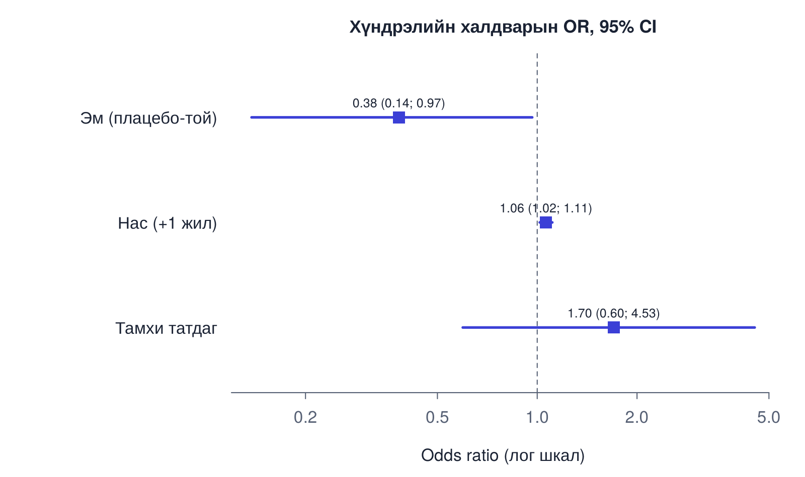

```{=html}
<header class="mt-hero" style="--mt-accent:#b45309">
  <p class="mt-eyebrow"><a href="../methods.html">Data Analysis Methods</a> · Хамаарал ба регресс</p>
  <h1>Логистик регресс</h1>
  <p class="mt-en" lang="en">Logistic regression</p>
  <p class="mt-lead">Үр дагавар хоёр утгатай (өвчтэй/эрүүл, нас барсан/амьд) үед тайлбарлагч хувьсагчдын нөлөөг сондгойн харьцаа (OR)-аар илэрхийлж, confounder-аар залруулна.</p>
  <ul class="mt-badges"><li>Хоёр утгат үр дагавар</li><li>OR</li><li><code>glm(binomial)</code></li><li><span class="vc" data-vc-href=""></span></li></ul>
</header>
```

## Товч мэдээлэл

```{=html}
<div class="mt-facts"><div><span>Үр дагавар</span><strong>Хоёр утгат (0/1)</strong></div><div><span>Тайлбарлагч</span><strong>Тоон ба ангиллын</strong></div><div><span>Үр дүн</span><strong>OR, aOR, AUC</strong></div><div><span>Түүврийн шаардлага</span><strong>EPV ≥ 10 орчим</strong></div></div>
```

## Хэзээ хэрэглэх вэ?

Хоёр утгат үр дагаврын эрсдэлт хүчин зүйлсийг тодорхойлох, эсвэл тохиолдол-хяналтын судалгааг шинжлэх бол.

::: {.callout-tip appearance="simple" icon="false"}
**Жишээ судалгааны асуулт:** Нас, хүйс, BMI-гээр залруулахад тамхи татах нь артерийн гипертензийн odds-ийг нэмэгдүүлдэг үү?
:::

## Таамаглалууд

Шинжилгээ хийхээс өмнө шалгана:

- [ ] Үр дагавар хоёр утгат.
- [ ] Ажиглалтууд хоорондоо хамааралгүй.
- [ ] Тасралтгүй тайлбарлагч ба logit(p)-ийн хамаарал шугаман.
- [ ] Тайлбарлагч хувьсагч бүрт хангалттай үйл явдал (EPV ≥ 10 орчим), олон шугамт хамааралгүй.

## R дээр хийх

```r
m <- glm(htn ~ smoke + age + sex + bmi, family = binomial, data = df)
summary(m)

# OR ба 95% CI
exp(cbind(OR = coef(m), confint(m)))

# Crude ба adjusted OR-ийг нэг хүснэгтэд
gtsummary::tbl_regression(m, exponentiate = TRUE)

# Ялгах чадвар
pROC::auc(pROC::roc(df$htn, fitted(m)))
```

## Жишээ: бодит гаралт ба тайлбар

::: {.mt-example-intro}
**Асуулт.** Нас ба тамхидалтаар залруулахад эм хүндрэлийн халдварын эрсдэлийг бууруулсан уу?

Доорх гаралтыг сайтын [жишээ өгөгдөл](../resources/data/emnelgiin-jishee.csv) дээр R 4.3.3-аар жинхэнээр нь ажиллуулж гаргасан. Кодыг хуулж өөрийн компьютер дээр ажиллуулбал яг ижил үр дүн гарна.
:::

```{.text .mt-console}
> df <- read.csv("emnelgiin-jishee.csv", fileEncoding = "UTF-8-BOM")
> df$group <- factor(df$group, levels = c("Плацебо", "Эм"))
> df$smoker <- factor(df$smoker, levels = c("Үгүй", "Тийм"))
> df$inf01 <- as.integer(df$infection == "Тийм")
> m <- glm(inf01 ~ group + age + smoker, family = binomial, data = df)
> summary(m)

Call:
glm(formula = inf01 ~ group + age + smoker, family = binomial, 
    data = df)

Coefficients:
            Estimate Std. Error z value Pr(>|z|)    
(Intercept) -5.24495    1.37069  -3.827  0.00013 ***
groupЭм     -0.96086    0.49043  -1.959  0.05009 .  
age          0.05988    0.02215   2.704  0.00686 ** 
smokerТийм   0.53117    0.50999   1.042  0.29763    
---
Signif. codes:  0 ‘***’ 0.001 ‘**’ 0.01 ‘*’ 0.05 ‘.’ 0.1 ‘ ’ 1

(Dispersion parameter for binomial family taken to be 1)

    Null deviance: 142.74  on 199  degrees of freedom
Residual deviance: 130.50  on 196  degrees of freedom
AIC: 138.5

Number of Fisher Scoring iterations: 5

> round(exp(cbind(OR = coef(m), confint(m))), 2)
              OR 2.5 % 97.5 %
(Intercept) 0.01  0.00   0.07
groupЭм     0.38  0.14   0.97
age         1.06  1.02   1.11
smokerТийм  1.70  0.60   4.53
```

{.mt-figure fig-alt="Залруулсан odds ratio ба 95% CI (лог шкал). Тасархай шугам (OR = 1) нь нөлөөгүйг илтгэнэ."}

### Гаралтыг хэрхэн унших вэ?

::: {.mt-readout}
1. `groupЭм Estimate -0.96086` Log-odds-ийн өөрчлөлт. Шууд тайлбарлахад хэцүү тул exp() авч OR болгоно.
2. `OR 0.38, 2.5 % 0.14, 97.5 % 0.97` Эм халдварын odds-ийг 62%-иар бууруулсан (OR = 0.38). Интервалын дээд хязгаар 0.97 тул 1-ийг арай л оруулаагүй.
3. `Pr(>|z|) 0.05009` Wald тестийн p = 0.050, хил дээр байна. Харин profile likelihood CI (0.14–0.97) нь 1-ийг оруулаагүй. Хоёр арга бага зэрэг ялгаатай байж болно.
4. `age OR 1.06 (1.02; 1.11)` Нас 1 жилээр ахих тутам халдварын odds 6%-иар нэмэгдэнэ. 10 жилд: 1.06¹⁰ ≈ 1.8 дахин.
5. `smokerТийм OR 1.70 (0.60; 4.53)` Тамхи татах нь odds-ийг нэмэгдүүлэх хандлагатай ч CI өргөн, 1-ийг агуулсан тул ач холбогдолгүй.
6. `AIC: 138.5, Residual deviance 130.50 / Null 142.74` Загварыг өөр загвартай харьцуулахад хэрэглэнэ (AIC бага нь сайн).
:::

::: {.mt-conclusion}
**Дүгнэлт (тайлагнах хэлбэрээр).** Нас ба тамхидалтаар залруулахад эмийн бүлэгт хүндрэлийн халдварын odds бага байв (OR = 0.38, 95% CI 0.14; 0.97; Wald p = 0.050). Нас ахих нь эрсдэлийг нэмэгдүүлж байв (жил тутам OR = 1.06, 95% CI 1.02; 1.11). Үйл явдал цөөн (23) тул үр дүнг болгоомжтой тайлбарлана.
:::

## Цэс дээр хийх (SPSS)

```{=html}
<div class="mt-menu"><div><b>SPSS</b> Analyze → Regression → Binary Logistic → Options… → CI for exp(B).</div></div>
```

## Үр дүнг тайлбарлах

- **OR = exp(β)** — тухайн хувьсагч нэг нэгжээр (эсвэл жишиг ангиллаас) өөрчлөгдөхөд үр дагаврын odds хэд дахин өөрчлөгдөх. OR > 1 эрсдэл нэмэгдүүлнэ.
- **95% CI** — 1-ийг агуулахгүй бол p < 0.05.
- **aOR** — бусад хувьсагчаар залруулсан OR, crude OR-той харьцуулж confounding-ийг үнэлнэ.
- **AUC** — загвар өвчтэй ба эрүүл хүмүүсийг ялгах чадвар.

## Тайлагнах жишээ

::: {.callout-note appearance="simple" icon="false"}
Нас, хүйс, BMI-гээр залруулахад тамхи татах нь артерийн гипертензийн odds-ийг 1.8 дахин нэмэгдүүлж байв (aOR = 1.82, 95% CI 1.31; 2.53, p < 0.001).

<small>Тоонууд зохиомол бөгөөд тайлагнах хэлбэрийг харуулах зорилготой.</small>
:::

## Түгээмэл алдаа

::: {.callout-warning appearance="simple" icon="false"}
- Үр дагавар түгээмэл үед OR-ийг «эрсдэл X дахин» гэж RR мэт тайлбарлах.
- Тайлбарлагч хувьсагч хэт олон, үйл явдал цөөн загвар (EPV бага).
- Тасралтгүй хувьсагчийг шалтгаангүйгээр бүлэглэх.
:::

## Өөр аргууд

- [Шугаман регресс](linear-regression.html) — Тасралтгүй үр дагаврыг нэг буюу олон тайлбарлагч хувьсагчаар загварчилна.
- [Коксын регресс](cox-regression.html) — Үйл явдал хүртэлх хугацаанд олон хувьсагчийн нөлөөг залруулж hazard ratio тооцно.
- [Ерөнхийлсөн үнэлгээний тэгшитгэл (GEE)](gee.html) — Давтан хэмжилт эсвэл кластерласан өгөгдлийн хүн амын түвшний нөлөөг үнэлнэ.
- [Хи-квадрат тест ба Фишерийн яг тест](chi-square-test.html) — Залруулгагүйгээр хоёр бүлгийн хувийг харьцуулах бол.

## Холбогдох нэр томьёо

```{=html}
<div class="glossary-embed"
     data-src="../glossary/terms.yml"
     data-glossary-url="../glossary.html"
     data-terms="logistic-regression,odds,odds-ratio,adjusted-odds-ratio,relative-risk,confounding,dummy-variable,interaction,overfitting,roc-curve,auc,case-control-study">
  <p class="gl-loading">Нэр томьёог ачаалж байна…</p>
</div>

<nav class="mt-pager" aria-label="Аргууд хооронд шилжих"><a href="linear-regression.html">← Шугаман регресс</a><a href="survival-analysis.html">Амьдрах чадварын шинжилгээ →</a></nav>
```
