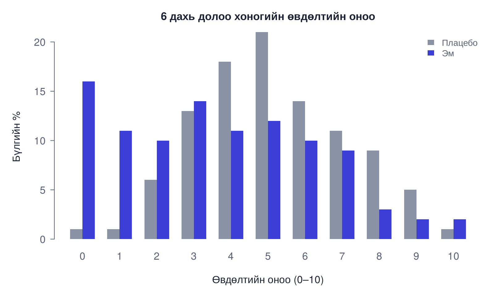

```{=html}
<header class="mt-hero" style="--mt-accent:#0284c7">
  <p class="mt-eyebrow"><a href="../methods.html">Data Analysis Methods</a> · Параметрийн бус тест</p>
  <h1>Манн-Уитнигийн U тест</h1>
  <p class="mt-en" lang="en">Mann–Whitney U test (Wilcoxon rank-sum test)</p>
  <p class="mt-lead">Хоёр хамааралгүй бүлгийн утгуудыг эрэмбэлж, нэг бүлгийн утга нөгөөгөөсөө системтэйгээр их эсвэл бага байх хандлагатай эсэхийг шалгана. Хэвийн бус тархалттай, хазайлттай эсвэл дараалсан хувьсагчид тохиромжтой.</p>
  <ul class="mt-badges"><li>Тасралтгүй / дараалсан</li><li>2 бүлэг</li><li><code>wilcox.test(y ~ g)</code></li><li><span class="vc" data-vc-href=""></span></li></ul>
</header>
```

## Товч мэдээлэл

```{=html}
<div class="mt-facts"><div><span>Үр дагавар</span><strong>Тасралтгүй (хэвийн бус) эсвэл дараалсан</strong></div><div><span>Бүлэг</span><strong>2, хамааралгүй</strong></div><div><span>Тэг таамаглал</span><strong>Хоёр бүлгийн тархалт ижил</strong></div><div><span>Параметрийн хувилбар</span><strong>Хамааралгүй t-тест</strong></div></div>
```

## Хэзээ хэрэглэх вэ?

Хамааралгүй t-тестийн таамаглал зөрчигдсөн үед: түүвэр бага бөгөөд тархалт хүчтэй хазайлттай, огцом утгатай, эсвэл үр дагавар нь дараалсан (жишээ нь өвдөлтийн 0–10 оноо) бол.

::: {.callout-tip appearance="simple" icon="false"}
**Жишээ судалгааны асуулт:** Шинэ мэдээгүйжүүлэлтийн аргаар хагалгаа хийлгэсэн өвчтөнүүдийн эмнэлэгт хэвтсэн хоног стандарт аргын бүлгийнхээс богино байна уу?
:::

## Таамаглалууд

Шинжилгээ хийхээс өмнө шалгана:

- [ ] Хоёр бүлгийн ажиглалтууд хоорондоо хамааралгүй.
- [ ] Үр дагавар нь дор хаяж дараалсан түвшинд хэмжигдсэн.
- [ ] "Медианы ялгаа" гэж тайлбарлах бол хоёр бүлгийн тархалтын хэлбэр ойролцоо байх ёстой. Эс бөгөөс "нэг бүлгийн утга их байх магадлал" гэж тайлбарлана.

## R дээр хийх

```r
# Өгөгдөл: df$los (хэвтсэн хоног), df$group ("Шинэ", "Стандарт")
tapply(df$los, df$group, summary)          # медиан ба IQR

wilcox.test(los ~ group, data = df,
            conf.int = TRUE, exact = FALSE) # Hodges-Lehmann зөрүү ба 95% CI

# Нөлөөний хэмжээ: rank-biserial корреляци
effectsize::rank_biserial(los ~ group, data = df)
```

## Жишээ: бодит гаралт ба тайлбар

::: {.mt-example-intro}
**Асуулт.** 6 дахь долоо хоногийн өвдөлтийн оноо (0–10, дараалсан хувьсагч) эмийн бүлэгт плацебо бүлгийнхээс бага байна уу?

Доорх гаралтыг сайтын [жишээ өгөгдөл](../resources/data/emnelgiin-jishee.csv) дээр R 4.3.3-аар жинхэнээр нь ажиллуулж гаргасан. Кодыг хуулж өөрийн компьютер дээр ажиллуулбал яг ижил үр дүн гарна.
:::

```{.text .mt-console}
> df <- read.csv("emnelgiin-jishee.csv", fileEncoding = "UTF-8-BOM")
> df$group <- factor(df$group, levels = c("Плацебо", "Эм"))
> tapply(df$pain6, df$group, summary)
$Плацебо
   Min. 1st Qu.  Median    Mean 3rd Qu.    Max. 
   0.00    4.00    5.00    5.17    7.00   10.00 

$Эм
   Min. 1st Qu.  Median    Mean 3rd Qu.    Max. 
   0.00    1.00    3.00    3.62    6.00   10.00 

> wilcox.test(pain6 ~ group, data = df, conf.int = TRUE, exact = FALSE)

	Wilcoxon rank sum test with continuity correction

data:  pain6 by group
W = 6752.5, p-value = 1.619e-05
alternative hypothesis: true location shift is not equal to 0
95 percent confidence interval:
 0.9999715 2.0000426
sample estimates:
difference in location 
              1.999996
```

{.mt-figure fig-alt="Бүлэг тус бүрийн өвдөлтийн онооны тархалт (бүлгийн %). Эмийн бүлэг бага оноо руу шилжсэн."}

### Гаралтыг хэрхэн унших вэ?

::: {.mt-readout}
1. `Плацебо: Median 5.00, 1st Qu. 4.00, 3rd Qu. 7.00` Плацебо бүлгийн медиан 5 (IQR 4–7).
2. `Эм: Median 3.00, 1st Qu. 1.00, 3rd Qu. 6.00` Эмийн бүлгийн медиан 3 (IQR 1–6).
3. `W = 6752.5` Плацебо бүлгийн утга эмийн бүлгийнхээс их байсан хосын тоо (U статистик). Тэг таамаглал үнэн бол ойролцоогоор 100 × 100 / 2 = 5000 байх ёстой.
4. `p-value = 1.619e-05` p < 0.001: хоёр бүлгийн тархалт ижил гэсэн тэг таамаглалыг няцаана.
5. `difference in location 1.999996, 95% CI 0.99997 2.00004` Hodges–Lehmann зөрүү ≈ 2 оноо. Оноо бүхэл тоо тул CI нь 1–2 гэж бөөрөнхийлөгдөж байна.
:::

::: {.mt-conclusion}
**Дүгнэлт (тайлагнах хэлбэрээр).** 6 дахь долоо хоногийн өвдөлтийн оноо эмийн бүлэгт (медиан 3, IQR 1–6) плацебо бүлгийнхээс (медиан 5, IQR 4–7) бага байв (Манн-Уитнигийн U тест, W = 6752.5, p < 0.001; Hodges–Lehmann зөрүү 2 оноо, 95% CI 1; 2).
:::

## Цэс дээр хийх (SPSS)

```{=html}
<div class="mt-menu"><div><b>SPSS</b> Analyze → Nonparametric Tests → Legacy Dialogs → 2 Independent Samples → Mann-Whitney U.</div></div>
```

## Үр дүнг тайлбарлах

- **W (эсвэл U), p-value**: хоёр бүлгийн тархалт ижил гэсэн тэг таамаглалын эсрэг нотолгоо. R нь U-г W гэж нэрлэдэг.
- **Медиан (IQR)**: бүлэг тус бүрийн тодорхойлох статистикийг дундаж ± SD-ийн оронд тайлагнана.
- **difference in location, 95% CI**: Hodges–Lehmann зөрүүний тооцоо. Энэ нь медиануудын зөрүү биш, хоёр бүлгийн хосуудын зөрүүний медиан юм.
- **Rank-biserial r**: нөлөөний хэмжээ (≈0.1 бага, ≈0.3 дунд, ≈0.5 их).

## Тайлагнах жишээ

::: {.callout-note appearance="simple" icon="false"}
Шинэ аргын бүлэгт эмнэлэгт хэвтсэн хоног (медиан 4, IQR 3–6) стандарт бүлгийнхээс (медиан 6, IQR 4–8) статистик ач холбогдолтой богино байв (Манн-Уитнигийн U тест, W = 1820, p = 0.004; Hodges–Lehmann зөрүү −1.0 хоног, 95% CI −2.0; −0.5; r = 0.27).

<small>Тоонууд зохиомол бөгөөд тайлагнах хэлбэрийг харуулах зорилготой.</small>
:::

## Түгээмэл алдаа

::: {.callout-warning appearance="simple" icon="false"}
- Тархалт хэвийн биш гэж автоматаар параметрийн бус тест сонгох. Түүвэр том (бүлэг бүрт n ≥ 30) бол Welch t-тест ихэвчлэн хангалттай бат бөх.
- Тархалтын хэлбэр өөр байхад үр дүнг "медиан ялгаатай" гэж тайлбарлах.
- Нөлөөний хэмжээ ба CI-г орхиж зөвхөн p-утга тайлагнах.
:::

## Өөр аргууд

- [Хамааралгүй түүврийн t-тест](independent-t-test.html) — тархалт хэвийн эсвэл түүвэр том бол.
- [Уилкоксоны тэмдэгт эрэмбийн тест](wilcoxon-signed-rank.html) — нэг хүний хоёр хэмжилтэд.
- [Крускал-Валлисын тест](kruskal-wallis.html) — ≥ 3 хамааралгүй бүлэгт.

## Холбогдох нэр томьёо

```{=html}
<div class="glossary-embed"
     data-src="../glossary/terms.yml"
     data-glossary-url="../glossary.html"
     data-terms="mann-whitney,nonparametric-test,parametric-test,median,interquartile-range,ordinal-variable,skewness,shapiro-wilk,effect-size">
  <p class="gl-loading">Нэр томьёог ачаалж байна…</p>
</div>

<nav class="mt-pager" aria-label="Аргууд хооронд шилжих"><a href="mcnemar-test.html">← МакНемарын тест</a><a href="wilcoxon-signed-rank.html">Уилкоксоны тэмдэгт эрэмбийн тест →</a></nav>
```
