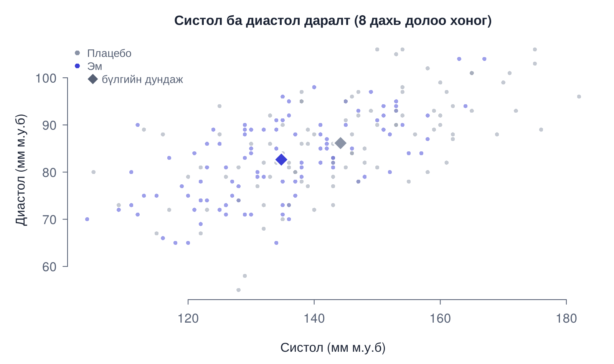

```{=html}
<header class="mt-hero" style="--mt-accent:#db2777">
  <p class="mt-eyebrow"><a href="../methods.html">Data Analysis Methods</a> · Дундаж харьцуулах</p>
  <h1>Олон хэмжээст дисперсийн шинжилгээ (MANOVA)</h1>
  <p class="mt-en" lang="en">Multivariate analysis of variance</p>
  <p class="mt-lead">Хоорондоо хамааралтай хэд хэдэн тасралтгүй үр дагаврын хувьсагчийг нэг дор авч үзэж, бүлгүүд эдгээр хувьсагчдын хослолоор ялгаатай эсэхийг шалгана.</p>
  <ul class="mt-badges"><li>≥ 2 тасралтгүй үр дагавар</li><li>≥ 2 бүлэг</li><li><code>manova()</code></li><li><span class="vc" data-vc-href=""></span></li></ul>
</header>
```

## Товч мэдээлэл

```{=html}
<div class="mt-facts"><div><span>Үр дагавар</span><strong>≥ 2 тасралтгүй</strong></div><div><span>Бүлэг</span><strong>≥ 2</strong></div><div><span>Тестийн статистик</span><strong>Pillai, Wilks&#x27; Λ</strong></div><div><span>Дараагийн алхам</span><strong>Үр дагавар тус бүрийн ANOVA</strong></div></div>
```

## Хэзээ хэрэглэх вэ?

Үр дагаврууд онолын хувьд нэг цогц ойлголтыг илэрхийлж, хоорондоо дунд зэрэг хамааралтай бол.

::: {.callout-tip appearance="simple" icon="false"}
**Жишээ судалгааны асуулт:** Гурван дасгалын хөтөлбөр систол ба диастолын даралтад хамтдаа ялгаатай нөлөөлөх үү?
:::

## Таамаглалууд

Шинжилгээ хийхээс өмнө шалгана:

- [ ] Ажиглалтууд хоорондоо хамааралгүй.
- [ ] Үр дагаврууд бүлэг бүрт олон хэмжээст хэвийн тархалттай.
- [ ] Ковариацын матрицууд бүлгүүдэд ижил (Box-ийн M тест).
- [ ] Үр дагаврууд дунд зэрэг хамааралтай (хэт өндөр биш, хэт бага биш).

## R дээр хийх

```r
# Өгөгдөл: df$sbp, df$dbp, df$program (3 түвшин)
m <- manova(cbind(sbp, dbp) ~ program, data = df)
summary(m, test = "Pillai")      # олон хэмжээст тест
summary.aov(m)                   # үр дагавар тус бүрийн ANOVA
```

## Жишээ: бодит гаралт ба тайлбар

::: {.mt-example-intro}
**Асуулт.** Эм систол ба диастол даралтад хамтдаа нөлөөлсөн үү?

Доорх гаралтыг сайтын [жишээ өгөгдөл](../resources/data/emnelgiin-jishee.csv) дээр R 4.3.3-аар жинхэнээр нь ажиллуулж гаргасан. Кодыг хуулж өөрийн компьютер дээр ажиллуулбал яг ижил үр дүн гарна.
:::

```{.text .mt-console}
> df <- read.csv("emnelgiin-jishee.csv", fileEncoding = "UTF-8-BOM")
> df$group <- factor(df$group, levels = c("Плацебо", "Эм"))
> fit <- manova(cbind(sbp8, dbp8) ~ group, data = df)
> summary(fit, test = "Pillai")
           Df   Pillai approx F num Df den Df    Pr(>F)    
group       1 0.093211   10.125      2    197 6.522e-05 ***
Residuals 198                                              
---
Signif. codes:  0 ‘***’ 0.001 ‘**’ 0.01 ‘*’ 0.05 ‘.’ 0.1 ‘ ’ 1
> summary.aov(fit)
 Response sbp8 :
             Df Sum Sq Mean Sq F value    Pr(>F)    
group         1   4409  4408.6  20.292 1.135e-05 ***
Residuals   198  43017   217.3                      
---
Signif. codes:  0 ‘***’ 0.001 ‘**’ 0.01 ‘*’ 0.05 ‘.’ 0.1 ‘ ’ 1

 Response dbp8 :
             Df  Sum Sq Mean Sq F value  Pr(>F)  
group         1   612.5  612.50  6.7227 0.01023 *
Residuals   198 18039.5   91.11                  
---
Signif. codes:  0 ‘***’ 0.001 ‘**’ 0.01 ‘*’ 0.05 ‘.’ 0.1 ‘ ’ 1
```

{.mt-figure fig-alt="Систол ба диастол даралт. Том ромбо нь бүлэг бүрийн хоёр хэмжээст дундаж."}

### Гаралтыг хэрхэн унших вэ?

::: {.mt-readout}
1. `Pillai 0.093211` Пиллайн мөр (trace): бүлэг хоёр үр дагаврын хамтын хэлбэлзлийн 9%-ийг тайлбарлаж байна. Бусад статистикаас бат бөх.
2. `approx F 10.125, num Df 2, den Df 197` Пиллайн статистикийг F тархалт руу хөрвүүлсэн утга. num Df = үр дагаврын тоо.
3. `Pr(>F) 6.522e-05 ***` p < 0.001: хоёр үр дагаврыг хамтад нь авч үзэхэд бүлгүүд ялгаатай.
4. `Response sbp8: F 20.292, p 1.135e-05; Response dbp8: F 6.7227, p 0.01023` Үр дагавар тус бүрийн ANOVA: систол (p < 0.001) ба диастол (p = 0.010) хоёулаа ялгаатай. Олон тест тул Бонферронигоор α = 0.025 гэж үзэхэд ч хоёулаа ач холбогдолтой.
:::

::: {.mt-conclusion}
**Дүгнэлт (тайлагнах хэлбэрээр).** Эм систол ба диастол даралтад хамтдаа нөлөөлсөн (MANOVA, Pillai = 0.093, F(2, 197) = 10.1, p < 0.001). Дагалдах ANOVA-аар систол (F = 20.3, p < 0.001) ба диастол (F = 6.7, p = 0.010) хоёулаа бүлгүүдэд ялгаатай байв.
:::

## Цэс дээр хийх (SPSS)

```{=html}
<div class="mt-menu"><div><b>SPSS</b> Analyze → General Linear Model → Multivariate.</div></div>
```

## Үр дүнг тайлбарлах

- **Pillai's trace** — хамгийн бат бөх тестийн статистик (таамаглал бага зэрэг зөрчигдсөн ч найдвартай).
- **approx F, Pr(>F)** — бүлгүүд үр дагаврын хослолоор ялгаатай эсэх.
- **summary.aov** — аль үр дагаварт ялгаа байгааг тус тусад нь харуулна (олон харьцуулалтын залруулга хийнэ).

## Тайлагнах жишээ

::: {.callout-note appearance="simple" icon="false"}
Дасгалын хөтөлбөрүүд систол ба диастолын даралтад хамтдаа ялгаатай нөлөөлсөн (Pillai's trace = 0.11, F(4, 294) = 4.27, p = 0.002). Тус тусын ANOVA-аар ялгаа систолын даралтад илэрсэн.

<small>Тоонууд зохиомол бөгөөд тайлагнах хэлбэрийг харуулах зорилготой.</small>
:::

## Түгээмэл алдаа

::: {.callout-warning appearance="simple" icon="false"}
- Хамааралгүй, онолын холбоогүй олон үр дагаврыг MANOVA-д хийх.
- MANOVA-г «олон тест хийхээс зайлсхийх» хамгаалалт гэж үзэх. Үр дагавар тус бүрийн дараах тестэд залруулга хэрэгтэй хэвээр.
:::

## Өөр аргууд

- [Дисперсийн шинжилгээ (ANOVA)](anova.html) — Гурав ба түүнээс дээш хамааралгүй бүлгийн дундажийг нэг дор харьцуулна.
- [Шугаман регресс](linear-regression.html) — Тасралтгүй үр дагаврыг нэг буюу олон тайлбарлагч хувьсагчаар загварчилна.

## Холбогдох нэр томьёо

```{=html}
<div class="glossary-embed"
     data-src="../glossary/terms.yml"
     data-glossary-url="../glossary.html"
     data-terms="manova,anova,multiple-comparisons,bonferroni,pearson-correlation,normal-distribution">
  <p class="gl-loading">Нэр томьёог ачаалж байна…</p>
</div>

<nav class="mt-pager" aria-label="Аргууд хооронд шилжих"><a href="ancova.html">← Ковариацын шинжилгээ (ANCOVA)</a><a href="correlation.html">Корреляцийн шинжилгээ →</a></nav>
```
