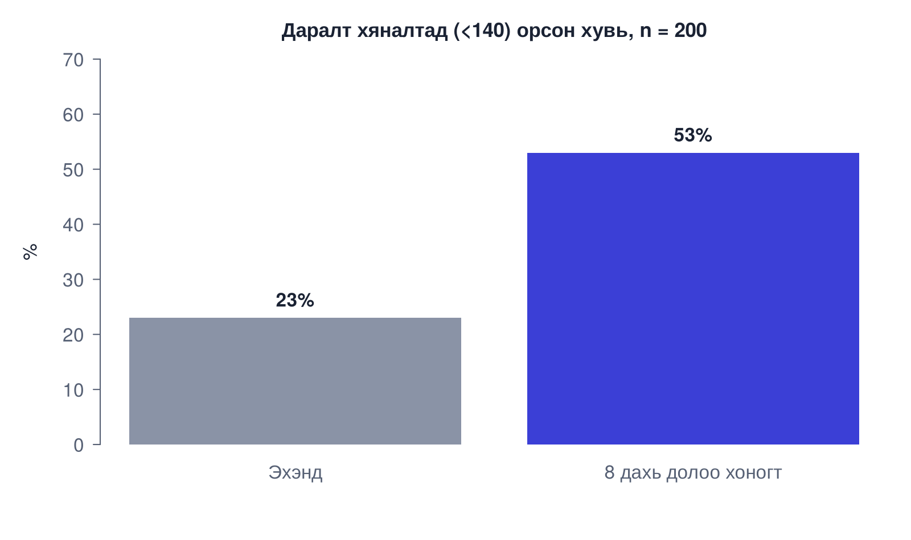

```{=html}
<header class="mt-hero" style="--mt-accent:#f43f5e">
  <p class="mt-eyebrow"><a href="../methods.html">Data Analysis Methods</a> · Категорийн өгөгдөл</p>
  <h1>МакНемарын тест</h1>
  <p class="mt-en" lang="en">McNemar's test</p>
  <p class="mt-lead">Нэг хүнд хоёр удаа (өмнө/дараа), эсвэл нэг хүнд хоёр өөр аргаар хийсэн тийм/үгүй хэмжилтийн хувь өөрчлөгдсөн эсэхийг шалгана. Хосолсон кейс-контрол судалгаанд ч хэрэглэнэ.</p>
  <ul class="mt-badges"><li>Хоёр утгат</li><li>2 хэмжилт, хосолсон</li><li><code>mcnemar.test()</code></li><li><span class="vc" data-vc-href=""></span></li></ul>
</header>
```

## Товч мэдээлэл

```{=html}
<div class="mt-facts"><div><span>Үр дагавар</span><strong>Хоёр утгат (0/1)</strong></div><div><span>Бүтэц</span><strong>Нэг хүний 2 хэмжилт / хос</strong></div><div><span>Тэг таамаглал</span><strong>Хоёр хэмжилтийн хувь тэнцүү</strong></div><div><span>Хамааралгүй бүлэгт</span><strong>Хи-квадрат тест</strong></div></div>
```

## Хэзээ хэрэглэх вэ?

Хамааралт түүврийн t тесттэй ижил санаа, гэхдээ үр дагавар нь тийм/үгүй байх үед. Тест зөвхөн **хариу нь өөрчлөгдсөн хүмүүст** (тийм→үгүй, үгүй→тийм) тулгуурладаг.

::: {.callout-tip appearance="simple" icon="false"}
**Жишээ судалгааны асуулт:** Эрүүл мэндийн боловсролын хөтөлбөрийн дараа тамхи татдаг оюутны хувь хөтөлбөрийн өмнөхөөс буурсан уу?
:::

## Таамаглалууд

Шинжилгээ хийхээс өмнө шалгана:

- [ ] Хэмжилтүүд хосолсон (нэг хүн эсвэл хосолсон хос).
- [ ] Хосууд хоорондоо хамааралгүй.
- [ ] Санал зөрөлдсөн хосын тоо (b + c) хангалттай, ойролцоогоор ≥ 25. Цөөн бол яг (exact) биномын хувилбарыг хэрэглэнэ.

## R дээр хийх

```r
# Өгөгдөл: нэг мөр = нэг оюутан; df$before, df$after ("Тийм", "Үгүй")
tab <- table(Before = df$before, After = df$after)
tab                                  # 2x2 хосолсон хүснэгт

mcnemar.test(tab)                    # тасралтгүй байдлын засвартай (анхдагч)

# Санал зөрөлдсөн хос цөөн бол яг тест:
exact2x2::mcnemar.exact(tab)         # эсвэл:
b <- tab["Тийм", "Үгүй"]; c <- tab["Үгүй", "Тийм"]
binom.test(b, b + c)
```

## Жишээ: бодит гаралт ба тайлбар

::: {.mt-example-intro}
**Асуулт.** Даралт хяналтад (< 140 мм м.у.б) орсон өвчтөний хувь эхэн ба 8 дахь долоо хоногт ялгаатай юу? (нэг хүмүүсийг хоёр удаа хэмжсэн)

Доорх гаралтыг сайтын [жишээ өгөгдөл](../resources/data/emnelgiin-jishee.csv) дээр R 4.3.3-аар жинхэнээр нь ажиллуулж гаргасан. Кодыг хуулж өөрийн компьютер дээр ажиллуулбал яг ижил үр дүн гарна.
:::

```{.text .mt-console}
> df <- read.csv("emnelgiin-jishee.csv", fileEncoding = "UTF-8-BOM")
> before <- ifelse(df$sbp0 < 140, "Хяналттай", "Хяналтгүй")
> after  <- ifelse(df$sbp8 < 140, "Хяналттай", "Хяналтгүй")
> tab <- table(Өмнө = before, Дараа = after)
> tab
           Дараа
Өмнө    Хяналтгүй Хяналттай
  Хяналтгүй        94        60
  Хяналттай         0        46
> mcnemar.test(tab)

	McNemar's Chi-squared test with continuity correction

data:  tab
McNemar's chi-squared = 58.017, df = 1, p-value = 2.599e-14
```

{.mt-figure fig-alt="Нийт 200 өвчтөнд даралт хяналтад орсон хувь, эхэнд ба 8 дахь долоо хоногт."}

### Гаралтыг хэрхэн унших вэ?

::: {.mt-readout}
1. `tab: Хяналтгүй→Хяналтгүй 94, Хяналтгүй→Хяналттай 60` Эхэндээ хяналтгүй байсан 154 хүний 60 нь хяналтад орсон.
2. `Хяналттай→Хяналтгүй 0, Хяналттай→Хяналттай 46` Эхэндээ хяналттай байсан 46 хүний хэн нь ч хяналтаас гараагүй.
3. `McNemar's chi-squared = 58.017` Тест зөвхөн хариу нь өөрчлөгдсөн хүмүүст (60 ба 0) тулгуурладаг: (|60 − 0| − 1)² / (60 + 0) = 58.0.
4. `p-value = 2.599e-14` p < 0.001: хяналтад орсон хувь хоёр хэмжилтийн хооронд ялгаатай.
:::

::: {.mt-conclusion}
**Дүгнэлт (тайлагнах хэлбэрээр).** Даралт хяналтад орсон өвчтөний хувь эхэн үед 23.0% (46/200) байсан бол 8 дахь долоо хоногт 53.0% (106/200) болж нэмэгдсэн (МакНемарын тест, χ²(1) = 58.0, p < 0.001; 60 хүн хяналтад орж, хэн нь ч хяналтаас гараагүй).
:::

## Цэс дээр хийх (SPSS)

```{=html}
<div class="mt-menu"><div><b>SPSS</b> Analyze → Descriptive Statistics → Crosstabs → Statistics… → McNemar. Эсвэл Nonparametric Tests → Legacy Dialogs → 2 Related Samples → McNemar.</div></div>
```

## Үр дүнг тайлбарлах

- **McNemar's chi-squared, p-value**: хоёр хэмжилтийн хувь ялгаатай эсэх. Зөвхөн b ба c нүдэнд (хариу нь өөрчлөгдсөн хүмүүст) үндэслэнэ.
- **Хувь**: өмнө ба дараах хувийг (жишээ нь 28% → 18%) заавал тайлагнана.
- **Хосолсон OR = b / c**: өөрчлөлтийн чиглэл ба хэмжээг илэрхийлнэ.

## Тайлагнах жишээ

::: {.callout-note appearance="simple" icon="false"}
Хөтөлбөрт хамрагдсан 200 оюутны тамхи татдаг хувь 28.0%-иас 18.0% болж буурсан бөгөөд статистик ач холбогдолтой байв (МакНемарын тест, χ²(1) = 11.3, p < 0.001; 26 оюутан татахаа больж, 6 оюутан шинээр татаж эхэлсэн).

<small>Тоонууд зохиомол бөгөөд тайлагнах хэлбэрийг харуулах зорилготой.</small>
:::

## Түгээмэл алдаа

::: {.callout-warning appearance="simple" icon="false"}
- Өмнө ба дараах өгөгдлийг хоёр хамааралгүй бүлэг мэт үзэж хи-квадрат хийх.
- 2×2 хүснэгтийг буруу байгуулах: мөр нь "өмнө", багана нь "дараа" байх ёстой, бүлэг ба үр дагавар биш.
- Өөрчлөгдсөн хүний тоог (b, c) тайлагнахгүй орхих.
:::

## Өөр аргууд

- [Хи-квадрат тест ба Фишерийн яг тест](chi-square-test.html) — хамааралгүй бүлгүүдийн хувийг харьцуулна.
- [Хамааралт түүврийн t тест](paired-t-test.html) — хосолсон тасралтгүй хэмжилтэд.
- [GEE](gee.html) — нэг хүнээс ≥ 3 удаа авсан хоёр утгат хэмжилт эсвэл ковариатаар залруулах бол.

## Холбогдох нэр томьёо

```{=html}
<div class="glossary-embed"
     data-src="../glossary/terms.yml"
     data-glossary-url="../glossary.html"
     data-terms="mcnemar-test,chi-square-test,contingency-table,matching,proportion,odds-ratio,p-value">
  <p class="gl-loading">Нэр томьёог ачаалж байна…</p>
</div>

<nav class="mt-pager" aria-label="Аргууд хооронд шилжих"><a href="chi-square-test.html">← Хи-квадрат тест</a><a href="mann-whitney.html">Манн-Уитнигийн U тест →</a></nav>
```
