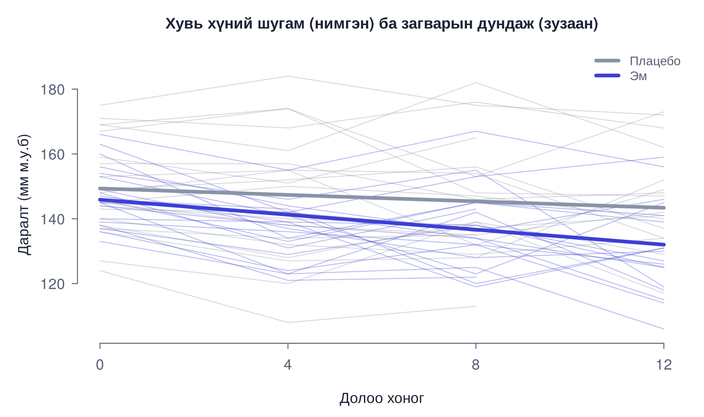

```{=html}
<header class="mt-hero" style="--mt-accent:#115e59">
  <p class="mt-eyebrow"><a href="../methods.html">Data Analysis Methods</a> · Давтан хэмжилт ба кластер</p>
  <h1>Холимог нөлөөний загвар</h1>
  <p class="mt-en" lang="en">Linear mixed-effects models (multilevel models)</p>
  <p class="mt-lead">Нэг хүнээс олон хэмжилт, эсвэл нэг эмнэлэг, сургуулиас олон хүн хамрагдсан үед тогтмол нөлөө (эмчилгээ, хугацаа) болон санамсаргүй нөлөөг (хүн, кластер бүрийн өөрийн суурь түвшин) хамтад нь загварчилна. Дутуу өгөгдөл, тэнцвэргүй хэмжилтийн хугацааг сайн даадаг.</p>
  <ul class="mt-badges"><li>Давтан хэмжилт / кластер</li><li>Тасралтгүй / 0-1 / тоо</li><li><code>lmer()</code></li><li><span class="vc" data-vc-href=""></span></li></ul>
</header>
```

## Товч мэдээлэл

```{=html}
<div class="mt-facts"><div><span>Үр дагавар</span><strong>Тасралтгүй (lmer); 0/1, тоо (glmer)</strong></div><div><span>Бүтэц</span><strong>Давтан хэмжилт / олон түвшин</strong></div><div><span>Үр дүн</span><strong>β (хувь хүний түвшин), ICC</strong></div><div><span>Гол сонголт</span><strong>Санамсаргүй нөлөөний бүтэц</strong></div></div>
```

## Хэзээ хэрэглэх вэ?

Ажиглалтууд бүлэглэгдсэн (хүн доторх давтан хэмжилт, эмнэлэг доторх өвчтөн) бөгөөд дараах тохиолдлуудад:

- Зарим хүнд дутуу хэмжилт байгаа, эсвэл хэмжилтийн хугацаа хүн бүрт өөр.
- Хүн бүрийн өөрчлөлтийн хурд (налуу) ялгаатай байж болох.
- Хувь хүн эсвэл кластер түвшний нөлөө, кластер хоорондын хэлбэлзэл (ICC) сонирхолтой.

::: {.callout-tip appearance="simple" icon="false"}
**Жишээ судалгааны асуулт:** Шинэ эм уусан бүлгийн систолын даралт 12 долоо хоногийн турш плацебо бүлгийнхээс илүү хурдан буурсан уу? (Зарим өвчтөн зарим үзлэгт ирээгүй.)
:::

## Таамаглалууд

Шинжилгээ хийхээс өмнө шалгана:

- [ ] Хүн (кластер) хоорондоо хамааралгүй.
- [ ] Үлдэгдэл ойролцоогоор хэвийн тархалттай, дисперс тогтмол (lmer-д).
- [ ] Санамсаргүй нөлөө ойролцоогоор хэвийн тархалттай.
- [ ] Дутуу өгөгдөл санамсаргүй (MAR): дутуу байх нь ажиглагдсан хувьсагчаас хамаарч болно, харин ажиглагдаагүй утгаас хамаарахгүй.
- [ ] Кластерын тоо хангалттай (санамсаргүй нөлөөнд ойролцоогоор ≥ 5–10, илүү байх тусмаа сайн).

## R дээр хийх

```r
library(lme4); library(lmerTest)   # lmerTest нь p-утга нэмнэ
# Урт хэлбэр: df$id, df$week (0, 4, 8, 12), df$group, df$sbp

# Санамсаргүй огтлолцол (хүн бүр өөр суурь түвшинтэй)
m1 <- lmer(sbp ~ group * week + (1 | id), data = df)

# Санамсаргүй налуу (хүн бүрийн өөрчлөлтийн хурд өөр)
m2 <- lmer(sbp ~ group * week + (1 + week | id), data = df)
anova(m1, m2)                      # санамсаргүй налуу хэрэгтэй эсэх

summary(m2)
confint(m2, method = "Wald")
performance::icc(m1)               # ангийн доторх корреляци
performance::check_model(m2)       # үлдэгдлийн оношилгоо

# Хоёр утгат үр дагавар:
glmer(infection ~ pm25 + age + (1 | id), family = binomial, data = df)
```

## Жишээ: бодит гаралт ба тайлбар

::: {.mt-example-intro}
**Асуулт.** Дутуу хэмжилттэй хүмүүсийг хасалгүйгээр систолын даралтын долоо хоног тутмын бууралтын хурдыг эм ба плацебо бүлэгт харьцуулах.

Доорх гаралтыг сайтын [жишээ өгөгдөл](../resources/data/emnelgiin-jishee.csv) дээр R 4.3.3-аар жинхэнээр нь ажиллуулж гаргасан. Кодыг хуулж өөрийн компьютер дээр ажиллуулбал яг ижил үр дүн гарна.
:::

```{.text .mt-console}
> df <- read.csv("emnelgiin-jishee.csv", fileEncoding = "UTF-8-BOM")
> library(lme4); library(lmerTest)
> long <- reshape(df[, c("id", "group", "sbp0", "sbp4", "sbp8", "sbp12")],
+                 direction = "long", varying = c("sbp0", "sbp4", "sbp8", "sbp12"),
+                 v.names = "sbp", timevar = "week", times = c(0, 4, 8, 12), idvar = "id")
> long$group <- factor(long$group, levels = c("Плацебо", "Эм"))
> long <- long[!is.na(long$sbp), ]                          # дутуу хэмжилтийг хасна, хүнийг биш
> m1 <- lmer(sbp ~ group * week + (1 | id), data = long)
> summary(m1)
Linear mixed model fit by REML. t-tests use Satterthwaite's method [
lmerModLmerTest]
Formula: sbp ~ group * week + (1 | id)
   Data: long

REML criterion at convergence: 5861.5

Scaled residuals: 
    Min      1Q  Median      3Q     Max 
-2.8244 -0.5272  0.0782  0.5529  3.1032 

Random effects:
 Groups   Name        Variance Std.Dev.
 id       (Intercept) 143.46   11.978  
 Residual              60.51    7.779  
Number of obs: 778, groups:  id, 200

Fixed effects:
              Estimate Std. Error        df t value Pr(>|t|)    
(Intercept)  149.34434    1.36477 268.42103 109.428  < 2e-16 ***
groupЭм       -3.46304    1.92970 268.23410  -1.795   0.0738 .  
week          -0.49663    0.09047 578.45684  -5.489 6.04e-08 ***
groupЭм:week  -0.65886    0.12715 578.08378  -5.182 3.04e-07 ***
---
Signif. codes:  0 ‘***’ 0.001 ‘**’ 0.01 ‘*’ 0.05 ‘.’ 0.1 ‘ ’ 1

Correlation of Fixed Effects:
            (Intr) gropЭм week  
groupЭм     -0.707              
week        -0.381  0.269       
groupЭм:wek  0.271 -0.381 -0.712
> vc <- as.data.frame(VarCorr(m1))
> vc$vcov[1] / sum(vc$vcov)                                  # ICC
[1] 0.703343
```

{.mt-figure fig-alt="Санамсаргүй сонгосон 40 хүний хувийн шугам (нимгэн) ба загварын дундаж шугам (зузаан)."}

### Гаралтыг хэрхэн унших вэ?

::: {.mt-readout}
1. `Number of obs: 778, groups: id, 200` 200 хүний бүгдийг ашигласан. 12 дахь долоо хоногт ирээгүй 22 хүнийг ч хасаагүй (800-аас 22 хэмжилт дутуу).
2. `Random effects: id (Intercept) Variance 143.46` Хүмүүсийн суурь даралт хоорондоо ихээхэн ялгаатай (SD ≈ 12 мм м.у.б).
3. `ICC [1] 0.703343` Нийт хэлбэлзлийн 70% нь хүн хоорондын ялгаа. Давтан хэмжилтийг тооцохгүй бол стандарт алдаа буруу гарна.
4. `week -0.49663` Плацебо бүлгийн даралт долоо хоног бүр 0.50 мм м.у.б-аар буурч байна.
5. `groupЭм:week -0.65886, Pr(>|t|) 3.04e-07` Эмийн бүлэгт долоо хоног бүр нэмэлт 0.66 мм м.у.б-аар буурч байна. Нийт хурд нь −0.50 − 0.66 = −1.16 мм м.у.б/долоо хоног.
6. `groupЭм -3.46304 (p 0.0738)` 0 дахь долоо хоногт (эхэнд) бүлгүүд ялгаагүй байсан нь санамсаргүйчлэл зөв явагдсаныг харуулна.
:::

::: {.mt-conclusion}
**Дүгнэлт (тайлагнах хэлбэрээр).** Шугаман холимог загвараар (хүн бүрт санамсаргүй огтлолцолтой) эмийн бүлгийн даралт плацебо бүлгийнхээс долоо хоногт 0.66 мм м.у.б-аар илүү хурдан буурч байв (бүлэг × долоо хоног β = −0.66, SE 0.13, p < 0.001; 200 хүний 778 хэмжилт; ICC = 0.70).
:::

## Цэс дээр хийх (SPSS)

```{=html}
<div class="mt-menu"><div><b>SPSS</b> Analyze → Mixed Models → Linear → Subjects: id → Fixed… ба Random… хэсгийг тохируулна. Хоёр утгат үр дагаварт: Mixed Models → Generalized Linear.</div></div>
```

## Үр дүнг тайлбарлах

- **Fixed effects (Estimate)**: хувь хүний түвшний нөлөө. `group:week` харилцан үйлчлэл нь бүлгүүдийн өөрчлөлтийн хурдны ялгаа.
- **Random effects (Variance, Std.Dev.)**: хүн хоорондын суурь түвшин ба налуугийн хэлбэлзэл.
- **ICC**: нийт хэлбэлзлийн хэдэн хувь нь хүн (кластер) хоорондынх вэ. ICC их бол давтан хэмжилтийг тооцох нь чухал.
- **anova(m1, m2)**: илүү төвөгтэй санамсаргүй бүтэц хэрэгтэй эсэхийг likelihood ratio тестээр шалгана.
- **Анхааруулга (singular fit)**: санамсаргүй бүтэц хэт төвөгтэй байна гэсэн дохио, загварыг хялбарчлана.

## Тайлагнах жишээ

::: {.callout-note appearance="simple" icon="false"}
Шугаман холимог загвараар (хүн бүрт санамсаргүй огтлолцол ба налуутай) эмийн бүлгийн систолын даралт плацебо бүлгийнхээс долоо хоногт дунджаар 0.52 мм м.у.б-аар илүү хурдан буурч байв (бүлэг × долоо хоног: β = −0.52, 95% CI −0.78; −0.26, p < 0.001; 120 өвчтөний 431 үзлэг; ICC = 0.61).

<small>Тоонууд зохиомол бөгөөд тайлагнах хэлбэрийг харуулах зорилготой.</small>
:::

## Түгээмэл алдаа

::: {.callout-warning appearance="simple" icon="false"}
- Холимог загварын OR-ийг (хувь хүний түвшин) GEE-ийн OR-той (хүн амын түвшин) шууд харьцуулах. Логистик загварт тэдгээр ялгаатай байдаг.
- Хэт цөөн кластерт (жишээ нь 3 эмнэлэг) санамсаргүй нөлөө оруулах.
- Санамсаргүй нөлөөний бүтцийг тайлагнахгүй орхих.
- "Singular fit" анхааруулгыг үл тоох.
:::

## Өөр аргууд

- [GEE](gee.html) — хүн амын дундаж нөлөө сонирхолтой, санамсаргүй нөлөөний таамаглалаас зайлсхийх бол.
- [Давтан хэмжилтийн ANOVA](repeated-measures-anova.html) — өгөгдөл бүрэн, хэмжилтийн цэгүүд ижил энгийн тохиолдолд.
- [Шугаман регресс](linear-regression.html) — ажиглалтууд хамааралгүй бол.

## Холбогдох нэр томьёо

```{=html}
<div class="glossary-embed"
     data-src="../glossary/terms.yml"
     data-glossary-url="../glossary.html"
     data-terms="mixed-model,clustered-data,gee,repeated-measures-anova,icc,interaction,missing-data,residual,regression-coefficient">
  <p class="gl-loading">Нэр томьёог ачаалж байна…</p>
</div>

<nav class="mt-pager" aria-label="Аргууд хооронд шилжих"><a href="repeated-measures-anova.html">← Давтан хэмжилтийн ANOVA</a><a href="diagnostic-accuracy.html">Оношилгооны тестийн нарийвчлал →</a></nav>
```
