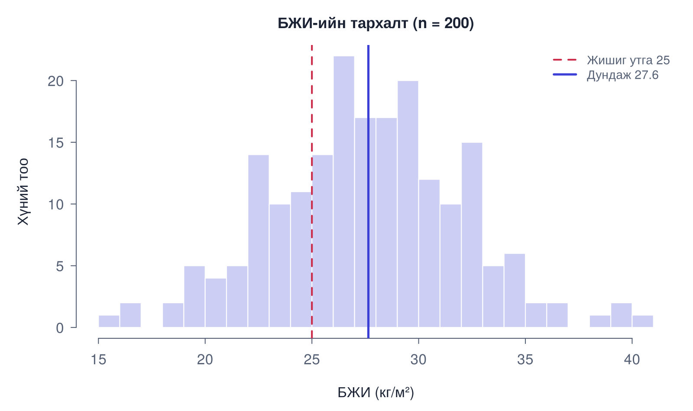

```{=html}
<header class="mt-hero" style="--mt-accent:#2563eb">
  <p class="mt-eyebrow"><a href="../methods.html">Data Analysis Methods</a> · Дундаж харьцуулах</p>
  <h1>Нэг түүврийн t-тест</h1>
  <p class="mt-en" lang="en">One-sample t-test</p>
  <p class="mt-lead">Нэг бүлгийн тасралтгүй хувьсагчийн дундаж урьдчилан мэдэгдэж буй утгаас (норм, үндэсний дундаж, онолын утга) статистик ач холбогдолтой ялгаатай эсэхийг шалгана.</p>
  <ul class="mt-badges"><li>Тасралтгүй</li><li>1 бүлэг</li><li><code>t.test(x, mu = )</code></li><li><span class="vc" data-vc-href=""></span></li></ul>
</header>
```

## Товч мэдээлэл

```{=html}
<div class="mt-facts"><div><span>Үр дагавар</span><strong>Тасралтгүй</strong></div><div><span>Бүлэг</span><strong>1</strong></div><div><span>Тэг таамаглал</span><strong>μ = μ₀</strong></div><div><span>Параметрийн бус хувилбар</span><strong>Уилкоксоны тэмдэгт эрэмбийн тест</strong></div></div>
```

## Хэзээ хэрэглэх вэ?

Таны судалгааны асуулт «манай бүлгийн дундаж X-ээс ялгаатай юу?» хэлбэртэй бол.

::: {.callout-tip appearance="simple" icon="false"}
**Жишээ судалгааны асуулт:** Сумын сургуулийн 9–12 насны хүүхдүүдийн дундаж гемоглобин 120 г/л-ийн доод нормоос ялгаатай юу?
:::

## Таамаглалууд

Шинжилгээ хийхээс өмнө шалгана:

- [ ] Ажиглалтууд хоорондоо хамааралгүй.
- [ ] Хувьсагч тасралтгүй.
- [ ] Өгөгдөл ойролцоогоор хэвийн тархалттай (n ≥ 30 бол энэ шаардлага суларна).

## R дээр хийх

```r
# Өгөгдөл: df$hb (г/л)
shapiro.test(df$hb)              # хэвийн тархалтыг шалгах
t.test(df$hb, mu = 120)          # нэг түүврийн t-тест

# Хэвийн тархалтгүй бол:
wilcox.test(df$hb, mu = 120)
```

## Жишээ: бодит гаралт ба тайлбар

::: {.mt-example-intro}
**Асуулт.** Жишээ өгөгдлийн 200 өвчтөний дундаж БЖИ (биеийн жингийн индекс) хэвийн дээд хязгаар болох 25-аас ялгаатай юу?

Доорх гаралтыг сайтын [жишээ өгөгдөл](../resources/data/emnelgiin-jishee.csv) дээр R 4.3.3-аар жинхэнээр нь ажиллуулж гаргасан. Кодыг хуулж өөрийн компьютер дээр ажиллуулбал яг ижил үр дүн гарна.
:::

```{.text .mt-console}
> df <- read.csv("emnelgiin-jishee.csv", fileEncoding = "UTF-8-BOM")
> mean(df$bmi); sd(df$bmi)
[1] 27.645
[1] 4.476648
> t.test(df$bmi, mu = 25)

	One Sample t-test

data:  df$bmi
t = 8.3558, df = 199, p-value = 1.105e-14
alternative hypothesis: true mean is not equal to 25
95 percent confidence interval:
 27.02078 28.26922
sample estimates:
mean of x 
   27.645
```

{.mt-figure fig-alt="БЖИ-ийн тархалт. Улаан тасархай шугам нь жишиг утга (25), хөх шугам нь түүврийн дундаж."}

### Гаралтыг хэрхэн унших вэ?

::: {.mt-readout}
1. `27.645, 4.476648` Түүврийн дундаж БЖИ 27.6, стандарт хазайлт 4.5 кг/м².
2. `t = 8.3558` Дундаж жишиг утгаас хэдэн стандарт алдаагаар зөрж байгааг харуулна. 0-ээс хол байх тусам ялгаа тод.
3. `df = 199` Чөлөөний зэрэг = n − 1 = 200 − 1.
4. `p-value = 1.105e-14` 1.105 × 10⁻¹⁴, өөрөөр хэлбэл 0.001-ээс хамаагүй бага. Хүн амын дундаж 25 гэсэн тэг таамаглалыг няцаана.
5. `95 percent confidence interval: 27.02078 28.26922` Хүн амын дундаж БЖИ 27.0–28.3 хооронд байх магадлалтай. 25 энэ интервалд ороогүй нь p < 0.05-тай нийцнэ.
:::

::: {.mt-conclusion}
**Дүгнэлт (тайлагнах хэлбэрээр).** Өвчтөнүүдийн дундаж БЖИ 27.6 (SD 4.5) байсан нь 25-аас статистик ач холбогдолтой өндөр байв (t(199) = 8.36, p < 0.001; дундаж 27.6, 95% CI 27.0; 28.3).
:::

## Цэс дээр хийх (SPSS)

```{=html}
<div class="mt-menu"><div><b>SPSS</b> Analyze → Compare Means → One-Sample T Test → Test Value.</div></div>
```

## Үр дүнг тайлбарлах

- **t ба df** — тестийн статистик ба чөлөөний зэрэг (n − 1).
- **p-value** — дундаж 120-тай тэнцүү гэсэн тэг таамаглалын эсрэг нотолгоо.
- **95% CI** — эх олонлогийн дундажийн боломжит муж. 120-ийг агуулахгүй бол p < 0.05.
- **mean of x** — түүврийн дундаж.

## Тайлагнах жишээ

::: {.callout-note appearance="simple" icon="false"}
Хүүхдүүдийн дундаж гемоглобин 114.2 ± 11.5 г/л байсан нь 120 г/л-ийн нормоос статистик ач холбогдолтой бага байв (t(84) = −4.65, p < 0.001; дунджийн зөрүү −5.8 г/л, 95% CI −8.3; −3.3).

<small>Тоонууд зохиомол бөгөөд тайлагнах хэлбэрийг харуулах зорилготой.</small>
:::

## Түгээмэл алдаа

::: {.callout-warning appearance="simple" icon="false"}
- Жишиг утгыг өгөгдлөө харсны дараа сонгох.
- Хоёр бүлгийг харьцуулахад нэг бүлгийн дундажийг нөгөөгийн «норм» мэт үзэж нэг түүврийн тест хийх. Хоёр бүлгийг харьцуулахдаа хамааралгүй t-тест хэрэглэнэ.
:::

## Өөр аргууд

- [Хамааралгүй түүврийн t-тест](independent-t-test.html) — Хоёр хамааралгүй бүлгийн тасралтгүй хувьсагчийн дундажийг харьцуулна.
- [Хамааралт түүврийн t тест](paired-t-test.html) — Нэг хүнээс авсан хоёр хэмжилтийн (өмнө/дараа) дундаж зөрүүг шалгана.
- [Уилкоксоны тэмдэгт эрэмбийн тест](wilcoxon-signed-rank.html) — Хэвийн тархалт зөрчигдсөн үед хэрэглэх параметрийн бус хувилбар.

## Холбогдох нэр томьёо

```{=html}
<div class="glossary-embed"
     data-src="../glossary/terms.yml"
     data-glossary-url="../glossary.html"
     data-terms="one-sample-t-test,mean,standard-deviation,standard-error,confidence-interval,null-hypothesis,p-value,degrees-of-freedom,normal-distribution,shapiro-wilk,wilcoxon">
  <p class="gl-loading">Нэр томьёог ачаалж байна…</p>
</div>

<nav class="mt-pager" aria-label="Аргууд хооронд шилжих"><a href="../methods.html">← Бүх аргууд</a><a href="independent-t-test.html">Хамааралгүй түүврийн t-тест →</a></nav>
```
