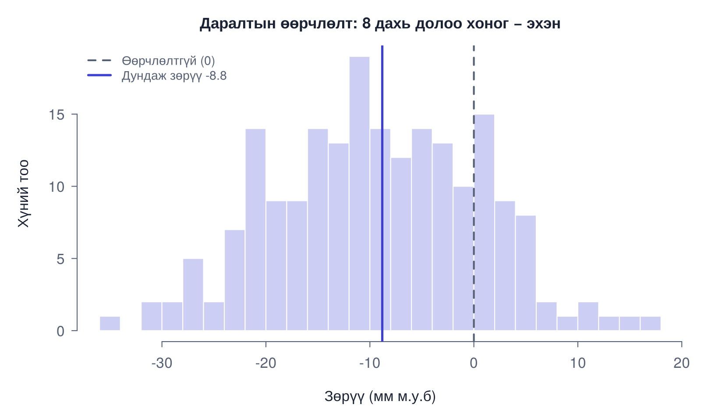

```{=html}
<header class="mt-hero" style="--mt-accent:#059669">
  <p class="mt-eyebrow"><a href="../methods.html">Data Analysis Methods</a> · Дундаж харьцуулах</p>
  <h1>Хамааралт түүврийн t тест</h1>
  <p class="mt-en" lang="en">Paired t-test</p>
  <p class="mt-lead">Нэг хүмүүсээс хоёр удаа (жишээ нь эмчилгээний өмнө ба дараа) эсвэл хосолсон хүмүүсээс авсан хэмжилтийн дундаж зөрүү тэгээс ялгаатай эсэхийг шалгана.</p>
  <ul class="mt-badges"><li>Тасралтгүй</li><li>2 хэмжилт</li><li><code>t.test(paired = TRUE)</code></li><li><span class="vc" data-vc-href=""></span></li></ul>
</header>
```

## Товч мэдээлэл

```{=html}
<div class="mt-facts"><div><span>Үр дагавар</span><strong>Тасралтгүй</strong></div><div><span>Бүлэг</span><strong>1 бүлэг, 2 хэмжилт</strong></div><div><span>Тэг таамаглал</span><strong>Зөрүүний дундаж = 0</strong></div><div><span>Параметрийн бус хувилбар</span><strong>Уилкоксоны тэмдэгт эрэмбийн тест</strong></div></div>
```

## Хэзээ хэрэглэх вэ?

Хэмжилтүүд хосоороо холбоотой бол: нэг хүний өмнө/дараах утга, баруун/зүүн нүд, ихрүүд, тохируулсан хосууд.

::: {.callout-tip appearance="simple" icon="false"}
**Жишээ судалгааны асуулт:** Гурван сарын хөдөлгөөний хөтөлбөрийн дараа оролцогчдын HbA1c буурсан уу?
:::

## Таамаглалууд

Шинжилгээ хийхээс өмнө шалгана:

- [ ] Хос бүрийн зөрүүг тооцох боломжтой (хоёр хэмжилт хоёулаа байгаа).
- [ ] Хосууд хоорондоо хамааралгүй.
- [ ] Зөрүүнүүд ойролцоогоор хэвийн тархалттай (анхны утгууд биш, зөрүү).

## R дээр хийх

```r
# Өгөгдөл: df$hba1c_0 (өмнө), df$hba1c_3 (3 сарын дараа)
diff <- df$hba1c_3 - df$hba1c_0
shapiro.test(diff)                         # зөрүүний хэвийн тархалт
t.test(df$hba1c_3, df$hba1c_0, paired = TRUE)

# Хэвийн тархалтгүй бол:
wilcox.test(df$hba1c_3, df$hba1c_0, paired = TRUE)
```

## Жишээ: бодит гаралт ба тайлбар

::: {.mt-example-intro}
**Асуулт.** Нийт 200 өвчтөний систолын даралт эхэн үеэс 8 дахь долоо хоног хүртэл өөрчлөгдсөн үү?

Доорх гаралтыг сайтын [жишээ өгөгдөл](../resources/data/emnelgiin-jishee.csv) дээр R 4.3.3-аар жинхэнээр нь ажиллуулж гаргасан. Кодыг хуулж өөрийн компьютер дээр ажиллуулбал яг ижил үр дүн гарна.
:::

```{.text .mt-console}
> df <- read.csv("emnelgiin-jishee.csv", fileEncoding = "UTF-8-BOM")
> d <- df$sbp8 - df$sbp0
> summary(d)
   Min. 1st Qu.  Median    Mean 3rd Qu.    Max. 
 -35.00  -16.00   -9.00   -8.81   -1.75   17.00 
> t.test(df$sbp8, df$sbp0, paired = TRUE)

	Paired t-test

data:  df$sbp8 and df$sbp0
t = -12.681, df = 199, p-value < 2.2e-16
alternative hypothesis: true mean difference is not equal to 0
95 percent confidence interval:
 -10.180024  -7.439976
sample estimates:
mean difference 
          -8.81
```

{.mt-figure fig-alt="Хүн бүрийн даралтын зөрүүний (8 дахь долоо хоног − эхэн) тархалт. Хөх шугам нь дундаж зөрүү."}

### Гаралтыг хэрхэн унших вэ?

::: {.mt-readout}
1. `summary(d): Median -9.00, Mean -8.81` Хүн бүрийн зөрүүний медиан −9, дундаж −8.8 мм м.у.б. Сөрөг утга нь даралт буурсныг илтгэнэ.
2. `t = -12.681` Дундаж зөрүүг стандарт алдаанд хуваасан утга. Сөрөг тэмдэг нь буурсныг харуулна.
3. `df = 199` Хосын тоо − 1 = 200 − 1.
4. `p-value < 2.2e-16` R-ийн хэвлэх хамгийн бага утга. Тэг зөрүүтэй гэсэн таамаглалыг хүчтэй няцаана.
5. `95 percent confidence interval: -10.180024 -7.439976` Дундаж бууралт 7.4–10.2 мм м.у.б хооронд байх магадлалтай.
:::

::: {.mt-conclusion}
**Дүгнэлт (тайлагнах хэлбэрээр).** 8 долоо хоногийн хугацаанд систолын даралт дунджаар 8.8 мм м.у.б-аар буурсан (хамааралт t(199) = −12.68, p < 0.001; 95% CI −10.2; −7.4).
:::

## Цэс дээр хийх (SPSS)

```{=html}
<div class="mt-menu"><div><b>SPSS</b> Analyze → Compare Means → Paired-Samples T Test.</div></div>
```

## Үр дүнг тайлбарлах

- **mean difference** — хос бүрийн зөрүүний дундаж (дараа − өмнө).
- **95% CI** — дундаж өөрчлөлтийн итгэх интервал. 0-ийг агуулахгүй бол p < 0.05.
- **df** — хосын тоо − 1.

## Тайлагнах жишээ

::: {.callout-note appearance="simple" icon="false"}
Хөтөлбөрийн дараа HbA1c дунджаар 0.42% (95% CI 0.25; 0.59) буурсан нь статистик ач холбогдолтой байв (хосолсон t(61) = −4.98, p < 0.001).

<small>Тоонууд зохиомол бөгөөд тайлагнах хэлбэрийг харуулах зорилготой.</small>
:::

## Түгээмэл алдаа

::: {.callout-warning appearance="simple" icon="false"}
- Өмнө/дараах хэмжилтэд хамааралгүй t-тест хэрэглэх. Ингэвэл хүн хоорондын хэлбэлзлийг тооцоогүйгээс чадал эрс буурна.
- Хяналтын бүлэггүй өмнө/дараах судалгаанд өөрчлөлтийг эмчилгээний нөлөө гэж дүгнэх. Цаг хугацааны нөлөө, регрессийн дундаж руу буцах үзэгдэл зэрэг өөр тайлбар байж болно.
- Гурав ба түүнээс дээш удаагийн хэмжилтэд олон хамааралт түүврийн t тест хийх. Давтан хэмжилтийн ANOVA эсвэл холимог загвар, GEE хэрэглэнэ.
:::

## Өөр аргууд

- [Хамааралгүй түүврийн t-тест](independent-t-test.html) — Хоёр хамааралгүй бүлгийн тасралтгүй хувьсагчийн дундажийг харьцуулна.
- [Ерөнхийлсөн үнэлгээний тэгшитгэл (GEE)](gee.html) — Давтан хэмжилт эсвэл кластерласан өгөгдлийн хүн амын түвшний нөлөөг үнэлнэ.
- [Уилкоксоны тэмдэгт эрэмбийн тест](wilcoxon-signed-rank.html) — Зөрүү хэвийн тархалтгүй үед хэрэглэх параметрийн бус хувилбар.

## Холбогдох нэр томьёо

```{=html}
<div class="glossary-embed"
     data-src="../glossary/terms.yml"
     data-glossary-url="../glossary.html"
     data-terms="paired-t-test,independence,mean,confidence-interval,p-value,wilcoxon,mcnemar-test,repeated-measures-anova,crossover-trial">
  <p class="gl-loading">Нэр томьёог ачаалж байна…</p>
</div>

<nav class="mt-pager" aria-label="Аргууд хооронд шилжих"><a href="independent-t-test.html">← Хамааралгүй түүврийн t-тест</a><a href="anova.html">Дисперсийн шинжилгээ (ANOVA) →</a></nav>
```
