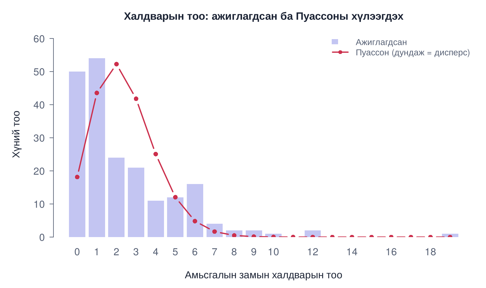

```{=html}
<header class="mt-hero" style="--mt-accent:#9333ea">
  <p class="mt-eyebrow"><a href="../methods.html">Data Analysis Methods</a> · Хамаарал ба регресс</p>
  <h1>Пуассон ба сөрөг биномын регресс</h1>
  <p class="mt-en" lang="en">Poisson &amp; negative binomial regression</p>
  <p class="mt-lead">Үр дагавар нь 0, 1, 2, … гэсэн тоо (халдварын тоо, эмнэлэгт хэвтсэн удаа, астмын сэдрэл) эсвэл хүн-хугацаанд ногдох түвшин байх үед хүчин зүйлсийн нөлөөг түвшний харьцаагаар (IRR) үнэлнэ.</p>
  <ul class="mt-badges"><li>Тоолсон үр дагавар</li><li>IRR</li><li><code>glm(poisson)</code></li><li><span class="vc" data-vc-href=""></span></li></ul>
</header>
```

## Товч мэдээлэл

```{=html}
<div class="mt-facts"><div><span>Үр дагавар</span><strong>Тоо (0, 1, 2, …) эсвэл түвшин</strong></div><div><span>Тайлбарлагч</span><strong>Тоон ба категорийн</strong></div><div><span>Үр дүн</span><strong>IRR = exp(β)</strong></div><div><span>Хэт тархалттай бол</span><strong>Сөрөг биномын регресс</strong></div></div>
```

## Хэзээ хэрэглэх вэ?

Нэг хүнд (эсвэл нэг нэгжид) тодорхой хугацаанд тохиолдсон үйл явдлын **тоог** загварчлах бол. Ажиглалтын хугацаа хүн бүрт өөр бол хугацааг **offset** болгон оруулж түвшинг загварчилна.

::: {.callout-tip appearance="simple" icon="false"}
**Жишээ судалгааны асуулт:** Гэртээ нүүрсний зуух хэрэглэдэг хүүхдүүдэд жилд тохиолдох амьсгалын замын цочмог халдварын тоо цахилгаан халаагууртай гэрийн хүүхдүүдийнхээс өндөр байна уу?
:::

## Таамаглалууд

Шинжилгээ хийхээс өмнө шалгана:

- [ ] Үр дагавар нь сөрөг биш бүхэл тоо.
- [ ] Ажиглалтууд хоорондоо хамааралгүй (давтан хэмжилт бол GEE эсвэл холимог загвар).
- [ ] log(түвшин) нь тоон тайлбарлагчтай шугаман хамааралтай.
- [ ] **Хэт тархалт (overdispersion) байхгүй:** Пуассон загвар дисперс = дундаж гэж үздэг. Дисперс их бол сөрөг биномын загвар хэрэглэнэ.
- [ ] Тэг утга хэт олон эсэхийг шалгана (шаардлагатай бол zero-inflated загвар).

## R дээр хийх

```r
# Өгөгдөл: df$ari (жилийн халдварын тоо), df$stove, df$age, df$years (ажигласан жил)
m_p <- glm(ari ~ stove + age + offset(log(years)),
           family = poisson, data = df)
summary(m_p)

# Хэт тархалт шалгах: харьцаа ≫ 1 бол асуудалтай
sum(residuals(m_p, type = "pearson")^2) / df.residual(m_p)
performance::check_overdispersion(m_p)

# Сөрөг биномын загвар
m_nb <- MASS::glm.nb(ari ~ stove + age + offset(log(years)), data = df)

# IRR ба 95% CI
broom::tidy(m_nb, conf.int = TRUE, exponentiate = TRUE)

# Пуассон загвар хэвээр бол robust SE ашиглах нэг сонголт:
lmtest::coeftest(m_p, vcov = sandwich::vcovHC(m_p, type = "HC0"))
```

## Жишээ: бодит гаралт ба тайлбар

::: {.mt-example-intro}
**Асуулт.** Хот ба тамхидалт амьсгалын замын цочмог халдварын жилийн давтамжтай (түвшинтэй) холбоотой юу? Ажигласан хугацаа хүн бүрт өөр тул offset хэрэглэнэ.

Доорх гаралтыг сайтын [жишээ өгөгдөл](../resources/data/emnelgiin-jishee.csv) дээр R 4.3.3-аар жинхэнээр нь ажиллуулж гаргасан. Кодыг хуулж өөрийн компьютер дээр ажиллуулбал яг ижил үр дүн гарна.
:::

```{.text .mt-console}
> df <- read.csv("emnelgiin-jishee.csv", fileEncoding = "UTF-8-BOM")
> df$smoker <- factor(df$smoker, levels = c("Үгүй", "Тийм"))
> m_p <- glm(ari ~ city + smoker + offset(log(years)), family = poisson, data = df)
> sum(residuals(m_p, type = "pearson")^2) / df.residual(m_p)   # хэт тархалтын харьцаа
[1] 2.345515
> m_nb <- MASS::glm.nb(ari ~ city + smoker + offset(log(years)), data = df)
> summary(m_nb)

Call:
MASS::glm.nb(formula = ari ~ city + smoker + offset(log(years)), 
    data = df, init.theta = 1.711281813, link = log)

Coefficients:
                Estimate Std. Error z value Pr(>|z|)   
(Intercept)       0.4726     0.1721   2.746  0.00603 **
cityУлаанбаатар   0.2185     0.1912   1.143  0.25299   
cityЭрдэнэт      -0.3109     0.2540  -1.224  0.22090   
smokerТийм        0.1489     0.1657   0.899  0.36883   
---
Signif. codes:  0 ‘***’ 0.001 ‘**’ 0.01 ‘*’ 0.05 ‘.’ 0.1 ‘ ’ 1

(Dispersion parameter for Negative Binomial(1.7113) family taken to be 1)

    Null deviance: 230.26  on 199  degrees of freedom
Residual deviance: 222.05  on 196  degrees of freedom
AIC: 799.5

Number of Fisher Scoring iterations: 1


              Theta:  1.711 
          Std. Err.:  0.335 

 2 x log-likelihood:  -789.504 
> round(exp(cbind(IRR = coef(m_nb), confint.default(m_nb))), 2)
                 IRR 2.5 % 97.5 %
(Intercept)     1.60  1.14   2.25
cityУлаанбаатар 1.24  0.86   1.81
cityЭрдэнэт     0.73  0.45   1.21
smokerТийм      1.16  0.84   1.61
```

{.mt-figure fig-alt="Халдварын тооны ажиглагдсан тархалт (баганууд) ба Пуассон тархалтын хүлээгдэх утга (улаан). Ажиглагдсан тархалт илүү өргөн буюу хэт тархалттай."}

### Гаралтыг хэрхэн унших вэ?

::: {.mt-readout}
1. `[1] 2.345515` Пуассон загварын хэт тархалтын харьцаа 2.3 ≫ 1. Пуассоны "дундаж = дисперс" таамаглал зөрчигдсөн тул сөрөг биномын загвар руу шилжив.
2. `Theta: 1.711` Сөрөг биномын нэмэлт параметр: бага байх тусам хэт тархалт их.
3. `cityУлаанбаатар 0.2185 (p 0.253)` Дарханыг (лавлах бүлэг) бодвол Улаанбаатарт халдварын түвшин өндөр байх хандлагатай ч ач холбогдолгүй.
4. `IRR 1.24 (0.86; 1.81)` Улаанбаатарт түвшин 24%-иар өндөр гэсэн тооцоо, гэхдээ CI 1-ийг агуулсан.
5. `smokerТийм IRR 1.16 (0.84; 1.61)` Тамхи татдаг хүмүүст 16%-иар өндөр гэсэн тооцоо, ач холбогдолгүй.
6. `(Intercept) IRR 1.60` Лавлах бүлгийн (Дархан, тамхи татдаггүй) жилийн дундаж халдвар ≈ 1.6 удаа.
:::

::: {.mt-conclusion}
**Дүгнэлт (тайлагнах хэлбэрээр).** Пуассон загварт хэт тархалт илэрсэн (харьцаа 2.35) тул сөрөг биномын регресс хэрэглэв. Хот (Улаанбаатар ба Дархан: IRR = 1.24, 95% CI 0.86; 1.81) болон тамхидалт (IRR = 1.16, 95% CI 0.84; 1.61) нь халдварын түвшинтэй ач холбогдолтой холбоогүй байв.
:::

## Цэс дээр хийх (SPSS)

```{=html}
<div class="mt-menu"><div><b>SPSS</b> Analyze → Generalized Linear Models → Generalized Linear Models → Type of Model: Poisson loglinear (эсвэл Negative binomial with log link). Offset-ийг Predictors хэсэгт тохируулна.</div></div>
```

## Үр дүнг тайлбарлах

- **Estimate (β)**: log(түвшин)-ий өөрчлөлт. exp(β) = **IRR** (incidence rate ratio).
- **IRR = 1.4**: бусад хувьсагчийг тогтмол үед түвшин 40%-иар өндөр. IRR < 1 бол бага.
- **Хэт тархалтын харьцаа**: ойролцоогоор 1 байвал Пуассон тохиромжтой, 1.5–2-оос их бол сөрөг биномын загвар руу шилжинэ.
- **AIC**: Пуассон ба сөрөг биномын загварыг харьцуулахад бага нь илүү.

## Тайлагнах жишээ

::: {.callout-note appearance="simple" icon="false"}
Нас болон ажигласан хугацаагаар залруулахад нүүрсний зуухтай гэрийн хүүхдүүдэд амьсгалын замын цочмог халдварын түвшин 1.38 дахин өндөр байв (IRR = 1.38, 95% CI 1.15; 1.66; сөрөг биномын регресс, n = 420). Пуассон загварт хэт тархалт илэрсэн (харьцаа 2.3) тул сөрөг биномын загварыг сонгосон.

<small>Тоонууд зохиомол бөгөөд тайлагнах хэлбэрийг харуулах зорилготой.</small>
:::

## Түгээмэл алдаа

::: {.callout-warning appearance="simple" icon="false"}
- Тоолсон үр дагаврыг шугаман регрессээр шинжлэх. Сөрөг таамаг утга гарч, стандарт алдаа буруу болно.
- Хэт тархалтыг шалгахгүй орхих. Стандарт алдаа хэт бага, p-утга хэт жижиг гарна.
- Ажиглалтын хугацаа өөр байхад offset оруулахгүй байх.
- Тоог "тийм/үгүй" болгож логистик регресс хийх. Мэдээлэл алдагдана.
:::

## Өөр аргууд

- [Логистик регресс](logistic-regression.html) — үр дагавар нь зөвхөн тийм/үгүй бол.
- [GEE](gee.html) — давтан эсвэл кластерласан тоолсон өгөгдөлд (`family = poisson`).
- [Холимог нөлөөний загвар](mixed-models.html) — `lme4::glmer(family = poisson)` хэлбэрээр.

## Холбогдох нэр томьёо

```{=html}
<div class="glossary-embed"
     data-src="../glossary/terms.yml"
     data-glossary-url="../glossary.html"
     data-terms="poisson-regression,poisson-distribution,incidence-rate,person-time,discrete-variable,regression-coefficient,confounding">
  <p class="gl-loading">Нэр томьёог ачаалж байна…</p>
</div>

<nav class="mt-pager" aria-label="Аргууд хооронд шилжих"><a href="kruskal-wallis.html">← Крускал-Валлисын тест</a><a href="repeated-measures-anova.html">Давтан хэмжилтийн ANOVA →</a></nav>
```
