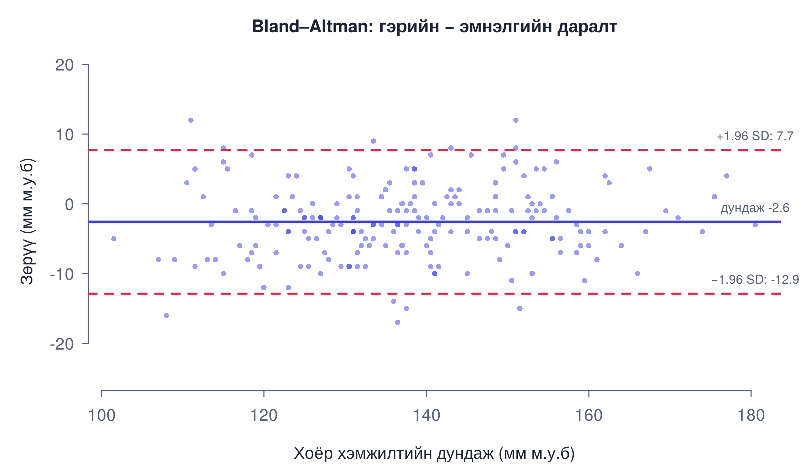

```{=html}
<header class="mt-hero" style="--mt-accent:#a21caf">
  <p class="mt-eyebrow"><a href="../methods.html">Data Analysis Methods</a> · Оношилгоо ба тохирол</p>
  <h1>Найдвартай байдал ба тохирол</h1>
  <p class="mt-en" lang="en">Reliability &amp; agreement: Cohen's kappa, ICC, Bland–Altman</p>
  <p class="mt-lead">Хоёр эмч нэг рентген зургийг ижил үнэлж байна уу, шинэ зөөврийн даралтын аппарат эмнэлгийн аппараттай ижил утга өгч байна уу гэх мэт асуултад хариулна. Категорийн үнэлгээнд kappa, тасралтгүй хэмжилтэд ICC ба Bland–Altman аргыг хэрэглэнэ.</p>
  <ul class="mt-badges"><li>Үнэлэгч / багаж хоорондын</li><li>κ, ICC</li><li><code>irr::kappa2()</code></li><li><span class="vc" data-vc-href=""></span></li></ul>
</header>
```

## Товч мэдээлэл

```{=html}
<div class="mt-facts"><div><span>Категорийн үнэлгээ</span><strong>Cohen-ийн κ (жинлэсэн κ)</strong></div><div><span>Тасралтгүй хэмжилт</span><strong>ICC, Bland–Altman</strong></div><div><span>≥ 3 үнэлэгч</span><strong>Fleiss-ийн κ, ICC</strong></div><div><span>Асуулт</span><strong>Тохирол, алтан стандарт биш</strong></div></div>
```

## Хэзээ хэрэглэх вэ?

- **Үнэлэгч хоорондын найдвартай байдал**: хоёр эмч, лаборант нэг өвчтөнийг тус тусдаа үнэлсэн.
- **Давтан хэмжилтийн найдвартай байдал (test–retest)**: нэг хүнийг нэг аргаар хоёр удаа хэмжсэн.
- **Аргын тохирол**: хоёр багаж эсвэл хоёр аргыг нэг хүмүүс дээр харьцуулсан, аль нь ч алтан стандарт биш.

::: {.callout-tip appearance="simple" icon="false"}
**Жишээ судалгааны асуулт:** Хоёр рентгенологич хүүхдийн цээжний рентген зурган дээр уушгины хатгалгааг (тийм/үгүй) хэр тохиролтой оношилж байна вэ?
:::

## Таамаглалууд

Шинжилгээ хийхээс өмнө шалгана:

- [ ] Үнэлэгчид бие биеийнхээ үнэлгээг мэдээгүй (бие даасан).
- [ ] Ижил ангилал эсвэл ижил нэгжийг хэрэглэсэн.
- [ ] ICC-д: зорилгодоо тохирох загвар (нэг эсвэл хоёр чиглэлт), төрөл (тохирол эсвэл тогтвортой байдал), нэгж (нэг эсвэл дундаж үнэлгээ) сонгосон.
- [ ] Bland–Altman-д: зөрүү ойролцоогоор хэвийн тархалттай, хэмжилтийн түвшнээс хамаарахгүй.

## R дээр хийх

```r
library(irr)
# Категорийн: df$rater1, df$rater2 ("Хатгалгаа", "Үгүй")
table(df$rater1, df$rater2)
kappa2(df[, c("rater1", "rater2")])                     # Cohen-ийн kappa
kappa2(df[, c("grade1", "grade2")], weight = "squared") # дараалсан ангилалд жинлэсэн kappa
kappam.fleiss(df[, c("r1", "r2", "r3")])                # ≥ 3 үнэлэгч

# Тасралтгүй: хоёр аппаратаар хэмжсэн систолын даралт
icc(df[, c("sbp_home", "sbp_clinic")],
    model = "twoway", type = "agreement", unit = "single")

# Bland–Altman
d <- df$sbp_home - df$sbp_clinic
m <- mean(d); s <- sd(d)
c(bias = m, lower = m - 1.96 * s, upper = m + 1.96 * s)  # тохирлын хязгаар
plot((df$sbp_home + df$sbp_clinic) / 2, d,
     xlab = "Хоёр аргын дундаж", ylab = "Зөрүү")
abline(h = c(m, m - 1.96 * s, m + 1.96 * s), lty = c(1, 2, 2))
```

## Жишээ: бодит гаралт ба тайлбар

::: {.mt-example-intro}
**Асуулт.** (1) Хоёр эмч ЭКГ-ээр зүүн ховдлын томролыг (тийм/үгүй) хэр тохиролтой үнэлж байна вэ? (2) Гэрийн даралтын аппарат эмнэлгийнхтэй хэр тохирч байна вэ?

Доорх гаралтыг сайтын [жишээ өгөгдөл](../resources/data/emnelgiin-jishee.csv) дээр R 4.3.3-аар жинхэнээр нь ажиллуулж гаргасан. Кодыг хуулж өөрийн компьютер дээр ажиллуулбал яг ижил үр дүн гарна.
:::

```{.text .mt-console}
> df <- read.csv("emnelgiin-jishee.csv", fileEncoding = "UTF-8-BOM")
> table(Үнэлэгч1 = df$lvh_r1, Үнэлэгч2 = df$lvh_r2)
        Үнэлэгч2
Үнэлэгч1 Тийм Үгүй
    Тийм   73   24
    Үгүй   18   85
> psych::cohen.kappa(cbind(df$lvh_r1, df$lvh_r2))
Call: cohen.kappa1(x = x, w = w, n.obs = n.obs, alpha = alpha, levels = levels)

Cohen Kappa and Weighted Kappa correlation coefficients and confidence boundaries 
                 lower estimate upper
unweighted kappa  0.47     0.58  0.69
weighted kappa    0.47     0.58  0.69

 Number of subjects = 200 
> psych::ICC(df[, c("sbp8_home", "sbp8")])
Call: psych::ICC(x = df[, c("sbp8_home", "sbp8")])

Intraclass correlation coefficients 
                         type  ICC  F df1 df2       p lower bound upper bound
Single_raters_absolute   ICC1 0.93 28 199 200 9.5e-90        0.91        0.95
Single_random_raters     ICC2 0.93 35 199 199 5.0e-98        0.87        0.96
Single_fixed_raters      ICC3 0.94 35 199 199 5.0e-98        0.93        0.96
Average_raters_absolute ICC1k 0.96 28 199 200 9.5e-90        0.95        0.97
Average_random_raters   ICC2k 0.96 35 199 199 5.0e-98        0.93        0.98
Average_fixed_raters    ICC3k 0.97 35 199 199 5.0e-98        0.96        0.98

 Number of subjects = 200     Number of Judges =  2
See the help file for a discussion of the other 4 McGraw and Wong estimates,
> d <- df$sbp8_home - df$sbp8
> round(c(bias = mean(d), lower = mean(d) - 1.96 * sd(d), upper = mean(d) + 1.96 * sd(d)), 1)
 bias lower upper 
 -2.6 -12.9   7.7
```

{.mt-figure fig-alt="Bland–Altman график: хоёр аргын зөрүүг дундажтай нь харьцуулав. Улаан тасархай шугам нь 95% тохирлын хязгаар."}

### Гаралтыг хэрхэн унших вэ?

::: {.mt-readout}
1. `table: 73 24 / 18 85` Хоёр үнэлэгч 73 + 85 = 158 тохиолдолд (79%) санал нийлсэн, 42 тохиолдолд зөрсөн.
2. `unweighted kappa 0.58 (0.47; 0.69)` Санамсаргүй тохиролыг хассан тохирол κ = 0.58: дунд зэрэг (0.41–0.60). Тохирлын 79% нь өндөр мэт боловч зарим нь санамсаргүй тохирол юм.
3. `ICC2 0.93 (0.87; 0.96)` Хоёр аргын тохирол (two-way random, absolute agreement, single): ICC = 0.93 буюу маш сайн.
4. `ICC3 0.94` Тогтвортой байдал (consistency): системтэй зөрүүг тооцохгүй тул ICC2-оос бага зэрэг өндөр.
5. `bias -2.6, lower -12.9, upper 7.7` Гэрийн аппарат дунджаар 2.6 мм м.у.б-аар бага хэмжинэ. Хүмүүсийн 95%-д зөрүү −12.9-аас +7.7 хооронд байна.
:::

::: {.mt-note}
Хуудасны дээрх кодод <code>irr</code> багцыг харуулсан. Энд <code>psych</code> багцын <code>cohen.kappa()</code> ба <code>ICC()</code> функцийг хэрэглэсэн. Тооцоо ижил.
:::

::: {.mt-conclusion}
**Дүгнэлт (тайлагнах хэлбэрээр).** Хоёр эмчийн ЭКГ-ийн үнэлгээний тохирол 79% байсан бөгөөд дунд зэргийн түвшинд байв (Cohen-ийн κ = 0.58, 95% CI 0.47; 0.69). Гэрийн ба эмнэлгийн даралтын аппаратын тохирол маш сайн байв (ICC(2,1) = 0.93, 95% CI 0.87; 0.96). Дундаж зөрүү −2.6 мм м.у.б, 95% тохирлын хязгаар −12.9; 7.7.
:::

## Цэс дээр хийх (SPSS)

```{=html}
<div class="mt-menu"><div><b>SPSS</b> Kappa: Analyze → Descriptive Statistics → Crosstabs → Statistics… → Kappa. ICC: Analyze → Scale → Reliability Analysis → Statistics… → Intraclass correlation coefficient.</div></div>
```

## Үр дүнг тайлбарлах

- **Cohen-ийн κ**: санамсаргүй тохиролыг хассан тохирол. Ойролцоогоор < 0.20 бага, 0.21–0.40 сул, 0.41–0.60 дунд, 0.61–0.80 сайн, > 0.80 маш сайн (Landis &amp; Koch).
- **Ажиглагдсан тохирлын хувь**: κ-тай хамт тайлагнана. Тархалт хэт өндөр эсвэл бага үед κ бага гарч болно.
- **ICC**: 0–1. < 0.5 бага, 0.5–0.75 дунд, 0.75–0.9 сайн, > 0.9 маш сайн (Koo &amp; Li). Ямар загвар, төрөл ашигласнаа заавал бичнэ.
- **Bland–Altman**: дундаж зөрүү (системтэй хазайлт) ба 95% тохирлын хязгаар. Хязгаар эмнэлзүйн хувьд хүлээн зөвшөөрөгдөхүйц эсэхийг судлаач урьдчилан тогтооно.

## Тайлагнах жишээ

::: {.callout-note appearance="simple" icon="false"}
Хоёр рентгенологичийн хатгалгааны оношийн тохирол 88.5% байсан бөгөөд дунд зэргээс сайн түвшинд байв (Cohen-ийн κ = 0.68, 95% CI 0.57; 0.79; n = 200). Гэрийн ба эмнэлгийн даралтын аппаратын хэмжилтийн тохирол сайн байв (ICC(2,1), absolute agreement = 0.87, 95% CI 0.82; 0.91); дундаж зөрүү −2.1 мм м.у.б, 95% тохирлын хязгаар −13.4; 9.2.

<small>Тоонууд зохиомол бөгөөд тайлагнах хэлбэрийг харуулах зорилготой.</small>
:::

## Түгээмэл алдаа

::: {.callout-warning appearance="simple" icon="false"}
- Хоёр аргын тохирлыг Пирсоны корреляциар үнэлэх. Корреляци өндөр ч системтэй зөрүү их байж болно.
- Тохирлын хувийг kappa-гүйгээр (санамсаргүй тохиролыг хасалгүй) тайлагнах.
- ICC-ийн загвар, төрлийг тайлагнахгүй орхих. Өөр төрлийн ICC өөр утга өгнө.
- Дараалсан ангилалд (I–IV зэрэг) жингүй kappa хэрэглэх.
:::

## Өөр аргууд

- [Оношилгооны тестийн нарийвчлал](diagnostic-accuracy.html) — нэг арга нь алтан стандарт бол.
- [Корреляцийн шинжилгээ](correlation.html) — хамаарлын хүч сонирхолтой бол (тохирол биш).
- [МакНемарын тест](mcnemar-test.html) — хоёр үнэлэгчийн эерэг хувь системтэйгээр ялгаатай эсэх.

## Холбогдох нэр томьёо

```{=html}
<div class="glossary-embed"
     data-src="../glossary/terms.yml"
     data-glossary-url="../glossary.html"
     data-terms="kappa,icc,ordinal-variable,pearson-correlation,confidence-interval,gold-standard">
  <p class="gl-loading">Нэр томьёог ачаалж байна…</p>
</div>

<nav class="mt-pager" aria-label="Аргууд хооронд шилжих"><a href="diagnostic-accuracy.html">← Оношилгооны тестийн нарийвчлал</a><a href="sample-size.html">Түүврийн хэмжээ ба чадал →</a></nav>
```
