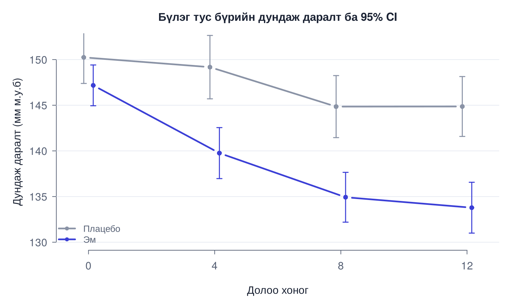

```{=html}
<header class="mt-hero" style="--mt-accent:#0f766e">
  <p class="mt-eyebrow"><a href="../methods.html">Data Analysis Methods</a> · Давтан хэмжилт ба кластер</p>
  <h1>Давтан хэмжилтийн ANOVA</h1>
  <p class="mt-en" lang="en">Repeated measures ANOVA</p>
  <p class="mt-lead">Нэг хүнийг гурав ба түүнээс дээш цэгт (жишээ нь 0, 3, 6 сар) хэмжсэн үед дундаж хугацааны явцад өөрчлөгдсөн эсэхийг, хүн хоорондын ялгааг тооцож шалгана. Бүлэг нэмбэл "холимог ANOVA" болж, бүлгүүдийн өөрчлөлтийг харьцуулна.</p>
  <ul class="mt-badges"><li>Тасралтгүй</li><li>≥ 3 хэмжилт</li><li><code>afex::aov_ez()</code></li><li><span class="vc" data-vc-href=""></span></li></ul>
</header>
```

## Товч мэдээлэл

```{=html}
<div class="mt-facts"><div><span>Үр дагавар</span><strong>Тасралтгүй</strong></div><div><span>Бүтэц</span><strong>Нэг хүний ≥ 3 хэмжилт</strong></div><div><span>Тэг таамаглал</span><strong>Бүх хугацааны дундаж тэнцүү</strong></div><div><span>Параметрийн бус хувилбар</span><strong>Фридманы тест</strong></div></div>
```

## Хэзээ хэрэглэх вэ?

Хамааралт түүврийн t тестийг хоёроос олон хэмжилт рүү өргөтгөсөн арга. Өгөгдөл **бүрэн** (хүн бүр бүх хэмжилттэй), хэмжилтийн цэгүүд хүн бүрт ижил бол тохиромжтой.

::: {.callout-tip appearance="simple" icon="false"}
**Жишээ судалгааны асуулт:** Хоолны дэглэм ба дасгалын хөтөлбөрт хамрагдсан 2-р хэвшлийн чихрийн шижинтэй өвчтөнүүдийн HbA1c 0, 3, 6 дахь сард өөрчлөгдсөн үү?
:::

## Таамаглалууд

Шинжилгээ хийхээс өмнө шалгана:

- [ ] Хүмүүс хоорондоо хамааралгүй.
- [ ] Хэмжилт бүрт үр дагавар ойролцоогоор хэвийн тархалттай.
- [ ] **Сферик байдал (sphericity):** хос хэмжилтийн зөрүүнүүдийн дисперс тэнцүү. Моклийн тестээр шалгаж, зөрчигдвөл Гринхаус-Гайссерын засвар хэрэглэнэ.
- [ ] Дутуу өгөгдөл байхгүй. Дутуутай хүн бүхэлдээ хасагддаг тул дутуу их бол [холимог загвар](mixed-models.html) илүү.

## R дээр хийх

```r
library(afex)
# Урт хэлбэрийн өгөгдөл: нэг мөр = нэг хүний нэг хэмжилт
# df$id, df$month (0, 3, 6 — factor), df$hba1c

m <- aov_ez(id = "id", dv = "hba1c", within = "month", data = df)
m              # Гринхаус-Гайссерын засвар анхдагчаар (GG)
summary(m)     # Моклийн сферик байдлын тест

# Хугацааны цэгүүдийг хосоор харьцуулах (Холмын засвартай)
emmeans::emmeans(m, pairwise ~ month, adjust = "holm")

# Бүлэг нэмэх (холимог ANOVA):
aov_ez(id = "id", dv = "hba1c", within = "month",
       between = "group", data = df)

# Параметрийн бус хувилбар:
friedman.test(hba1c ~ month | id, data = df)
```

## Жишээ: бодит гаралт ба тайлбар

::: {.mt-example-intro}
**Асуулт.** Систолын даралт 0, 4, 8, 12 дахь долоо хоногт өөрчлөгдсөн үү, өөрчлөлт нь эм ба плацебо бүлэгт ялгаатай юу? (хүн бүр 4 хэмжилттэй)

Доорх гаралтыг сайтын [жишээ өгөгдөл](../resources/data/emnelgiin-jishee.csv) дээр R 4.3.3-аар жинхэнээр нь ажиллуулж гаргасан. Кодыг хуулж өөрийн компьютер дээр ажиллуулбал яг ижил үр дүн гарна.
:::

```{.text .mt-console}
> df <- read.csv("emnelgiin-jishee.csv", fileEncoding = "UTF-8-BOM")
> long <- reshape(df[, c("id", "group", "sbp0", "sbp4", "sbp8", "sbp12")],
+                 direction = "long", varying = c("sbp0", "sbp4", "sbp8", "sbp12"),
+                 v.names = "sbp", timevar = "week", times = c(0, 4, 8, 12), idvar = "id")
> long$week <- factor(long$week)
> full <- long[long$id %in% df$id[!is.na(df$sbp12)], ]     # бүрэн өгөгдөлтэй хүмүүс
> m <- afex::aov_ez(id = "id", dv = "sbp", within = "week", between = "group", data = full)
> m
Anova Table (Type 3 tests)

Response: sbp
      Effect           df    MSE         F  ges p.value
1      group       1, 176 627.10 19.89 *** .081   <.001
2       week 2.39, 420.25  76.14 56.68 *** .067   <.001
3 group:week 2.39, 420.25  76.14  9.54 *** .012   <.001
---
Signif. codes:  0 ‘***’ 0.001 ‘**’ 0.01 ‘*’ 0.05 ‘+’ 0.1 ‘ ’ 1

Sphericity correction method: GG 
> summary(m)$sphericity.tests
           Test statistic    p-value
week              0.53894 1.0869e-21
group:week        0.53894 1.0869e-21
```

{.mt-figure fig-alt="Бүлэг тус бүрийн дундаж даралт ба 95% CI, хугацаагаар. Шугамууд зэрэгцээ бус байгаа нь бүлэг × хугацааны харилцан үйлчлэлийг илтгэнэ."}

### Гаралтыг хэрхэн унших вэ?

::: {.mt-readout}
1. `full <- ... !is.na(df$sbp12)` Давтан хэмжилтийн ANOVA бүрэн өгөгдөл шаарддаг тул 12 дахь долоо хоногт ирээгүй 22 хүнийг бүхэлд нь хассан (178 үлдсэн).
2. `Mauchly: week 0.53894, p-value 1.0869e-21` Моклийн тест: сферик байдлын таамаглал зөрчигдсөн (p < 0.001). Тиймээс Гринхаус-Гайссерын (GG) засварыг хэрэглэнэ.
3. `week df 2.39, 420.25` GG засвар чөлөөний зэргийг 3 ба 528-аас 2.39 ба 420.25 болгон багасгасан.
4. `week F 56.68, p < .001` Хугацааны гол нөлөө: бүх хүмүүсийн даралт хугацааны явцад өөрчлөгдсөн.
5. `group:week F 9.54, p < .001` Хамгийн чухал мөр: даралтын өөрчлөлтийн хурд хоёр бүлэгт ялгаатай. Эмийн бүлэгт илүү хурдан буурсан.
6. `ges .081 / .067 / .012` Ерөнхийлсөн η² (нөлөөний хэмжээ): бүлэг 8%, хугацаа 7%, харилцан үйлчлэл 1%.
:::

::: {.mt-conclusion}
**Дүгнэлт (тайлагнах хэлбэрээр).** Бүрэн өгөгдөлтэй 178 өвчтөнд хийсэн холимог давтан хэмжилтийн ANOVA-аар бүлэг × хугацааны харилцан үйлчлэл ач холбогдолтой байв (Гринхаус-Гайссерын засвартай F(2.39, 420.3) = 9.54, p < 0.001, ges = 0.012). Өөрөөр хэлбэл даралт эмийн бүлэгт плацебо бүлгийнхээс илүү хурдан буурсан.
:::

## Цэс дээр хийх (SPSS)

```{=html}
<div class="mt-menu"><div><b>SPSS</b> Analyze → General Linear Model → Repeated Measures → хүчин зүйл (month, 3 түвшин) тодорхойлно → EM Means… → Compare main effects (Bonferroni).</div></div>
```

## Үр дүнг тайлбарлах

- **F, df, p-value**: бүх хугацааны дундаж тэнцүү гэсэн тэг таамаглалын эсрэг нотолгоо. GG засвартай үед df бутархай байна.
- **Mauchly's test**: p < 0.05 бол сферик байдал зөрчигдсөн, GG засвартай үр дүнг тайлагнана.
- **ges (generalized η²)**: нөлөөний хэмжээ.
- **Хосын харьцуулалт**: аль хугацааны цэгүүд ялгаатайг харуулна.
- Холимог ANOVA-д **бүлэг × хугацааны харилцан үйлчлэл** хамгийн чухал: бүлгүүдийн өөрчлөлт өөр эсэхийг харуулна.

## Тайлагнах жишээ

::: {.callout-note appearance="simple" icon="false"}
HbA1c хугацааны явцад статистик ач холбогдолтой буурсан (давтан хэмжилтийн ANOVA, Гринхаус-Гайссерын засвартай F(1.72, 92.9) = 18.4, p < 0.001, ges = 0.08). Дундаж HbA1c 0 дахь сард 8.4%, 3 дахь сард 7.9%, 6 дахь сард 7.6% байсан бөгөөд хос бүрийн ялгаа ач холбогдолтой байв (Холмын засвартай p ≤ 0.012; n = 55).

<small>Тоонууд зохиомол бөгөөд тайлагнах хэлбэрийг харуулах зорилготой.</small>
:::

## Түгээмэл алдаа

::: {.callout-warning appearance="simple" icon="false"}
- Хугацааны цэгүүдийг хосоор нь олон хамааралт t тестээр засваргүй харьцуулах.
- Давтан хэмжилтийг хамааралгүй бүлэг мэт үзэж энгийн ANOVA хийх.
- Сферик байдлыг шалгахгүй, засваргүй үр дүн тайлагнах.
- Дутуу өгөгдөлтэй хүмүүсийг чимээгүй хасах. Хэдэн хүн хасагдсаныг тайлагнах эсвэл холимог загвар хэрэглэнэ.
:::

## Өөр аргууд

- [Холимог нөлөөний загвар](mixed-models.html) — дутуу өгөгдөл, хүн бүрт өөр хэмжилтийн хугацаа, ковариат байвал.
- [GEE](gee.html) — хүн амын дундаж нөлөө сонирхолтой бол.
- [Хамааралт түүврийн t тест](paired-t-test.html) — зөвхөн хоёр хэмжилттэй бол.

## Холбогдох нэр томьёо

```{=html}
<div class="glossary-embed"
     data-src="../glossary/terms.yml"
     data-glossary-url="../glossary.html"
     data-terms="repeated-measures-anova,anova,paired-t-test,post-hoc-test,multiple-comparisons,mixed-model,missing-data,effect-size">
  <p class="gl-loading">Нэр томьёог ачаалж байна…</p>
</div>

<nav class="mt-pager" aria-label="Аргууд хооронд шилжих"><a href="poisson-regression.html">← Пуассон регресс</a><a href="mixed-models.html">Холимог нөлөөний загвар →</a></nav>
```
