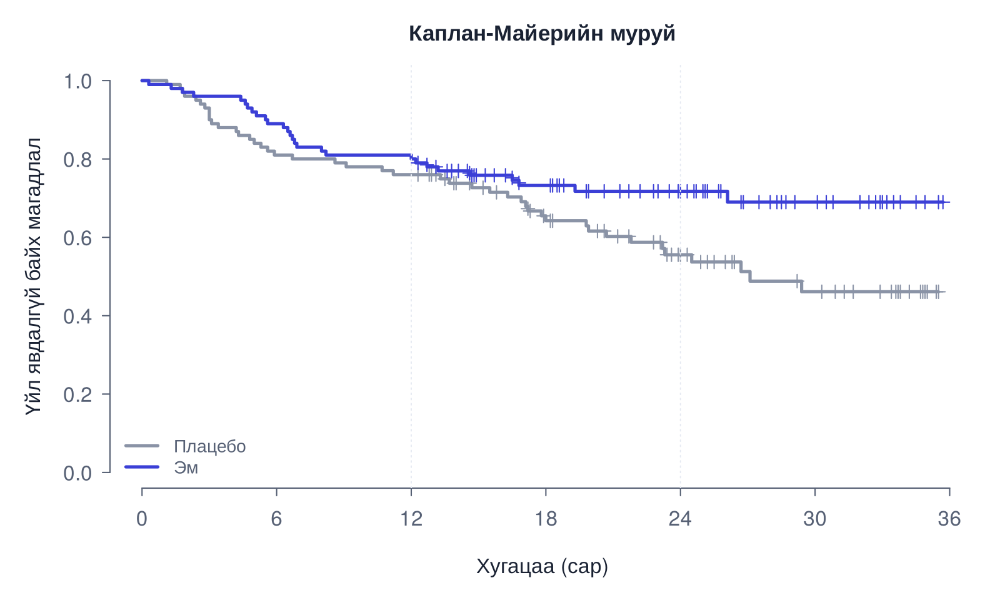

```{=html}
<header class="mt-hero" style="--mt-accent:#0f766e">
  <p class="mt-eyebrow"><a href="../methods.html">Data Analysis Methods</a> · Амьдрах чадвар</p>
  <h1>Амьдрах чадварын шинжилгээ</h1>
  <p class="mt-en" lang="en">Kaplan–Meier &amp; log-rank test</p>
  <p class="mt-lead">Нас баралт, дахилт зэрэг үйл явдал тохиолдох хүртэлх хугацааг шинжилнэ. Каплан-Майерын муруйгаар амьдрах магадлалыг харуулж, лог-ранк тестээр бүлгүүдийг харьцуулна.</p>
  <ul class="mt-badges"><li>Хугацаа + үйл явдал</li><li>Цензур</li><li><code>survfit()</code></li><li><span class="vc" data-vc-href=""></span></li></ul>
</header>
```

## Товч мэдээлэл

```{=html}
<div class="mt-facts"><div><span>Үр дагавар</span><strong>Хугацаа + үйл явдал (0/1)</strong></div><div><span>Онцлог</span><strong>Цензурлагдсан өгөгдөл</strong></div><div><span>Үр дүн</span><strong>S(t), медиан хугацаа</strong></div><div><span>Бүлгийн харьцуулалт</span><strong>Лог-ранк тест</strong></div></div>
```

## Хэзээ хэрэглэх вэ?

Үр дагавар нь «тохиолдсон эсэх» төдийгүй «хэзээ тохиолдсон» нь чухал, зарим хүний дагалт үйл явдалгүй дууссан бол.

::: {.callout-tip appearance="simple" icon="false"}
**Жишээ судалгааны асуулт:** Хорт хавдрын шинэ ба стандарт эмчилгээ хийлгэсэн өвчтөнүүдийн 3 жилийн амьдрах чадвар ялгаатай юу?
:::

## Таамаглалууд

Шинжилгээ хийхээс өмнө шалгана:

- [ ] Цензур нь мэдээлэлгүй (non-informative): дагалтаас гарах шалтгаан үйл явдлын эрсдэлтэй холбоогүй.
- [ ] Судалгааны туршид элссэн хүмүүсийн амьдрах чадвар ижил (элсэлтийн хугацааны нөлөөгүй).
- [ ] Үйл явдлын хугацаа нарийн бүртгэгдсэн.

## R дээр хийх

```r
library(survival)
# time: хугацаа (сар), status: 1 = үйл явдал, 0 = цензур
fit <- survfit(Surv(time, status) ~ group, data = df)
summary(fit, times = c(12, 24, 36))   # 1, 2, 3 жилийн амьдрах чадвар
print(fit)                            # медиан хугацаа ба 95% CI

survdiff(Surv(time, status) ~ group, data = df)   # лог-ранк тест

# График (эрсдэлийн хүснэгттэй)
survminer::ggsurvplot(fit, risk.table = TRUE, conf.int = TRUE)
```

## Жишээ: бодит гаралт ба тайлбар

::: {.mt-example-intro}
**Асуулт.** Эмийн бүлэгт үйл явдал (жишээ нь зүрх судасны хүндрэл) тохиолдох хүртэлх хугацаа плацебо бүлгийнхээс урт уу?

Доорх гаралтыг сайтын [жишээ өгөгдөл](../resources/data/emnelgiin-jishee.csv) дээр R 4.3.3-аар жинхэнээр нь ажиллуулж гаргасан. Кодыг хуулж өөрийн компьютер дээр ажиллуулбал яг ижил үр дүн гарна.
:::

```{.text .mt-console}
> df <- read.csv("emnelgiin-jishee.csv", fileEncoding = "UTF-8-BOM")
> library(survival)
> df$group <- factor(df$group, levels = c("Плацебо", "Эм"))
> km <- survfit(Surv(time_months, event) ~ group, data = df)
> km
Call: survfit(formula = Surv(time_months, event) ~ group, data = df)

                n events median 0.95LCL 0.95UCL
group=Плацебо 100     44   27.1    21.8      NA
group=Эм      100     28     NA      NA      NA
> summary(km, times = c(12, 24))
Call: survfit(formula = Surv(time_months, event) ~ group, data = df)

                group=Плацебо 
 time n.risk n.event survival std.err lower 95% CI upper 95% CI
   12     76      24    0.760  0.0427        0.681        0.848
   24     32      16    0.556  0.0544        0.459        0.673

                group=Эм 
 time n.risk n.event survival std.err lower 95% CI upper 95% CI
   12     81      20    0.800  0.0400        0.725        0.882
   24     37       7    0.717  0.0468        0.631        0.815

> survdiff(Surv(time_months, event) ~ group, data = df)
Call:
survdiff(formula = Surv(time_months, event) ~ group, data = df)

                N Observed Expected (O-E)^2/E (O-E)^2/V
group=Плацебо 100       44     35.3      2.17      4.25
group=Эм      100       28     36.7      2.08      4.25

 Chisq= 4.2  on 1 degrees of freedom, p= 0.04
```

{.mt-figure fig-alt="Каплан-Майерийн муруй. Босоо зураас (+) нь цензурласан (судалгаанаас гарсан эсвэл үйл явдалгүй дууссан) хүмүүс."}

### Гаралтыг хэрхэн унших вэ?

::: {.mt-readout}
1. `n 100, events 44 / 28` Плацебо бүлэгт 44, эмийн бүлэгт 28 үйл явдал тохиолдсон.
2. `median 27.1 / NA` Плацебо бүлгийн медиан хугацаа 27.1 сар. Эмийн бүлэгт 50%-д хүрэх үйл явдал тохиолдоогүй тул медиан тооцогдоогүй (NA).
3. `time 12: survival 0.760 / 0.800` 12 сарын үйл явдалгүй байх магадлал: плацебо 76.0%, эм 80.0%.
4. `time 24: survival 0.556 / 0.717` 24 сард: плацебо 55.6% (95% CI 45.9; 67.3), эм 71.7% (63.1; 81.5).
5. `Observed 44 / 28, Expected 35.3 / 36.7` Лог-ранк тест: хоёр бүлэг ижил байсан бол хүлээгдэх үйл явдлын тоо. Плацебо бүлэгт хүлээгдэхээс олон тохиолдсон.
6. `Chisq= 4.2 on 1 degrees of freedom, p= 0.04` p = 0.04 < 0.05: хоёр бүлгийн муруй ялгаатай.
:::

::: {.mt-conclusion}
**Дүгнэлт (тайлагнах хэлбэрээр).** 24 сарын үйл явдалгүй байх магадлал эмийн бүлэгт 71.7% (95% CI 63.1; 81.5), плацебо бүлэгт 55.6% (45.9; 67.3) байв. Хоёр бүлгийн муруй статистик ач холбогдолтой ялгаатай байв (лог-ранк χ²(1) = 4.2, p = 0.04).
:::

## Цэс дээр хийх (SPSS)

```{=html}
<div class="mt-menu"><div><b>SPSS</b> Analyze → Survival → Kaplan-Meier → Compare Factor… → Log rank; Options… → Survival plot.</div></div>
```

## Үр дүнг тайлбарлах

- **S(t)** — t хугацаанд үйл явдалгүй үлдэх магадлал.
- **median** — тал хувьд нь үйл явдал тохиолдох хүртэлх хугацаа (муруй 50%-д хүрээгүй бол NA).
- **n.risk** — тухайн хугацаанд эрсдэлд байгаа хүний тоо. Муруйн сүүл хэсэгт цөөн бол найдвар муу.
- **Chisq, p (survdiff)** — бүлгүүдийн муруй бүхэлдээ ялгаатай эсэх.

## Тайлагнах жишээ

::: {.callout-note appearance="simple" icon="false"}
3 жилийн амьдрах чадвар шинэ эмчилгээний бүлэгт 68% (95% CI 61; 75), стандарт бүлэгт 54% (95% CI 47; 62) байв. Медиан амьдрах хугацаа стандарт бүлэгт 41 сар, шинэ бүлэгт хүрээгүй (лог-ранк χ² = 7.9, p = 0.005).

<small>Тоонууд зохиомол бөгөөд тайлагнах хэлбэрийг харуулах зорилготой.</small>
:::

## Түгээмэл алдаа

::: {.callout-warning appearance="simple" icon="false"}
- Цензурлагдсан хүмүүсийг хасах эсвэл «амьд» гэж логистик регрессээр шинжлэх.
- Муруйн сүүл хэсгийг (эрсдэлд цөөн хүн үлдсэн) хэт итгэлтэй тайлбарлах.
- Эмчилгээ эхэлсний дараах хувьсагчаар бүлэглэх (immortal time bias).
:::

## Өөр аргууд

- [Коксын регресс](cox-regression.html) — Үйл явдал хүртэлх хугацаанд олон хувьсагчийн нөлөөг залруулж hazard ratio тооцно.

## Холбогдох нэр томьёо

```{=html}
<div class="glossary-embed"
     data-src="../glossary/terms.yml"
     data-glossary-url="../glossary.html"
     data-terms="survival-analysis,censoring,kaplan-meier,median-survival,log-rank-test,hazard,person-time,loss-to-follow-up">
  <p class="gl-loading">Нэр томьёог ачаалж байна…</p>
</div>

<nav class="mt-pager" aria-label="Аргууд хооронд шилжих"><a href="logistic-regression.html">← Логистик регресс</a><a href="cox-regression.html">Коксын регресс →</a></nav>
```
