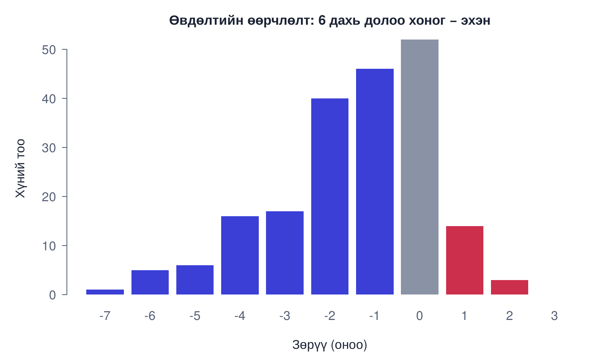

```{=html}
<header class="mt-hero" style="--mt-accent:#0369a1">
  <p class="mt-eyebrow"><a href="../methods.html">Data Analysis Methods</a> · Параметрийн бус тест</p>
  <h1>Уилкоксоны тэмдэгт эрэмбийн тест</h1>
  <p class="mt-en" lang="en">Wilcoxon signed-rank test</p>
  <p class="mt-lead">Нэг хүнээс авсан хоёр хэмжилтийн (өмнө/дараа) зөрүү тэгээс ялгаатай эсэхийг зөрүүний эрэмбээр шалгана. Нэг бүлгийн утгыг жишиг утгатай харьцуулахад ч хэрэглэнэ.</p>
  <ul class="mt-badges"><li>Тасралтгүй / дараалсан</li><li>2 хэмжилт эсвэл 1 бүлэг</li><li><code>wilcox.test(paired = TRUE)</code></li><li><span class="vc" data-vc-href=""></span></li></ul>
</header>
```

## Товч мэдээлэл

```{=html}
<div class="mt-facts"><div><span>Үр дагавар</span><strong>Тасралтгүй (хэвийн бус) эсвэл дараалсан</strong></div><div><span>Бүтэц</span><strong>Нэг хүний 2 хэмжилт / 1 бүлэг</strong></div><div><span>Тэг таамаглал</span><strong>Зөрүүний медиан = 0</strong></div><div><span>Параметрийн хувилбар</span><strong>Хамааралт эсвэл нэг түүврийн t-тест</strong></div></div>
```

## Хэзээ хэрэглэх вэ?

Хамааралт түүврийн t тестийн оронд, хоёр хэмжилтийн **зөрүү** нь хэвийн бус тархалттай, огцом утгатай эсвэл үр дагавар нь дараалсан оноо байх үед.

::: {.callout-tip appearance="simple" icon="false"}
**Жишээ судалгааны асуулт:** Физик эмчилгээний 6 долоо хоногийн дараа өвдөгний өвдөлтийн оноо (0–10) эмчилгээний өмнөхөөс буурсан уу?
:::

## Таамаглалууд

Шинжилгээ хийхээс өмнө шалгана:

- [ ] Хэмжилтүүд хосолсон бөгөөд хосууд хоорондоо хамааралгүй.
- [ ] Зөрүүг эрэмбэлэх боломжтой (дор хаяж дараалсан түвшин).
- [ ] Зөрүүний тархалт медианыхаа хоёр талд ойролцоогоор тэгш хэмтэй. Хүчтэй хазайлттай бол тэмдгийн тест (sign test) хэрэглэнэ.

## R дээр хийх

```r
# Өргөн хэлбэрийн өгөгдөл: df$pain0 (өмнө), df$pain6 (6 долоо хоногийн дараа)
summary(df$pain6 - df$pain0)                # зөрүүний медиан ба IQR

wilcox.test(df$pain6, df$pain0, paired = TRUE,
            conf.int = TRUE, exact = FALSE)

# Нэг бүлгийг жишиг утгатай (жишээ нь медиан = 5):
wilcox.test(df$pain0, mu = 5)

# Нөлөөний хэмжээ
effectsize::rank_biserial(df$pain6, df$pain0, paired = TRUE)
```

## Жишээ: бодит гаралт ба тайлбар

::: {.mt-example-intro}
**Асуулт.** Нийт өвчтөнүүдийн өвдөлтийн оноо эхэн үеэс 6 дахь долоо хоног хүртэл буурсан уу? (нэг хүмүүс, дараалсан оноо)

Доорх гаралтыг сайтын [жишээ өгөгдөл](../resources/data/emnelgiin-jishee.csv) дээр R 4.3.3-аар жинхэнээр нь ажиллуулж гаргасан. Кодыг хуулж өөрийн компьютер дээр ажиллуулбал яг ижил үр дүн гарна.
:::

```{.text .mt-console}
> df <- read.csv("emnelgiin-jishee.csv", fileEncoding = "UTF-8-BOM")
> summary(df$pain6 - df$pain0)
   Min. 1st Qu.  Median    Mean 3rd Qu.    Max. 
  -7.00   -2.00   -1.00   -1.44    0.00    2.00 
> wilcox.test(df$pain6, df$pain0, paired = TRUE, conf.int = TRUE, exact = FALSE)

	Wilcoxon signed rank test with continuity correction

data:  df$pain6 and df$pain0
V = 673, p-value < 2.2e-16
alternative hypothesis: true location shift is not equal to 0
95 percent confidence interval:
 -2.000030 -1.500043
sample estimates:
(pseudo)median 
     -1.999991
```

{.mt-figure fig-alt="Хүн бүрийн өвдөлтийн өөрчлөлт. Хөх нь буурсан, саарал нь өөрчлөгдөөгүй, улаан нь нэмэгдсэн хүмүүс."}

### Гаралтыг хэрхэн унших вэ?

::: {.mt-readout}
1. `summary: Median -1.00, Mean -1.44, Max. 2.00` Зөрүүний медиан −1 оноо. Зарим хүнд өвдөлт 2 оноо хүртэл нэмэгдсэн ч ихэнх нь буурсан.
2. `V = 673` Эерэг зөрүүтэй (өвдөлт нэмэгдсэн) хүмүүсийн эрэмбийн нийлбэр. Бага байх нь өвдөлт ихэвчлэн буурсныг илтгэнэ.
3. `p-value < 2.2e-16` p < 0.001: зөрүүний медиан тэг гэсэн тэг таамаглалыг няцаана.
4. `(pseudo)median -1.999991, 95% CI -2.00003 -1.50004` Зөрүүний төв утгын тооцоо ≈ −2 оноо. Тэг зөрүүтэй хүмүүсийг тест хасдаг тул энгийн медианаас (−1) ялгаатай байж болно.
:::

::: {.mt-conclusion}
**Дүгнэлт (тайлагнах хэлбэрээр).** Өвдөлтийн оноо 6 долоо хоногийн дараа буурсан (Уилкоксоны тэмдэгт эрэмбийн тест, V = 673, p < 0.001; зөрүүний псевдомедиан −2.0, 95% CI −2.0; −1.5; n = 200).
:::

## Цэс дээр хийх (SPSS)

```{=html}
<div class="mt-menu"><div><b>SPSS</b> Analyze → Nonparametric Tests → Legacy Dialogs → 2 Related Samples → Wilcoxon.</div></div>
```

## Үр дүнг тайлбарлах

- **V, p-value**: зөрүүний медиан тэг гэсэн тэг таамаглалын эсрэг нотолгоо (R нь эерэг зөрүүний эрэмбийн нийлбэрийг V гэж нэрлэдэг).
- **(pseudo)median, 95% CI**: зөрүүний төв утгын тооцоо ба итгэх интервал.
- **Тэг зөрүүтэй хосууд**: тест тэдгээрийг хасдаг тул хэдэн хос хасагдсаныг тайлагнана.
- **Rank-biserial r**: нөлөөний хэмжээ.

## Тайлагнах жишээ

::: {.callout-note appearance="simple" icon="false"}
Физик эмчилгээний дараа өвдөлтийн оноо медиан 6 (IQR 5–7)-аас 4 (IQR 3–5) болж буурсан бөгөөд статистик ач холбогдолтой байв (Уилкоксоны тэмдэгт эрэмбийн тест, V = 52, p < 0.001; зөрүүний псевдомедиан −2.0, 95% CI −2.5; −1.5; n = 48).

<small>Тоонууд зохиомол бөгөөд тайлагнах хэлбэрийг харуулах зорилготой.</small>
:::

## Түгээмэл алдаа

::: {.callout-warning appearance="simple" icon="false"}
- Хоёр хэмжилтийг хамааралгүй бүлэг мэт үзэж Манн-Уитнигийн тест хийх.
- Зөрүүний оронд хэмжилт тус бүрийн хэвийн тархалтыг шалгах. Хамааралт тестэд **зөрүүний** тархалт чухал.
- ≥ 3 давтан хэмжилтийг хосоор нь олон Уилкоксоны тестээр харьцуулах. Фридманы тест эсвэл холимог загвар хэрэглэнэ.
:::

## Өөр аргууд

- [Хамааралт түүврийн t тест](paired-t-test.html) — зөрүү хэвийн тархалттай бол.
- [Манн-Уитнигийн U тест](mann-whitney.html) — хамааралгүй хоёр бүлэгт.
- [Давтан хэмжилтийн ANOVA](repeated-measures-anova.html) — нэг хүний ≥ 3 хэмжилтэд.

## Холбогдох нэр томьёо

```{=html}
<div class="glossary-embed"
     data-src="../glossary/terms.yml"
     data-glossary-url="../glossary.html"
     data-terms="wilcoxon,nonparametric-test,paired-t-test,median,interquartile-range,ordinal-variable,effect-size">
  <p class="gl-loading">Нэр томьёог ачаалж байна…</p>
</div>

<nav class="mt-pager" aria-label="Аргууд хооронд шилжих"><a href="mann-whitney.html">← Манн-Уитнигийн U тест</a><a href="kruskal-wallis.html">Крускал-Валлисын тест →</a></nav>
```
